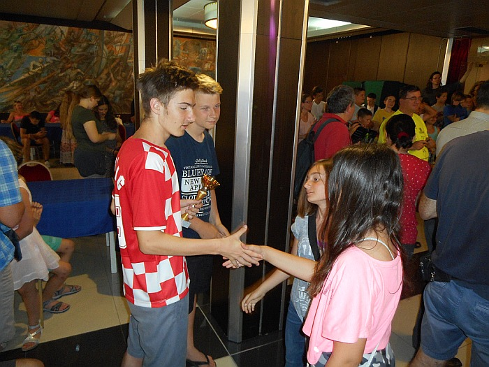
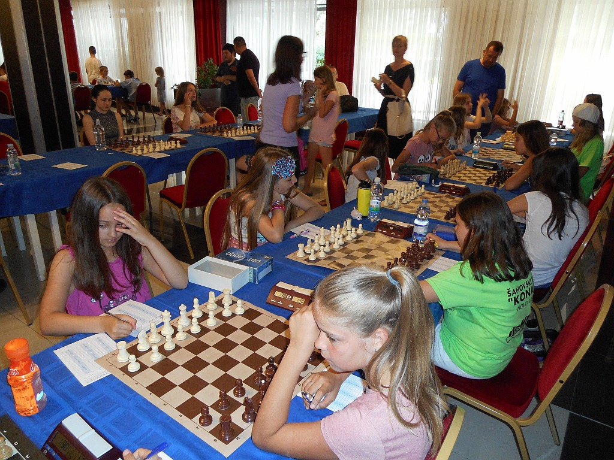

Pojedinačno kadetsko prvenstvo Hrvatske 2017. održano je od 16. do 22. lipnja, kao i prošle godine, u hotelu Medena u Segetu Donjem pokraj Trogira. Igralo se u konkurencijama do 7, 9, 11, 13 i 15 godina, posebno za djevojčice, a posebno za dječake. Nastupilo je 249 sudionika, 180 dječaka i 69 djevojčica. Naši članovi nastupili su, u konkurenciji do 15 godina: **Kljujev, Bruno i Božo**; u konkurenciji do 13 godina: **Ivan, Vraneša, Samanta, Katarina i Ana**; u konkurenciji do 11 godina: **Monika, Lucija, Luka Fiolić i Filip** te u konkurenciji do 9 godina **Luka Matašić i Dora**. Za klince su se brinuli Goran, Cvetko, Anđa, Darko i roditelji Matašić.  
Najveći osobni i uspjeh Kluba donio nam je **Ivan Maravić** osvajanjem **trećeg mjesta** u konkurenciji do 13 godina! Čestitke Ivanu na tome velikom uspjehu i na trudu koji ulaže u šahovski razvoj. On najviše uči i trenira i taj se rad isplatio.

Pobjednici po skupinama

Turniri do 7 godina  
1. VK **Brleković, Dominik** 0 1666 ŠK ETF-Osijek, Osijek 7,5  
2. VK Horvat, Ivan 0 1651 ŠK Sveta Nedelja, Sveta Nedelja 7,5  
3. VK Štajmaher, David 0 1637 ŠK ETF-Osijek, Osijek 7,0  
1. VK **Kokša, Agata**  0 1600 ŠŠK Konaki, Novo Virje 3,5  
2. VK Milevčić, Paula 0 1600 ŠK Jelsa, Jelsa 1,5  
3. VK Kos, Maja 0 1600 ŠK Polet, Buševec 1,0  
Turniri do 9 godina  
1. III **Colev, Ivor** 1657 1876 ŠK Stridon, Štrigova 7,5  
2. III Borzan, Matej 1571 1874 ŠK ETF-Osijek, Osijek 7,5  
3. IV Babler, Jan 0 1756 ŠK Đuro Đaković, Slavonski Brod 7,0  
1. II **Hajdinić, Ema** 0 1709 ŠK Kraljevica, Kraljevica 8,5  
2. II Gretić, Tina 0 1775 ŠK Radnik, Velimirovac 7,0  
3. III Karlušić, Sara 0 1645 ŠK Caissa (rad s mladima), Zagreb 6,5  
Turniri do 11 godina  
1. III **Kovač, Petar** 1447 1873 ŠK Sladorana, Županja 7,5  
2. III Franc, Borna 1638 1879 ŠK Samobor, Samobor 7,0  
3. II Vučenović, Damian 1579 1873 ŠK Casper, Zadar 7,0  
1. II **Kovač Petra** 0 1746 ŠŠK Konaki, Novo Virje 9,0  
2. I Trgovac Marta 1344 1867 ŠK Polet, Buševec 7,0  
3. I Putar Lara 1372 1888 ŠK Brestje, Sesvete 6,5  
…11. IV **Kolovrat, Monika** 0 1600 ŠK Odra, Odra-Novi Zagreb 4,0  
Turniri do 13 godina  
1. III **Jurakić, Lukas** 0 1889 ŠK Đuro Đaković, Slavonski Brod 7,5  
2. I Dabić, Stjepan 1891 2067 ŠK Sladorana, Županja 7,0  
3. **III Maravić, Ivan 1650 1803 ŠK Odra, Odra – Novi Zagreb 7,0  
**1. MK **Bevanda, Ema** 1592 1914 ŠK Picok Đurđevac, Đurđevac 7,0  
2. MK Kokša, Jelena 1473 1863 ŠŠK Konaki, Novo Virje 6,5  
3. I Desnica, Lara 1297 1758 ŠK Krk, Krk 6,5  
Turniri do 15 godina  
1. I **Duda, Daniel** 1876 1996 ŠK Liburnija, Rijeka 7,5  
2. MK Čotić, Borna 2116 2098 ŠK Mornar, Split 7,0  
3. I Smetiško, Josip 1913 2034 ŠK Ericsson-Nikola Tesla, Zagreb 6,0  
1. NM **Bogdanić, Katarina** 2007 2044 ŠK Krk, Krk 8,0  
2. NM Radiković, Anamarija 1883 2028 ŠŠK Konaki, Novo Virje 8,0  
3. MK Randić, Petra 1507 1860 ŠD Sisak, Sisak 7,5

Čestitke pobjednicima!

**O**rganizacijski smo ove godine dobro prošli, dečke koji nastupaju na ovom turniru već nekoliko godina, smjestili smo na Čiovu kod Stjepka, a na njih su pazili Goran i Cvetko, dok su djevojčice bile u apartmanu blizu hotela, kao i braća Matašić, o kojima su na turniru skrbili roditelji. Nije bilo lako, ali je bilo zadovoljstvo. Klinci od četvrtog razreda uglavnom su već dovoljno samostalni, dok je mlađima potrebno više pažnje. Uza sve to, Goran je morao nakratko poslovno otići, ali smo ipak uspjeli sve organizirati. Pomogao je i vlasnik apartmana gospodin Zdravko, koji je jedne večeri  za nas dvadeset  pekao roštilj.  
**O**rganizator turnira ove je godine pomalo neuspješno eksperimentirao pa je, umjesto uobičajene prakse da igrači koji su bijeli donesu opremu za igru, tražio da igrači koji su bijeli u prvom kolu, ostave garniture u dvorani. Kako je to nekima bio problem jer nisu imali dovoljno garnitura za analize i igru izvan turnira, tako su “posuđivali” garniture iz dvorane za igru pa je na kraju nastao kaos i organizatori su vratili staro pravilo, a u svoj toj zbrci mi smo ostali bez jednoga kompleta. Tko zna, možda HŠS jednog dana skupi 125 šahova koje bi postavio u dvoranu pa da se klinci brinu samo o satovima.  
**I**gra. Kljujev, Božo i Bruno, koji su ove godine igrali u konkurenciji do 15, došli su na turnir kao slabije rangirani igrači, tako su i završili turnir, u donjoj polovici. Ne igraju loše, ali je u njihovoj konkurenciji šah već na malo višoj razini i partije su gubili zbog sporijih reakcija, nepotrebne pripreme pješačkih napada, gdje taj jedan nepotreban tempo-potez odlučuje razliku između pobjede i poraza. Bilo je i kod njih “dječjih bolesti”, previda, brzopletosti (Kljujev je uspio izgubiti pješačku završnicu s pješakom više) i slično, ali je ipak glavni razlog nedovoljan rad na šahu. Ni jedan od njih nema razrađen repertoar otvaranja, a samostalan rad još im je tabu. Nije kasno, iskreno se nadam da će sljedećih dvanaest mjeseci uložiti više truda i rada te za godinu dana pokazati više. Posljednjih nekoliko godina Kljujev je pokazao mrvicu više volje i, premda se ekipi pridružio naknadno, nije samo šahovski dostigao klupsku generaciju nego je trenutačno čak i bolji.  
**I**van i Vraneša igrali su u konkurenciji do 13. Njih dvojica rade na šahu mnogo više od trojice koje smo prve spomenuli, imaju i repertoar otvaranja, a Ivan za šah odvoji vrijeme svaki dan. On je i na ovaj turnir nosio desetak kilograma šahovskih knjiga. Vraneša radi nešto manje, pa iako je možda i veći talent od Ivana, rezultati su mu (zasad) nešto slabiji. Vraneša je izgubio jednu partiju na turniru i nije ušao među prvih deset, što po snazi zaslužuje. Ivan je odigrao turnir bez poraza, a pobjeda u posljednjem kolu (koju donosimo u nastavku) donijela mu je  i treće mjesto! Imao je i mrvicu sreće, ali sreća prati hrabre. Zanimljivo je da su naši dečki na turnir ponijeli i kupaće i loptu i karte, ali su zaboravili šahove. Šahovi su ipak dopremljeni prije početka turnira. 🙂  
**D**o 13 su igrale i Ana, Katarina i Samanta. Ovo im je prvi ozbiljniji turnir i pokazale su ozbiljan pristup. Čak je i Katarina počela primjenjivati naučeno, iako se dosad najviše opirala. Ana je prilično bistra i ne treba je previše upozoravati na pogreške, sama ih uoči. A Samanta je najugodnije iznenađenje. Na ovom turniru, bez obzira na rezultat, pokazala je više od klupskih kolegica, a sada je možda čak i jača od njih. Koja od njih prva shvati da se šah može učiti i iz knjiga, ta će najbrže napredovati.  
**D**o 11 su igrali Luka Fiolić i Filip Matašić. Luka igra lijepo, nadigrao je većinu protivnika, primjenjuje naučeno, ali je prilično zaigran i ne voli baš učiti i analizirati partije. Osvojio je četiri boda. Jedan mu je nedostajao da mu tata kupi plejku. I meni je bilo žao. No takav je bio dogovor. 🙂 Filip je još na počecima, prve partije igrao je katastrofalno loše, ali kako je turnir odmicao, partije su mu postajale sve bolje. U tih devet partija popravio se jako mnogo. Želim mu što više sporopoteznih partija koje ćemo moći analizirati i vjerujem da će brzo dostići, ako ne i prestići generaciju. U istoj dobnoj skupini nastupile su i Monika i Lucija. Monika je i dalje naša najjača igračica (i kapetan ekipe) i na turniru je pokazala da se može ravnopravno nositi s najjačim igračicama. Štoviše, protiv svih je imala šansu (što je i sama uočila). Nažalost, njoj nedostaje samo partija. Još joj se dogodi poneki previd, a konkurencija je takva da već u ovoj dobnoj skupini previd jednog pješaka odlučuje rezultat. Mrvicu joj je nedostajalo da uđe među prvih deset. Vjerujem da će si dati truda i u sljedećih godinu dana odigrati koji turnir više, pa i povući ostatak ekipe.  
Od svih naših djevojaka Lucija igra najbolji šah. To sam uočio i na prošlom turniru. Ima najviše (dobrih) ideja, vuče najlogičnije poteze i njezine su partije najljepše. Istina, odigrala je i nekoliko lošijih, ali imam osjećaj da je to namjerno učinila. Prvih nekoliko kola poklanjala je remije i cijele pobjede. U posljednjem kolu opet je pokazala koliko je jaka pa me impresionirala iako je izgubila. Nisam siguran da znam kako je motivirati da svaku partiju tako odigra i da ne bude velikodušna prema slabijim protivnicama. Možda će biti nemilosrdnija prema protivnicama kada budu igrale ekipna prvenstva.  
**T**urnir do 9 igrali su Dora i Luka Matašić. Dora je ostvarila impresivan rezultat, četiri boda. Igru ne bih hvalio, ali voljni dio ne nedostaje. U toj skupini šah je još u povojima, još se igraju nemogući potezi, ali u Doru ne sumnjam. Nadam se da će i tata naći vremena i s njom odigrati koju partiju tijekom ljeta, tako da ostane  u formi do početka nove sezone. Luka Matašić velik je talent, upija kao spužva, sklon je kombinatorici i čudi me da nije i više postigao na turniru. Nadam se da ćemo naći više vremena koje bismo posvetili samo njemu. On i sljedeće godine igra u ovoj konkurenciji i vjerujem da će ostvariti lijep rezultat te da ga tata neće slati baki na čuvanje kada se igraju prvenstva Zagreba.  
**Z**aključak je da je cijeli turnir dobro prošao, ponosni smo na Ivanovo treće mjesto, klinci su napredovali, mnogi su prvi put vidjeli kako izgleda pravi šahovski turnir, pokazali dovoljno zrelosti za svoju dob, zbližili se, a i dobro zabavili. Vjerujem da će i roditeljima biti lakše za godinu dana.  
**U** nastavku donosimo nekoliko partija s turnira, a kao prvu, odlučujuće deveto kolo u kojem je Ivan Maravić pobijedio prošlogodišnjeg prvaka, igrača s mnogo većim rejtingom, i tom pobjedom osvojio broncu!

---

```pgn
[Event "Pojedinačno kadetsko prvenstvo Hrvatske, do 13"]
[Site "sahovski-klub.com"]
[Date "2017.06.22"]
[Round "9"]
[White "Maravić, Ivan III, 1650, 1803, ŠK Odra, Odra"]
[Black "Dabić , Stjepan I, 1891, 2067, ŠK Sladorana, Županja"]
[Result "1-0"]
[ECO "B78"]
[WhiteElo "1650"]
[BlackElo "1891"]
[PlyCount "54"]
1. e4 c5 2. Nf3 d6 3. d4 cxd4 4. Nxd4 Nf6 5. Nc3 g6 6. Be3 Bg7 7. f3 O-O 8. Qd2
Nc6 9. Bc4 Bd7 10. O-O-O Rb8 11. h4 Na5 12. Bb3 b5 13. Bh6 Nxb3+ 14. Nxb3 Be6
15. h5 Qd7 16. Bxg7 Kxg7 17. hxg6 fxg6 18. Qh6+ Kg8 19. e5 Nh5 20. Nc5 Qc8 21.
Nxe6 Qxe6 22. g4 Rxf3 23. gxh5 Rh3 24. Rxh3 Qxh3 25. exd6 exd6 26. Qg5 Rf8 27.
hxg6 h6 1-0
```

---

```pgn
[Event "Pojedinačno kadetsko prvenstvo Hrvatske, do 11"]
[Site "sahovski-klub.com"]

[Date "2017.06.20"]
[Round "7"]
[White "Ladan, Paula VK, 1600  ŠK Jelsa, Jelsa"]
[Black "Kolovrat, Monika IV, 1600  ŠK Odra, Odra"]
[Result "0-1"]
[ECO "C50"]
[PlyCount "52"]

1. e4 e5 2. Nf3 Nc6 3. Bc4 Bc5 4. d3 Nf6 5. Nc3 O-O 6. O-O d6 7. h3 Bd7 8. Qe2
a6 9. a3 h6 10. Be3 Bxe3 11. Qxe3 b5 12. Ba2 b4 13. axb4 Nxb4 14. Bb1 a5 15.
Nh4 Re8 16. Qg3 Nh5 17. Qf3 Qxh4 18. Nd1 a4 19. c3 Nc6 20. Ne3 Be6 21. Nf5 Bxf5
22. exf5 Ne7 23. d4 exd4 24. cxd4 Qg5 25. Qd3 Nf4 26. Qc2 Qxg2# 0-1
```

---

```pgn
[Event "Pojedinačno kadetsko prvenstvo Hrvatske, do 11"]
[Site "sahovski-klub.com"]

[Date "2017.06.17"]
[Round "1"]
[White "Kolovrat , Lucija, VK 1600  ŠK Odra, Odra"]
[Black "Dokoza, Nikolina, VK 1600  ŠK Casper, Zadar"]
[Result "1/2-1/2"]
[ECO "C53"]
[BlackElo "1297"]
[PlyCount "74"]

1. e4 e5 2. Nf3 Nc6 3. Bc4 Bc5 4. c3
a6 5. d4 Ba7 6. dxe5 d6 7. exd6 Bg4 8. dxc7 Qxd1+ 9. Kxd1 Nge7 10. Bf4 O-O 11.
Nbd2 Bxf2 12. Rf1 Bh4 13. Kc1 Bf6 14. Ng5 Be5 15. h3 Ng6 16. g3 Nxf4 17. gxf4
Bxc7 18. hxg4 b5 19. Bd5 Rad8 20. Bxc6 f6 21. Bd5+ Kh8 22. Nf7+ Rxf7 23. Bxf7
Rc8 24. Be6 Rb8 25. Nf3 Bxf4+ 26. Kd1 Rd8+ 27. Ke2 Rd6 28. Nd4 Be5 29. Ke3 Rd8
30. Rf5 b4 31. Nc6 Re8 32. Bf7 Rf8 33. Nxe5 bxc3 34. bxc3 (34. Ng6+ hxg6 35.
Rh1#) 34... Rc8 35. Kd2 Rd8+ 36. Kc2 h6 37. Ng6+ Kh7 1/2-1/2
```

---

```pgn
[Event "Pojedinačno kadetsko prvenstvo Hrvatske, do 9"]
[Site "sahovski-klub.com"]
[Date "2017.06.18"]
[Round "4"]
[White "Matašić, Luka VK, 1600  ŠK Odra"]
[Black "Štefanec, Petar VK, 1680  ŠŠK Koprivnica"]
[Result "1-0"]
[ECO "B06"]
[PlyCount "39"]
1. d4 g6 2. e4 Bg7 3. Nc3 e5 4. Nf3
d6 5. Be3 Bg4 6. Qd2 Nf6 7. Bh6 O-O 8. h3 Bxf3 9. gxf3 c5 10. d5 Qa5 11. O-O-O
Bxh6 12. Qxh6 Na6 13. Nb5 Nb8 14. Nxd6 Qxa2 15. Nf5 gxf5 16. Rg1+ Ng4 17. hxg4
Qa1+ 18. Kd2 Qxb2 19. gxf5+ Kh8 20. Qg7# 1-0
```

---
