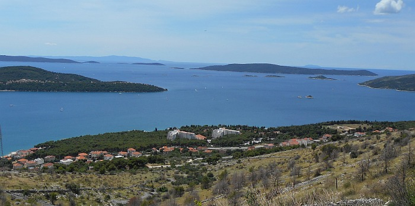
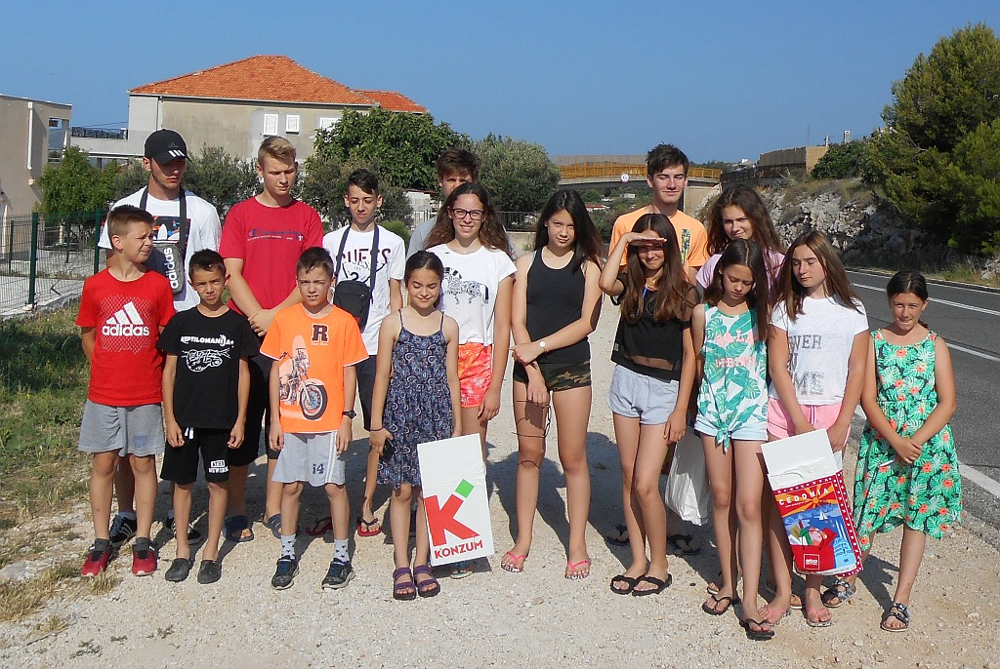
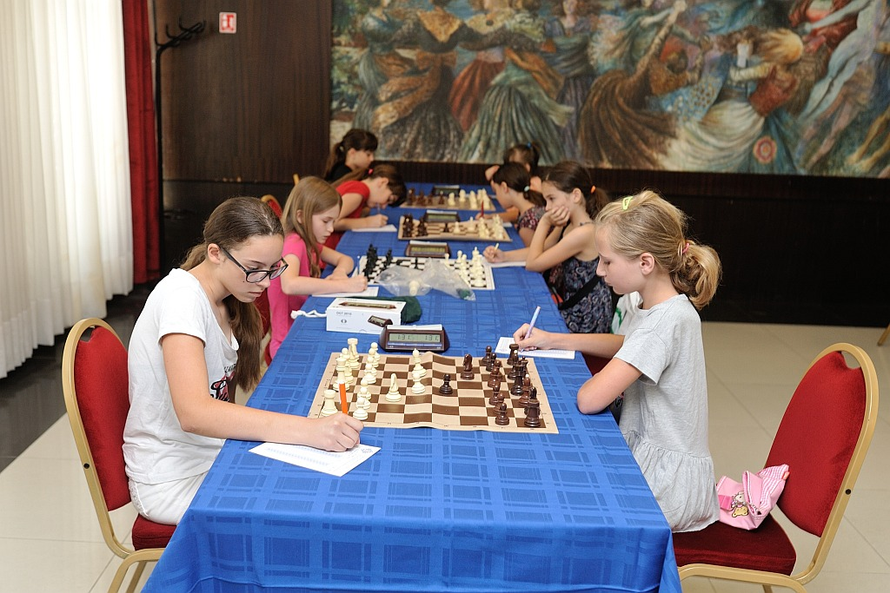

Od 15. do 21. lipnja u Segetu Donjem održano je Pojedinačno kadetsko prvenstvo Hrvatske. Nastupilo je 294 mladih šahista, 217 dječaka i 77 djevojčica. Tempo igre bio je 90+30. Igralo se u konkurencijama do 7, 9, 11, 13 i 15 godina. Partije su igrane u hotelu Medena. Ove godine imali smo i po nekoliko elektroničkih ploča na prvim stolovima pa su se neke partije mogle pratiti i u živo. Primjetio sam da je to imalo dobar učinak i na igru naših predstavnika jer su se ozbiljnije pripremali kada bi igrali na prvim stolovima. I dalje se nadam da će organizator, možda već za godinu dana, imati šahove i za ostale sudionike te tako  djeci smanjiti gnjavažu oko donošenja garnitura na pojedina kola. Ipak, najveću korist za kadetski šah, HŠS kao organizator, napravio bi kada bi našao povoljniji smještaj za sudionike. Ove godine, troškovi (smještaj u depadansama, kotizacija, prijevoz) iznosili su minimalno 2000 kn po djetetu, ne računajući pratnju. A samo naša ekspedicija brojala je 22 osobe. Najvažnije je pak da je sve prošlo u najboljem redu, povećao se broj sudionika, pobjednici su otišli sretni, a svi ostali su imali priliku nešto naučiti i dobro se zabaviti.

POBJEDNICI  
do 7  
1. VK Ferdebar Noa 0 1614 **8** ŠK Vukovar ’91, Vukovar  
2. VK Tomac Matej 0 1614 **7** ŠK Radnik, Velimirovac  
3. VK Đurašin Dominik 0 1606 **6,5** ŠK Polet, Buševec  
1. VK Kokša Agata 0 1618 **7** ŠŠK Konaki, Novo Virje  
2. VK Škiljan Tara 0 1600 **4,5** ŠK Crikvenica, Crikvenica  
3. VK Hranilović Renata 0 1600 **4,5** ŠU Bljesak, Garešnica

do 9  
1. II Gal Andrej 1445 1890 **8** ŠK Novi Zagreb, Zagreb  
2. IV Štajmaher David 0 1757 **7** ŠK FERIT-OSIJEK, Osijek  
3. IV Tomaić Nikola 0 1790 **7** ŠK Radnik, Velimirovac  
1. I Gretić Tina 1193 1897 **6,5** ŠK Radnik, Velimirovac  
2. MK Hajdinić Ema 0 1910 **6** ŠK Kraljevica, Kraljevica  
3. VK Zagorac Lara 0 1600 **4,5** ŠK Rječina, Dražice

do 11  
1. III Bunić Emanuel 1531 1892 **7** ŠŠK Koprivnica, Koprivnica  
2. II Franc Borna 1591 1886 **6,5** ŠK Samobor, Samobor  
3. II Mandarić Fran 1717 1901 **6,5** ŠK Amater, Strizivojna  
1. I Putar Lara 1484 1802 **8** ŠK Sljeme-Agroproteinka, Sesvete  
2. I Karij Petra 1360 1819 **7,5** ŠK Dama, Đakovo  
3. I Smetiško Renata 1165 1794 **7,5** ŠK Ericsson-Nikola Tesla, Zagreb

do 13  
1. II Novosel Lovro 1588 1982 **7,5** Šk Sveta Nedelja, Sveta Nedelja  
2. II Car Filip 1576 1967 **7** Šk Ban Jelačić, Zaprešić  
3. II Putar Leon 1680 1906 **6,5** ŠK Sljeme-Agroproteinka, Sesvete  
1. MK Bevanda Ema 1548 1985 **9** Šk Picok Đurđevac, Đurđevac  
2. I Arnold Dora 1427 1882 **7** ŠK Jelsa, Jelsa  
3. MK Vidović Petra 1444 1910 **6** ŠK Radnik, Velimirovac

do 15  
1. II Trošelj Ivan 1775 2069 **7,5** AŠK Junior, Rijeka  
2. MK Dabić Stjepan 2068 2102 **7** ŠK Vinkovci, Vinkovci  
3. I Ljubičić Mario 1777 2018 **6,5** ŠK Casper, Zadar  
1. NM Radiković Anamarija1771 2045 **7** ŠK Liburnija, Rijeka  
2. MK Dejanović Tereza 1815 2022 **7** ŠD Sisak, Sisak  
3\. MK Kokša Jelena 1666 1990 **7** ŠŠK Konaki, Novo Virje

ŠK ODRA. Nastupilo je 16 naših članova, 8 dječaka i 8 djevojčica. Ove godine imali smo ozbiljnijih organizacijskih problema, prvenstveno zbog manjka voditelja. Nasreću, uskočio je i Davor na nekoliko dana i pomogao da sve prođe bez većih problema. Po prvi puta za prijevoz smo koristili i autobusne linije pa je dio klinaca doputovao i otputovao autobusom. Tu je i  Brunina dogodovština (sada već anegdota), koji je nekim čudnim spletom okolnosti završio na Braču. Svi su klinci bili poslušni, Monika se iskazala kao najpedantnija u kućanskim poslovima, Lucija najbolja u kulinarskim vještinama, Anu je bilo teško prehraniti zbog izbirljivosti, ali je preživjela, a na površinu su izbile i neke simpatije, što je samo dalo dodatni plus cijelom prvenstvu. Nismo osvojili medalju, ali nismo imali niti jedno posljednje mjesto, za razliku od prošle godine, kada smo ih kući nosili cijeli naramak. Cjelokupni dojam malo nam je pokvario Kljujev koji se baš za vrijeme prvenstva odlučio razboljeti i sve nas pomalo zabrinuo.  
IGRA. Svi, svi su previđali, a očekivano, najbolje su igrali Ivan, Vraneša i Ana. Tako da se čini da rejting i nije loš pokazatelj snage igrača. Ivan je izgubio dvije partije. U prvoj izgubljenoj partiji dosta grubo je previdio protivnički napad na rokadni položaj, dok u drugoj izgubljenoj partiji nije niti pokušao napasti protivnika. Uspio je izboriti 10. mjesto i time se kvalificirati za nastup na Prvenstvu Europe i sljedeće godine. Vidio sam i jedan Vranešin poraz. U teškoj poziciji, izabrao je popravak pješačke strukture, umjesto razvoja figure i izgubio u nekoliko sljedećih poteza. Najviše rejting bodova izgubio je u prvom kolu prijateljskim remijem s Božom. Njih dvojica su neposredno nakon ovog turnira otputovali u Pulu na seniorski turnir koji je završio krajem mjeseca. Da su u HŠS-u Vraneši obračunali i taj turnir, sada bi bio ponosni vlasnik II kategorije. Na njemu je sada i težak zadatak da u kratkom roku od mlađih igrača učini respektabilnu školsku ekipu. Ana igra dobro, što smo svi mogli primjetiti još početkom godine. Na ovom turniru je, uz Moniku i Samantu, osvojila i prve međunarodne rejting bodove. Najviše (samostalno) radi na šahu, a sljedeći zadatak joj je naučiti se služiti računalom i e-mailom. Još nije naučila predati partiju (ni pojest figuru, dodala bi Monika), ali je barem korektna pa izgubljene pozicije igra tako da što prije završe u protivničku korist. Uvela je i novi izraz, “samoubila se”, kada bi u jednom potezu potpuno uništila vlastitu poziciju. Opet joj se dogodilo u jednoj partiji, kao i na “Buševcu”, da nije uzela figuru u potezu. Nekoliko partija riješila je efektnim minijaturama. Božo i Monika su dobro igrali, ali ih “nije išlo”. Božo je proširio znanja otvaranja za nekoliko poteza, ali još uvijek nedovoljno. Počeo se i ozbiljno pripremati za neke partije. Monika i dalje najbolje računa, dobro pamti, dobro i igra, ali je postala preoprezna. Dosad je ona Franku nagovarala da se opusti dok igra, a sada bi njoj dobro došlo da preuzme više rizika te se pokuša i zabaviti. Jednu partiju protivnica ju je nadigrala u otvaranju te je izgubila damu za topa. Pa, iako ih učimo da takve pozicije predaju, igrala je i dalje, iskoristila jedinu pogrešku protivnice te efektnom žrtvom vratila materijal i na kraju upisala cijeli bod. Nadam se da će preko ljeta vježbati zadatke i postati još bolja. Kljujeva nećemo ocijenjivati, jer je veći dio turnira bio bolestan. Jedno kolo čak nije ni došao na partiju. Loše su igrali Luka Fiolić i Katarina. Oni su veliki talenti i od njih očekujem puno više. Za Luku je najviše kriv tata, jer mu treba čvrsta ruka. Brzao je, neće poslušati ničiji savjet, a uz to igra na jeftine trikove koji na ovoj razini ne prolaze. Prošle godine pružio je bolje partije. Veliki je problem i što prije ovog turnira nije odigrao ništa ozbiljnije. Već ovo ljeto pruža mu se prilika da odigra i prvi seniorski turnir. Bude li popravio ponašanje i slušao Vranešu, možda se za godinu dana i popravi. Katarina je tek prošle godine na PH počela prihvaćati savjete, ali je ove godine opet sve odbacila i nije se držala osnovnih principa. Vrlo je snalažljiva i to ju još drži, ali ne odluči li se usporiti igru i prihvaćati savjete, neće napredovati. A bez njenog napretka i školska ekipa postaje slabija. Bruno je dosta ugodno iznenađenje. Ono što je igrao, “uopće nije bilo loše”, kažu njegovi kolege. Na dosadašnja prvenstva, imao sam osjećaj da dolazi više zbog kupanja nego zbog šaha. Uglavnom bi remizirao kada god je mogao, makar i dobivene pozicije. Sada se ipak trudio, posljednje kolo igrao je preko četiri sata i pobijedio, osvojio je (napokon!) i četvrtu kategoriju. Ne znam što je uzrok takvoj promjeni u stavu i pristupu igri, ali drago mi je da je do nje došlo. Možda je uzrok u tome što su ga počeli zezati da cure igraju bolje od njega. Što god bio uzrok, dobrodošao je. Lucija se također popravila. Upisala je dvije pobjede, prvi dio turnira igrala vrlo dobro, ali ju je pod kraj turnira opet ubila samokritičnost. Iako u pravilu ostvaruje jednake rezultate kao i klupske kolegice, često je previše samokritična prema sebi. Vidi svoje propuste, a ne vidi da ni drugi nisu ništa bolji, samo se ne grizu previše zbog toga. Još uvijek radi dosta grubih previda pa je tako jednu dobivenu poziciju izgubila. Dok je tražila dobitnički plan, neoprezno je spustila topa na tučeno polje. Veliki je talent, a bude li igrala na dovoljno turnira, previdi će se smanjiti na minimum. Samanta je ostvarila najbolji rezultat u skupini do 13, 12. mjesto! Prošle godine bila je posljednja. Igra agresivno, dosta previđa, dobro se nosi s porazima, prilično dobro računa, nekoliko partija se “samoubila”, ali je neke partije dobila i na sreću. Može od svakog izgubiti, ali može i svakoga pobijediti. Ostvarila je veliki napredak u godinu dana. Psihički je vrlo stabilna i mislim da bi uz Anu mogla početi igrati i seniorske turnire. Filip i Luka Matašić igraju dobro, ali nisu napredovali koliko smo očekivali. Filip bolje razumije pozicije od Luke, ali je slabiji taktičar. Krasi ga upornost, ali je i prilično lijen i ne vježba. Obojica su, kao i Luka Fiolić, došli na turnir bez odigranog i jednog jačeg turnira prije i vidi se da im to nedostaje. Uz to, na prvenstvu su s roditeljima te su na neki način izolirani i ne kupe dovoljno znanja jedni od drugih. Oni su od ove godine članovi prve školske ekipe pa će, ukoliko će slušati Vranešu, imati priliku i više igrati. A i tata ih mora malo pogurati. Od najmlađih djevojčica, Dora je imala samo jednu pobjedu. Vidi se da godinu dana nije praktički ništa igrala. Ovu godinu prednost su imali vjeronauk i karate. Ima priličnu dozu snalažljivosti, poput Katarine, a vidjet ćemo hoće li se malo više posvetiti šahu. Nedavno je dobila mobitel i to joj je dobra prilika da vježbom sustigne klupske kolegice. Botica je jedno od većih, ugodnih iznenađenja. Počela je dolaziti na šah početkom školske godine i još često ne ostaje do kraja. Prije par mjeseci me pitala zar je partija uistinu gotova kada previdi damu. A na ovom turniru je zabljesnula. Trebalo joj je par dana da se prilagodi, kako na kolegice, tako i na turnir. Bila je pažljiva, nije grubo previđala, ali je propuštala neke prilike. Mora vježbati. Držala se uputa, osvojila je 12. mjesto i njena igra i rezultat jedno su od najugodnijih iznenađenja. I prije sam primjetio da ima ideje, ali ih nije znala realizirati. Sada je uspijevala. Franka. Franka je ipak zvijezda ovog turnira. Osvojila je sedmo mjesto (i tako pretekla Moniku koja je 2014. osvojila 9. mjesto na prvenstvu do 8., Franka je tada bila 13.) i pokazala veliki talent. Djelovala je samouvjereno, držala se osnovnih principa, nisu je pogađali porazi, dobro je računala, (skoro kao Monika koja je predvidjela njen veliki uspjeh), nadigrala čak i prvakinju, ali nije vidjela uzeti fguru u dvopotezu, a posljednje kolo dobila je varijantom koju je naučila od Ane. Jednu partiju je izgubila jer je krivo zaključila da joj je bolje zadržati u igri lovca umjesto skakača. Još ne zna otvaranja, ali to će lako naučiti. Pitao sam ju što joj se događa, obzirom da je još prije mjesec dana radila gluposti, igrala dva puta zaredom istom figurom i slično, na što me ispravila i rekla da je to bilo prije dva dana, a ne mjesec dana. I da joj sve izgleda jednostavno, a vuče samo logične poteze. Osvojila je treću kategoriju. Uz sve to, bila je jedna od najvrijednijih u kućanskim poslovima. Čestitke svim sudionicima, a posebno Franki.  
   
[ODRA napredak po kolima](/files/wp/2018/07/ODRA-napredak-po-kolima.xlsx)  
[Kadetsko prvenstvo Hrvatske 2018.pgn](/files/wp/2018/07/Kadetsko-prvenstvo-Hrvatske-2018.pgn)

[Kadetsko prvenstvo Hrvatske 2018.pgn](./kadetsko-prvenstvo-hrvatske-2018.pgn)
