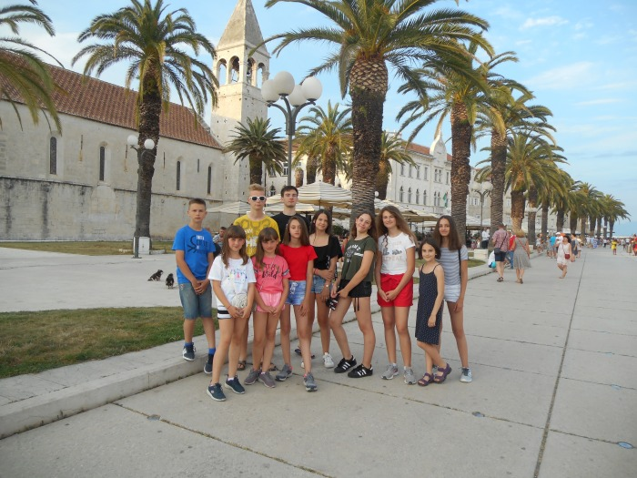
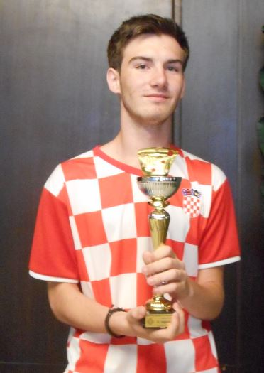
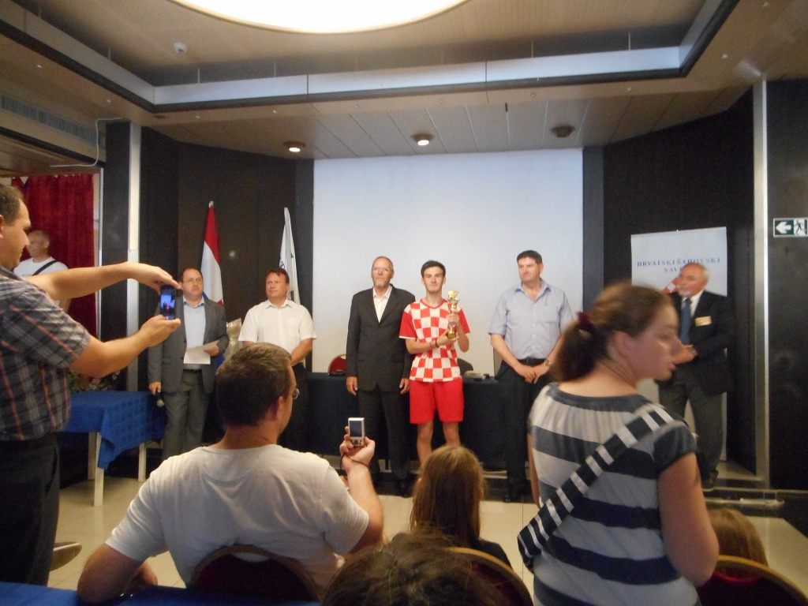
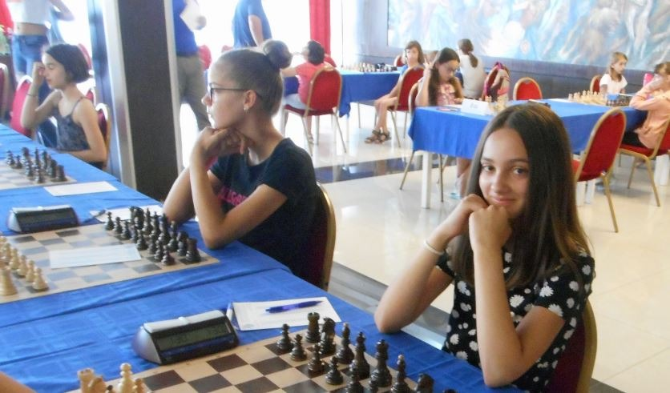
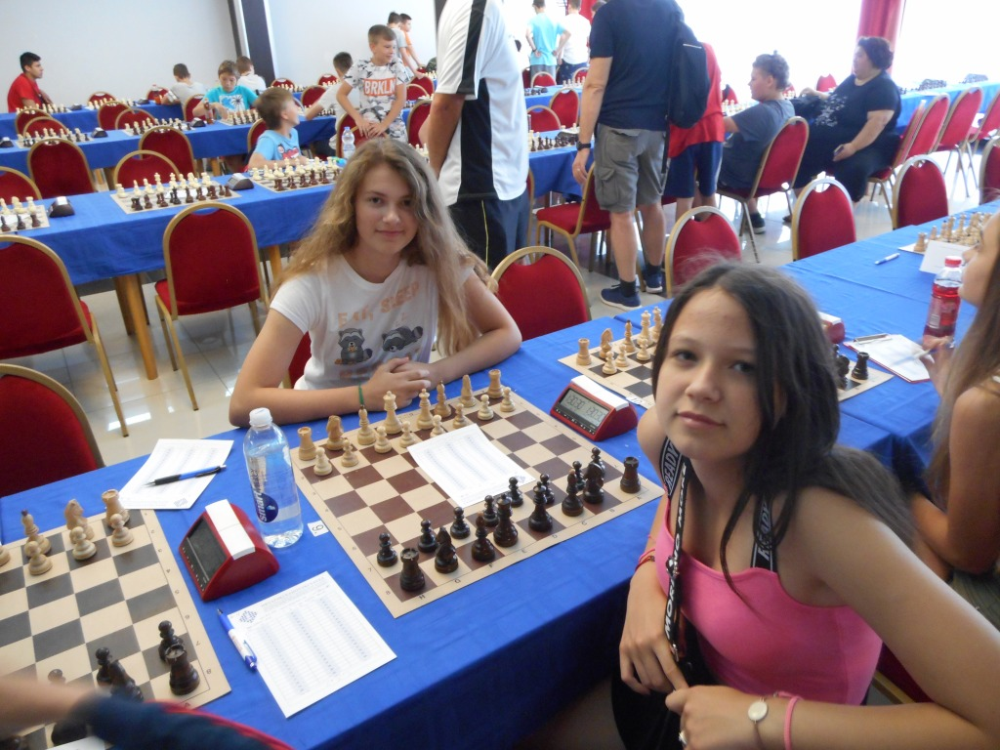
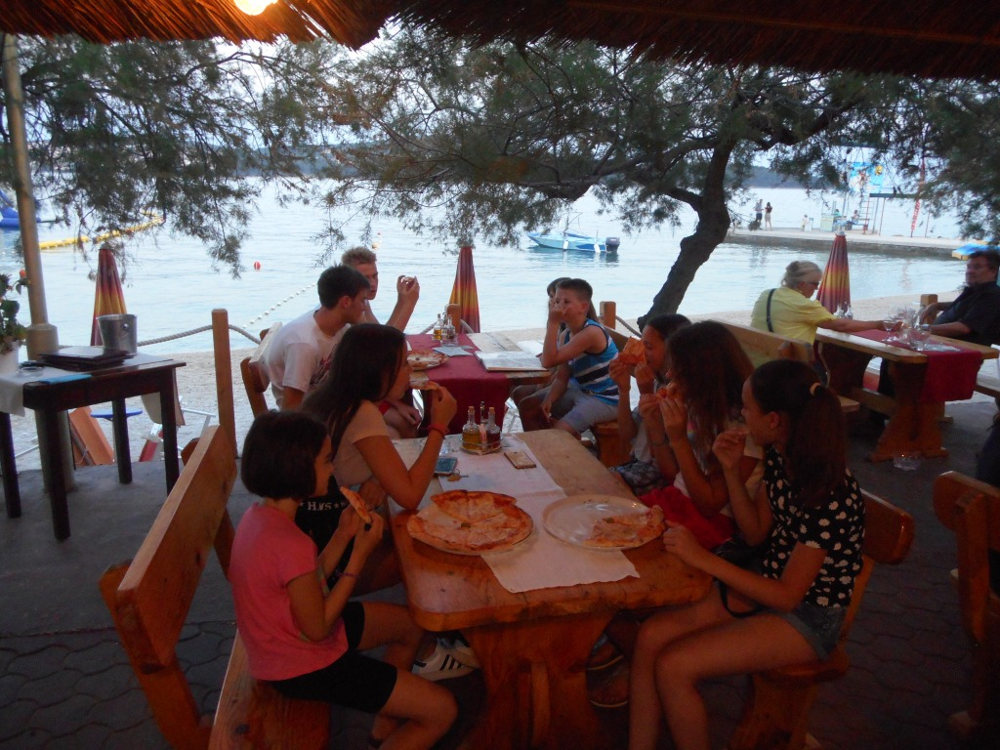
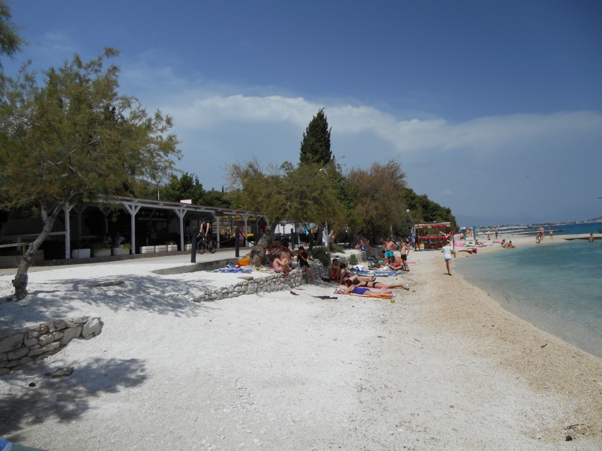
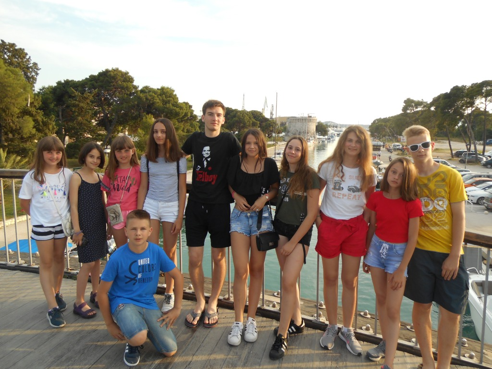

  
Na jučer završenom Pojedinačnom kadetskom prvenstvu Hrvatske, ostvarili smo sljedeće rezultate; [Ivan Maravić](http://chess-results.com/tnr447620.aspx?lan=13&art=4&fed=CRO) TREĆI, [Monika](http://chess-results.com/tnr447619.aspx?lan=13&art=4&fed=CRO) PETA, [Višeslav](http://chess-results.com/tnr447575.aspx?lan=13&art=4&fed=CRO) DEVETI, [Lucija](http://chess-results.com/tnr447619.aspx?lan=13&art=4&fed=CRO) DVANAESTA, [Botica](http://chess-results.com/tnr447619.aspx?lan=13&art=4&fed=CRO) PETNAESTA, [Flucija](http://chess-results.com/tnr447581.aspx?lan=13&art=4&fed=CRO) i [Samanta](http://chess-results.com/tnr447623.aspx?lan=13&art=4&fed=CRO) SEDAMNAESTE; [Ana](http://chess-results.com/tnr447623.aspx?lan=13&art=4&fed=CRO), [Fivana](http://chess-results.com/tnr447581.aspx?lan=13&art=4&fed=CRO) i [Franka](http://chess-results.com/tnr447619.aspx?lan=13&art=4&fed=CRO) OSAMNAESTE, [Vraneša](http://chess-results.com/tnr447620.aspx?lan=13&art=4&fed=CRO) 29., [Luka](http://chess-results.com/tnr447603.aspx?lan=13&art=4&fed=CRO) 44., nitko nije zadnji! 🙂 I ove godine, prvenstvo se igralo u Segetu Donjem, pokraj Trogira. Na turniru su učestvovala 302 igrača, 228 dječaka i 74 djevojčice. Igralo se u dobnim skupinama do 9, 11, 13 i 15 godina, posebno za dječake, a posebno za djevojčice. HŠS kao organizator, ove je godine napravio veliki pozitivni pomak i osim prijenosa partija na nekoliko prvih stolova u starijim skupinama, osigurao je šahove i satove za sve igrače te time klincima uvelike olakšao dolazak na partiju. Svaki drugi dan igrala se po jedna, odnosno dvije partije, a svi ozbiljniji izbjegavali su kupanje između kola kako bi sačuvali snagu za poslijepodnevnu partiju. Bilo ih je dosta i među našim igračima. Ipak, stigli su se svi i zabaviti i okupati i to je jedan veliki plus ovog prvenstva, jer je nastup na njemu velika motivacija svim klincima tijekom cijele školske godine. Stoga se iskreno nadam da su tračevi o tome da se prvenstvo prebaci na zimski period ipak samo tračevi. Ili možda nerazumne ideje ljudi koji uopće ne rade s djecom.  
–**Ivan Maravić osvojio je treće mjesto!** Čestitamo! Radi na šahu i izrastao je u igrača kome u Klubu možemo od sada pomagati samo logistički, obzirom da je kvalitetom igre vjerojatno prestigao sve seniore. Imao je ozbiljan pristup, išao rano na spavanje, za pripreme koristio minimalno potrebno vrijeme, igrao vrhunski i izgubio samo jednu partiju. Želimo mu da i predstojeće prvenstvo Europe odigra jednako kvalitetno.  
– Monika (5.), a posebno njena igra su najveće ugodno iznenađenje ovog turnira. Ni na prvenstvu Zagreba koje je osvojila lakoćom, nije pokazala takvu kvalitetu. Istina, ona i Ivan najviše i rade na šahu i ostvarili su najbolji rezultat. Ne znam je li to ikako povezano. :))) Do osmog kola bila je u borbi za medalju, a i u tom kolu vidjela je potez koji ju je mogao odvesti do postolja, ali se ipak odlučila na mirniju varijantu. Morat će ubuduće preuzeti mrvicu više rizika. Uz to, izgubila je dvije potpuno dobivene pozicije zbog previda, ali toga će biti sve manje, kao i kod ostalih igrača. Što su više u šahu, to manje previđaju.  Uz Ivana i Vranešu, mislim da smo i u Moniki dobili pojačanje za seniorsku ekipu Kluba.  
– Višeslav (9.) je pokazao jako dobru igru i još bolje razumijevanje pozicija. Deveto mjesto je naš treći najbolji rezultat na ovom turniru. Nadigrao je većinu protivnika od kojih je izgubio, uglavnom zbog previda jednopoteznih matova. Zna biti neoprezan, ali vjerujem da će mu i ovaj turnir pomoći da što prije otkloni i taj nedostatak u igri te će uskoro i on na postolje. Najveći napredak pokazao je u ponašanju, od klinca koji je prije manje od godinu dana lio suze kada bi izgubio kvalitet i bacao figure poslije poraza, pretvorio se u šestogodišnjaka koji tati objašnjava da nije bitno što je izgubio partiju. Ne bih vjerovao da nisam čuo na svoje uši. 🙂 Na turniru ga je pazio tata kome je ovaj turnir bio traumatičniji nego Višeslavu.  
– Lucija (12.) je završila turnir dvanaesta, ugodno je iznenadila činjenicom da nije pokazivala komplekse koji su ju kočili prijašnjih godina. Imao sam osjećaj da se dobro zabavlja dok igra, hladnokrvno podnosi poraze, a znala se i zainatiti pa se boriti do kraja. Jednu njenu partiju donosimo u nastavku.  
– Botica (15.) je, u najmanju ruku neobjašnjivo napredovala. U godinu i pol, ne da je dostigla, nego je šahovski i prestigla neke svoje klupske kolegice. Na ovom turniru jedina je nadigrala Moniku, ali je nažalost previdila taktički udar i izgubila. Dobar dio turnira bila je u borbi za medalju. Ponekad preemotivno doživljava svoje pogreške. Prikazanom igrom pokazala je da klupske kolegice s pravom cvile kolika je šteta da ne idu u istu školu, jer bi onda imale uistinu strašnu ekipu.  
– Flucija (17.) je imala zadatak osvojiti dva boda. Ovo joj je (kao i sestri Fivani) bio prvi nastup na ozbiljnijem turniru. Osvojila je 3,5 boda! Prvu partiju odigrala je vrlo loše, ali se nakon analize popravila već u drugom. Još je malena pa neke obaveze nije shvaćala dovoljno ozbiljno. Tako je ponekad znala formular partije ostaviti tati na čuvanje. Starija ekipa je i nju i sestru Fivanu dobro prihvatila i budu li i dalje radile na šahu, za manje od dvije godine rezervirano im je mjesto u školskoj ekipi.  
– Samanta (17.) je pokazala trud i volju, ali je rezultatski podbacila. Ni igra nije bila blistava. Krivo je računala i igrala nedovoljno agresivno, što smo od nje najmanje očekivali, a ne znam gdje leže razlozi za to. Ili je trenutno nečim drugim više zaokupljena ili ju muči nešto drugo u životu pa se to odrazilo na šahovskoj ploči. U svim drugim segmentima bila je primjer ostalima, a pokazala je zavidnu strpljivost i tolerantnost na neke “mušice” klupskih kolegica.  
– Ana (18.) je kao i Samanta prilično podbacila rezultatski. Iako mislim da je trenutno najjača igračica u Klubu, rezultat to nije pokazao. Više je timski igrač i teško joj je pronaći motivaciju za ozbiljniji samostalni rezultat. Još uvijek sumnja u svoje sposobnosti, strašno se boji cajtnota te ju je to natjeralo da prebrzo odigra neka otvaranja i pogriješi u ranoj fazi otvaranja, a na ovoj razini suparnice nisu opraštale pogreške. Nadam se da će ubrzo shvatiti da je njen osobni napredak najveća pomoć ekipi. I da će pomalo (kao što to radi Monika) vježbati i brzopotezni šah te se riješiti straha od cajtnota.  
– Fivana (18.) je od prvog kola igrala dobro, a nakon analiza i poboljšavala svoju igru. Ostvarila je 2,5 boda te kao i sestra prebacila zadani rezultat. Uklopila se u ekipu, tata je uvijek bio u blizini pa je osim početnih strahova sve prošlo u redu. Mora samo nastavit vježbati i šahovski napredak je neizbježan.  
– Franka (18.) bi vjerojatno ostvarila i bolji rezultat, ali je zbog drugih obaveza morala otići s turnira nakon šest kola. Vidi se da ju šah zanima i zabavlja, a i igra joj je prilično dobra. Ipak, nije znala dati suvisao odgovor zašto ne radi više na šahu. Još uvijek bi željela da se s njom radi, umjesto da sama uči neke stvari. A to je u Klubu uz veliki broj mladih igrača prilično teško. Dvanaest joj je godina i trebala bi pokušati biti samostalnija.  
– Vraneša (29.) je ostvario lijep rezultat. Osvojio je 4,5 boda. U posljednje vrijeme ne radi na šahu, posvetio se nogometu i vjerojatno je pred potpisom svog prvog profesionalnog ugovora. Ipak, pokazao je čvrstinu i talent, ali za neki ozbiljniji rezultat morat će početi raditi i na šahu. Da je šahu posvetio samo dva mjeseca, vjerujem da bi bio među prvih deset.  
– Luka (44.) je ove godine pokazao malo zrelije ponašanje, možda zato jer ga je ovaj put tata pazio. Trudio se, donosio partije na analizu, ali mu i dalje nedostaju neke osnove koje su drugi klinci već naučili. U ovoj dobi mogao bi to naučiti za mjesec dana, a ovaj rezultat je posljedica cjelogodišnjeg nerada. Zainteresiranost i volju je pokazao tek po dolasku na turnir, a kao da ne shvaća da je potrebno raditi cijelu godinu da bi se to vidjelo na kraju. Ljeto je pred njim, veliki je talent. Za njega nije kasno da se ozbiljnije prihvati vježbe i učenja. A dovoljno je dobar da može i sestrama pomagati.  
Za vrijeme turnira Viska i Luku su pazili tate, Cvetko je brinuo o Vraneši i Ivanu, a Kuhar je čuvao klinke. Osim par ježevih bodlji, malo izgaranja na suncu i par uboda komaraca, nije bilo problema. Na šahovskom polju svi su ponešto naučili, a nadam se i shvatili što im je dalje činiti kako bi poboljšali igru. Posebno je bio ugodan osjećaj što se više naših igrača borilo za medalju, barem prvi dio turnira. Nadam se da ćemo se jednog dana vratiti i sa dvije medalje. Od igrača koji su ostali doma, a teoretski su mogli pridružiti se ekipi na moru (Slavko, Ivanda, Dora, Filip, Nola…) jedino je Ivanda nastavio raditi na šahu.  
   
   
 

---

```pgn
[Event "Pojedinačno kadetsko prvenstvo Hrvatske 2019.,  do 13z"]
[Site "sahovski-klub.com"]
[Date "2019.06.21"]
[Round "7"]
[White "Svea, Buchwald 1749 ŠK FERIT-Osijek"]
[Black "Lucija , Kolovrat 1601 ŠK Odra, Zagreb"]
[Result "0-1"]
[ECO "C50"]
[PlyCount "182"]

1. e4 e5 2. Bc4 Nf6 3. Nc3 Bc5 4. Nf3 Nc6 5. d3 d6 6. h3 a6 7. Bg5 b5 8. Bxf6
Qxf6 9. Bd5 Bb7 10. Bxc6+ Bxc6 11. a3 Bb6 12. Qd2 O-O 13. O-O Bd7 14. Qg5 Qxg5
15. Nxg5 f5 16. Nd5 Rae8 17. Nxb6 cxb6 18. exf5 Rxf5 19. Ne4 Re6 20. Ng3 Rg5
21. Ne4 Rgg6 22. Rfe1 Re8 23. Re3 d5 24. Nd2 d4 25. Rg3 Rxg3 26. fxg3 Rf8 27.
Ne4 Rc8 28. c3 dxc3 29. bxc3 Bc6 30. Nd6 Rd8 31. Nf5 Rxd3 32. Ne7+ Kf7 33. Nxc6
Ke6 34. g4 Rxc3 35. Nb4 a5 36. Na6 e4 37. Re1 Ke5 38. Nb8 e3 39. Nd7+ Kd4 40.
Nxb6 Rxa3 41. Re2 Kd3 42. Re1 e2 43. Kf2 Ra2 44. Nd5 Rd2 45. Nf4+ Kc4 46. Rc1+
Kb3 47. Nxe2 Kb2 48. Rc5 b4 49. Rxa5 b3 50. Ke3 Rd7 51. Nd4 Rb7 52. Kd2 Rb4 53.
Kd3 Rb6 54. Kc4 Rb8 55. g3 Rc8+ 56. Kb4 Rb8+ 57. Kc4 Rc8+ 58. Kd3 Rb8 59. h4
Kb1 60. Kc3 b2 61. Ra3 Kc1 62. Nb3+ Kb1 63. g5 Rc8+ 64. Kd3 Rd8+ 65. Nd4 Kc1
66. Rc3+ Kb1 67. Rc4 Ka1 68. Ra4+ Kb1 69. Kd2 Rc8 70. g4 Rc1 71. Ne2 Rc2+ 72.
Kd3 Rc1 73. h5 Rc6 74. Kd2 Rd6+ 75. Ke1 Kc2 76. Rc4+ Kb3 77. Rc3+ Kb4 78. Nc1
Kxc3 79. Ne2+ Kc2 80. g6 hxg6 81. hxg6 b1=Q+ 82. Kf2 Rxg6 83. Nd4+ Kd3 84. Nf3
Rh6 85. g5 Rh3 86. Ne5+ Ke4 87. Nc4 Qc2+ 88. Kg1 Qxc4 89. g6 Rb3 90. Kf2 Qc2+
91. Ke1 Rb1# 0-1
```

**Pobjednici po skupinama:**  
M7  
1\. VK Tomac, Matej  0 1694 ŠK Radnik, Velimirovac 7,5  
2\. VK Šoštarić, Gabriel  0 1671 ŠK Polet, Buševec 6,5  
3\. VK Katić, Mihael 0 1600 ŠK Ericsson-N. Tesla, Zagreb 6,0

Ž7  
1\. IV Hranilović, Renata 0 1600 ŠK Garešnica 5,0  
2\. VK Rilje, Lucija 0 1604 ŠKRM Caissa, Zagreb 4,0  
3\. VK Stanković, Sonja 0 1600 ŠK Novi Zagreb, Zagreb 3,0

M9  
1\. VK Tadić, Jure 0 1642 ŠK Zadar, Zadar 7,0  
2\. IV Štajmaher, David 1049 1692 ŠK FERIT-Osijek, Osijek 7,0  
3\. IV Brleković, Dominik 0 1776 ŠK FERIT-Osijek, Osijek 6

Ž9  
1\. II Zagorac, Lara 0 1767 ŠK Rječina, Dražice 7,5  
2\. II Kokša, Agata 0 1679 ŠŠK Konaki, Novo Virje 7,0  
3\. IV Paulić, Franka 0 1622 ŠK Samobor, Samobor 6,5

M11  
1\. II Borzan, Matej 1667 1876 ŠK FERIT-Osijek, Osijek 7,5  
2\. I Colev, Ivor 1878 2012 ŠK Stridon, Štrigova 7,5  
3\. I Gal, Andrej 1697 2013 ŠK Novi Zagreb, Zagreb 7,5

Ž11  
1\. MK Gretić, Tina 1151 1944 ŠK Radnik, Velimirovac 8,0  
2\. II Karlušić, Sara 0 1635 ŠKRM Caissa, Zagreb 7,0  
3\. I Savić, Anja 0 1889 ŠK FERIT-Osijek, Osijek 6,5

M13  
1\. I Kovač, Petar 1906 ŠK Sladorana, Županja 8,0  
2\. II Jaković, Roko 1698 ŠK Oroslavje, Oroslavje 7,0  
3\. II Bunić, Emanuel 1662 ŠŠK Koprivnica, Koprivnica 7,0

Ž13  
1\. MK Trgovac, Marta 1222 ŠK Polet, Buševec 7,5  
2\. I Kovač, Petra 1398 ŠŠK Konaki, Novo Virje 7,0  
3\. II Mihaljević, Eva 1241 ŠU Bljesak, Garešnica 6,0

M15  
1\. MK Dabić, Stjepan 2091 ŠK Vinkovci, Vinkovci 7,5  
2\. I Trošelj, Ivan 1790 AŠK Junior, Rijeka 7,0  
**3\. I Maravić, Ivan 1905 ŠK Odra, Zagreb 7,0**

Ž15  
1\. MK Kokša, Jelena 1757 ŠŠK Konaki, Novo Virje 7,5  
2\. MK Desnica, Lara 1538 ŠK Krk, Krk 7,0  
3\. NM Bevanda, Ema 1775 ŠK Picok, Đurđevac 6,0

darko
