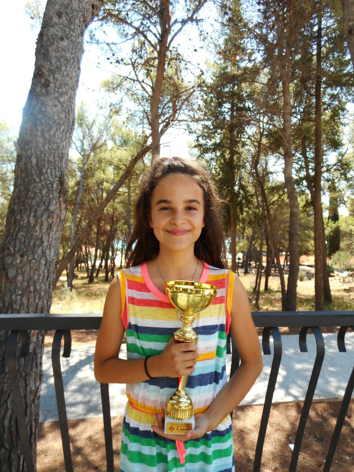
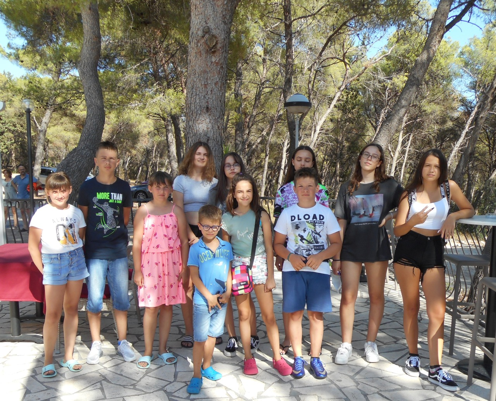

**Lucija Botica osvojila srebro na Pojedinačnom kadetskom prvenstvu Hrvatske 2020.!** Time je prestigla najbolji klupski pojedinačni rezultat u muškoj konkurenciji (Ivan Maravić, 2xbronca) i dostigla najbolji takav klupski rezultat u ženskoj konkurenciji (Anita Fiolić, ali još prije nekoliko desetljeća!).  
Bravo za Boticu koja nas je sve neizmjerno obradovala ovim velikim uspjehom. A prilično, i vrlo ugodno iznenadila i svojom igrom. Osvojila je respektabilnih 7 bodova! 🙂  
Jako je napredovala u računu, ostalo je još rupa u završnicama, ali je pokazala veliku hrabrost i smirenost kada je bilo najvažnije.  
U nastavku donosimo i njene dvije partije koje zorno prikazuju raskoš njenog talenta.  
U Klubu imamo respektabilnu bazu igračica pa je tako ove godine na PH otputovalo više djevojčica nego dječaka, a iako smo nade više polagali u Moniku i Ivanu, još je slađi ovaj uspjeh jer je pokazao da osim u konkurenciji U11 i U15, imamo vrhunskih igračica i u skupini **[U13](http://chess-results.com/tnr531914.aspx?lan=1&art=1)**!  
U toj skupini nastupila je i Franka(3) i također odigrala nekoliko začuđujuće lijepih partija, a imala je šansu i u partiji protiv srebrne klupske kolegice.  
U skupini **[U11](http://chess-results.com/tnr531926.aspx?lan=1&art=1)** igrale su Ivana(6) i Lucija Fiolić(4). Ivana je bila i naš kandidat za medalju, na kraju je završila četvrta što je također veliki, veliki uspjeh. Obje dobro napreduju, a nadamo se da će i Lucija uskoro početi prihvaćati savjete, više samostalno raditi te dostići sestru. Talenta joj ne nedostaje.  
U kategoriji **[U15](http://chess-results.com/tnr531915.aspx?lan=1&art=4)** nastupile su Lucija Kolovrat (4), Samanta(4,5), Monika(4,5) i Ana(4,5). Samanta je rano digla ruke od turnira, već nakon trećeg kola i nesretnog poraza grubim previdom.  
Lucija, koja je najveći talent, imala je najlošiji rezultat što samo potvrđuje činjenicu da uspjeh ipak više ovisi o uloženom trudu, radu i vježbi, nego o talentu.  
Ana je igrala najbolje što može sve do samog kraja i zaslužuje pohvale za upornost i posvećenost turniru. Monika je bila u konkurenciji za medalju sve do osmog kola kada je ušla u vremenski tjesnac i previdom izgubila partiju. Impresionirala je svojom igrom i rješenjima koje je pronalazila. Jednu partiju je izgubila jer je već zaboravila neke stvari koje smo učili, a vježbala je premalo za ovako važan turnir. Već u prvom kolu imala je potpuno dobivenu poziciju protiv pobjednice turnira. Nažalost, kod svih djevojaka se vidio nedostatak vježbe. Trud na turniru svih igračica je za svaku pohvalu i time su me ugodno iznenadile. Nadam se da su uživale i u slobodnom vremenu. 🙂  
Kod dječaka, Višeslav(4,5) je igrao u skupini **[U9](http://chess-results.com/tnr531925.aspx?lan=1&art=4)** i pristup partijama mu je varirao iz kola u kolo, sukladno njegovim godinama. Njemu je tek osam i imat će priliku već sljedeće godine popraviti rezultat u ovoj istoj skupini.  
Luka(3,5) je igrao u konkurenciji **[U13](http://chess-results.com/tnr531912.aspx?lan=1&art=4&turdet=YES)** i uporno tražio brza rješenja (što npr. nije radio prije tri godine). Prilično je naporedovao u razumijevanju otvaranja, ali i dalje podcjenjuje protivnike, a konkurencija mu je sve, samo ne bezazlena.  
Slavku(1,5) je ovo prvi nastup, igrao je u skupini **[U11](http://chess-results.com/tnr531927.aspx?lan=1&art=4)**, dobro razumije otvaranja (“Nemaš mu što prigovoriti.” rekao je trener Vraneša), ali u daljnjem tijeku partije podcjenjuje snagu protivnika i slično Luki traži brza rješenja ne pazeći na troškove. 🙂 Bistar je dječak i vjerujem da će uskoro početi uvažavati protivnike. Bio je uporan i na kraju zasluženo upisao i pobjedu na turniru! Bravo za Slavka!

Pojedinačna kadetska prvenstva u šahu igrana su u Hotelu Medena u Segetu donjem od 23. do 29. kolovoza. Tempo igre bio je 90+30, a učesnici su morali osigurati ispravan šahovski sat, dok je organizator osigurao figure. Igralo se po skupinama, do 7, do 9, do 11, do 13 i do 15 godina starosti, posebno za djevojčice, posebno za dječake. Turnir se prvotno trebao održati u lipnju, ali je zbog panike oko covida19 odgođen za kolovoz. I odgoda, i covid19 i cijene u kolovozu su vjerojatni razlozi da je ove godine bilo znatno manje učesnika nego obično. Ove godine nastupilo je oko 200 klinaca, a uobičajena brojka je preko 300.  
Djeci su prije nastupa mjerili temperaturu (djeci koja su trčala do sale za igru, kao što djeca rade, temperatura je bila povišena dok se ne bi ohladili :D), špricali ih raznim kemikalijama i prislili ih da nose maske za vrijeme igre. Zabranjen je bio ulazak u dvoranu ikome osim sucima i natjecateljima, a bili su skriveni i od pogleda zastorima.  
Istina je da je na djeci najlakše trenirati strogoću, ali se zbio ipak sramotan događaj u skupini U11 za djevojčice kada se neki kreten (sudac?) derao na jednu djevojčicu jer je bila spustila masku ispod nosa. I za kaznu joj oduzeo vrijeme za razmišljanje.(!!!???)  
Iskreno se nadam da će mu ubuduće zabraniti ikakvo suđenje, a i prilazak bilo kojoj djeci.  
Sve u svemu, turnir je sretno završio, proglašenje je održano na otvorenom tj. terasi Hotela Medena što je možda trebala biti praksa i prije corona-krize, kući nosimo pehar i veselimo se sljedećem prvenstvu.

darko



---

```pgn
[Event "Pojedinacno kadetsko prvenstvo Hrvatske - U13"]
[Date "2020.08.27"]
[Round "6.9"]
[White "Lukinovic, Laura (1791)"]
[Black "Botica, Lucija (1660)"]
[Result "0-1"]
[Variant "Standard"]
[TimeControl "-"]
[ECO "D05"]
[Opening "Colle System"]
[Termination "Normal"]

1. Nf3 d5 2. d4 Nf6 3. e3 e6 4. c4 Be7 5. Nc3 O-O 6. Be2 c5 7. cxd5 exd5 8. dxc5 Bxc5 9. O-O Nc6 10. b3 d4 11. exd4 Nxd4 12. Nxd4 Bxd4 13. Bb2 Bb6 14. Bf3 Qc7 15. Rc1 Qf4 16. Ne2 Qg5 17. Qd3 Bf5 18. Qb5 h6 19. Bxb7 Rab8 20. Qa6 Rfd8 21. Bf3 Bd3 22. Qa4 Bxe2 23. Bxe2 Rd2 24. Bxf6 Qxf6 25. Bf3 Qe5 26. a3 Bxf2+ 27. Kh1 Rbd8 28. Qe4 Qxe4 29. Bxe4 Re8 30. Bf3 f5 31. Bd5+ Kf8 32. Bf3 g5 33. Rc6 Re1 34. Rxe1 Bxe1 35. Rxh6 g4 36. Bc6 Rd1 37. g3 Bd2+ 38. Kg2 Bxh6 0-1
```

---

```pgn
[Event "Pojedinacno kadetsko prvenstvo Hrvatske - U13"][Date "2020.08.28"]
[Round "7.9"]
[White "Botica, Lucija (1660)"]
[Black "Zovko, Josipa (1864)"]
[Result "1-0"]
[ECO "C42"]
[PlyCount "57"]

1. e4 e5 2. Nf3 Nf6 3. Nxe5 d6 4. Nxf7 Kxf7 5. d4 Nxe4 6. Qh5+ Ke7 7. Qe2 Kf7 8. Qxe4 Be7 9. Bc4+ Ke8 10. O-O h6 11. Qg6+ Kd7 12. Qe6+ Kc6 13. Qd5+ Kd7 14. Qe6+ Kc6 15. Qe4+ d5 16. Qg6+ Bf6 17. Bb3 Re8 18. Nc3 a6 19. a4 a5 20. Bxd5+ Kb6 21. Qd3 c6 22. Bf3 Bxd4 23. Nd5+ cxd5 24. Qxd4+ Kc6 25. c4 Re7 26. Bxd5+ Kc7 27. Bf4+ Kd7 28. Bc6+ Kxc6 29. Qxd8 1-0
```

**Pobjednici po skupinama:**

Ž7  
1\. Gal Ema 0 1600 ŠKRM Caissa, Zagreb 4,0  
2\. Rilje Marta 0 1615 ŠKRM Caissa, Zagreb 2,0  
3\. Đurašin Melanija 0 1600 ŠK Polet, Buševec 0,0

M7  
1 IV Katić Mihael 0 1717 ŠK Sesvete Agroproteinka, Zagreb 6,5  
2\. Štajmaher Karlo 0 1650 ŠK Novi Zagreb, Zagreb 6,5  
3\. Lukšić Frane 0 1600 ŠK Jelsa, Jelsa 4,0

Ž9  
1\. II Kokša Agata 0 1758 ŠŠK Konaki, Novo Virje 5,5  
2\. II Škiljan Tara 0 1707 ŠK Crikvenica, Crikvenica 5,5  
3\. II Rilje Lucija 0 1737 ŠKRM Caissa, Zagreb 4,0

M9  
1\. IV Apostolovski Filip 0 1789 ŠK Travno, Zagreb 7,0  
2\. Kašelić Noa 0 1649 ŠŠ Goranka, Ravna Gora 6,5  
3\. IV Ribić Ivan 0 1717 ŠK Goranka, Ravna Gora 6,5

Ž11  
1\. I Zagorac Lara 1285 1777 U10 ŠK Rječina, Dražice 8,0  
2\. Car Lana 0 1600 U11 ŠK Tomislav-Goran, Sveti Ivan Žabno 7,0  
3\. I Žagar Lara Marija 0 1854 U11 ŠK Sveta Nedelja, Sveta Nedelja 7,0

M11  
1\. I Gal Andrej 1753 2000 U11 ŠK Samobor, Samobor 8,0  
2\. II Poljan Max 1608 1928 U11 ŠK Stridon, Štrigova 7,5  
3\. III Delibašić Dominik 1463 1872 U11 ŠK Zagreb, Zagreb 6,0

Ž13  
1\. I Karij Petra 1275 1829 ŠŠK Konaki, Novo Virje 7,5  
**2\. III Botica Lucija 1048 1660 ŠK Odra, Zagreb 7,0**  
3\. I Zovko Josipa 1358 1864 ŠK Bošnjaci, Bošnjaci 7,0

M13  
1\. II Jaković Roko 1828 ŠK Oroslavje, Oroslavje 7,0  
2\. II Bunić Emanuel 1758 ŠŠK Koprivnica, Koprivnica 6,5  
3\. II Horčička Jan 1560 Ššk Koprivnica, Koprivnica 6,5

Ž15  
1\. NM Bevanda Ema 1550 1974 ŠK Picok, Đurđevac 7,5  
2\. MK Vidović Petra 1537 1947 ŠK Radnik, Velimirovac 7,0  
3\. MK Trgovac Marta 1315 1875 ŠK Polet, Buševec 6,5

M15  
1\. I Vučenović Damian 1952 2066  ŠK Zagreb, Zagreb 7,0  
2\. I Kovač Petar 1949 2067  GŠK Županja, Županja 7,0  
3\. I Novosel Lovro 1761 2008  Šk Sveta Nedelja, Sveta Nedelja 6,5
