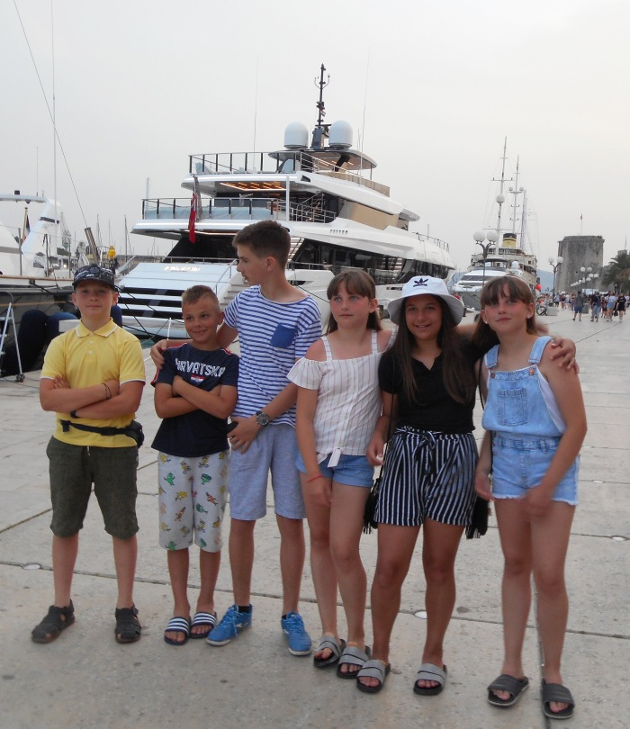

Pojedinačna kadetska prvenstva u šahu igrana su u Hotelu Medena u Segetu Donjem od 18. do 24. lipnja. Tempo igre bio je 90+30, a učesnici su morali osigurati ispravan šahovski sat, dok je organizator osigurao figure. Igralo se po skupinama, do 7, do 9, do 11, do 13 i do 15 godina starosti, posebno za djevojčice, posebno za dječake. U starijim dobnim skupinama, partije na prvim pločama mogle su se pratiti uživo na internetu.  
Iz ŠK Odra nastupilo je šest članova, u skupini [M15](http://chess-results.com/tnr563905.aspx?lan=13&art=4), Luka Fiolić (24.) 5 bodova, tri djevojke u skupini [Ž13](http://chess-results.com/tnr563906.aspx?lan=13&art=4), Lucija Fiolić (7.) 5 bodova, Ivana Fiolić (9.) 4,5 boda i Vjeka Vidra (15.) 2 boda. U skupini [M11](http://chess-results.com/tnr563857.aspx?lan=13&art=4) nastupio je Slavko Biondić (23.) 4 boda i u skupini [M9](http://chess-results.com/tnr563855.aspx?lan=13&art=4) Ivan Pisačić (14.) 5 bodova. Ekipa je bila vesela i prilično uspješna u skupljanju bodova, a iako se ove godine vraćamo bez medalja možemo biti zadovoljni ponašanjem i rezultatima. Stekli su iskustvo više i svatko je mogao uvidjeti svoje slabosti koje treba pokušati ispraviti do sljedećeg nastupa. Usporiti igru, naučiti neka otvaranja, ostati smiren u obrani, ne poklanjati bodove i remije, ne ulaziti u maske i naravno, nastaviti vježbati još više. Uz ekipu su bili naši bivši kadeti, Božo, Vraneša i Ivan Maravić koji su premostili generacijsku razliku između igrača i voditelja. Od odraslih, na djecu su pazili Goran, Cvetko i Darko. Nadamo se da će i iz mlađe generacije netko podići kvalitetu igre i pridružiti se ekipi na sljedećem PH.  
Prvenstvo je prošlo u redu, iako je i ove godine, baš kao i prošle, bilo ispada, ne od djece nego od sudaca. Tako se sudac Ivančić sjetio šesto kolo maltretirati dijete sa astmom i pravilima oko nošenja maski. Uspio je iznervirati roditelje, rasplakati dijete i upropastiti mu cijeli turnir. Pomalo je neozbiljno da se takve suce, koji su višekratno pokazali i dokazali da nisu u stanju kvalitetno voditi natjecanja i dalje postavlja na ovako osjetljive turnire i u kontakt s djecom.  
Igrao se kvalitetan šah, podijeljene su medalje i pehari, a nas čekaju pripreme za školska natjecanja koja su proteklu godinu izostala, ali se iskreno nadam da će se igrati sljedeće školske godine.

**Pobjednici po skupinama:**

Ž7

1\. Rilje Marta 0 1612 ŠKRM Caissa, Zagreb 6,5  
2\. Đurašin Melanija  0 1600 ŠK Polet, Buševec 5,0  
3\. Perak Ana  0 1600 ŠK Dubrovnik, Dubrovnik 4,5

M7

1\. Friščić Jakov 1600 ŠK Ivanec, Ivanec 8,0  
2\. Živić Luka 1600 ŠK Novi Zagreb, Zagreb 7,5  
3\. Potočki Borislav 1600 ŠK Mornar, Split 6,0

Ž9

1\. II   Rilje Lucija 1729 ŠKRM Caissa, Zagreb 8,0  
2\. III Hranilović Renata 1640 ŠK Garešnica-Mount trade, Garešnica 8,0  
3.       Gal Ema 1661 ŠKRM Caissa, Zagreb 6,5

M9

1\. III Golubović Erik 1815 ŠK Rijeka, Rijeka 8,0  
2.      Močić Ivano 1603 ŠK Šibenik, Šibenik 7,5  
3.      Mesić Josip 1633 ŠK Samobor, Samobor 6,5

Ž11

1\. I  Zagorac Lara 1277 1884 ŠK Rječina, Dražice 9,0  
2.    Končar Klara 0 1615 ŠK Bjelovar, Bjelovar 6,5  
3\. IV Franc Marta 0 1608 ŠK Samobor, Samobor 6,0

M11

1\. IV  Tadić Jure 1374 1746 ŠK Zadar, Zadar 8,5  
2\. IV Kucelj Kevin 1383 1733 ŠK Oroslavje, Oroslavje 7,0  
3\. III Mandarić Duje 1166 1777 ŠK Amater, Strizivojna 6,0

Ž13

1\. MK  Hajdinić Ema 1565 1903 ŠK Kraljevica, Kraljevica 7,0  
2\. I  Zovko Josipa 1359 1842 ŠK Vinkovci, Vinkovci 6,5  
3\. I  Žagar Lara Marija 1247 1860 ŠK Sveta Nedelja, Sveta Nedelja 6,0

M13

1\. I Gal Andrej 1770 2033 ŠK Samobor, Samobor 7,5  
2\. I Colev Ivor 1842 2010 ŠK Stridon, Štrigova 7,5  
3\. II Babler Jan 1660 1930 ŠK Đuro Đaković, Slavonski Brod 6,5

Ž15

1\. MK Kovac Petra 1441 1866 ŠŠK Konaki, Novo Virje 8,5  
2\. MK Mihaljević Eva 1572 1892 ŠŠK Konaki, Novo Virje 7,5  
3\. MK Trgovac Marta 1472 1919 ŠK Polet, Buševec 6,5

M15

1\. MK Kovač Petar 2067 2129 ŠK Slaven, Vukovar 8,0  
2\. I Jaković Roko 1736 1940 ŠK Oroslavje, Oroslavje 7,5  
3\. MK Vučenović Damian 2040 2124 ŠK Sesvete Agroproteinka, Zagreb 7,0

darko
