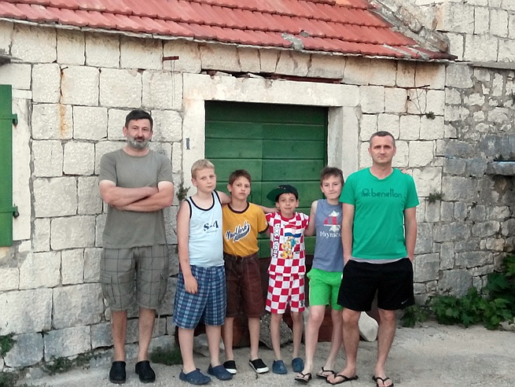
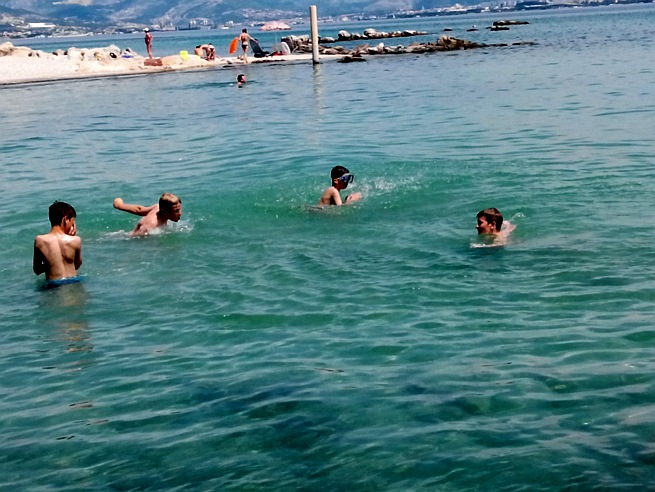

Prijave na kadetsko prvenstvo Hrvatske poslane su za **Ivana**, **Vranešu**, **Brunu** i **Božu**.

Sada čekamo potvrdu Saveza i početak turnira. Sretno!  [Prijavljeni igrači.](http://chess-results.com/tnr136386.aspx?lan=13&art=0&wi=821 "Prijavljeni igrači.")

[Prijava.](./prijava-na-kadetsko-prv-hrvatske-2014.jpg)    [Pravilnik.](/files/wp/2014/06/Pravilnik-kadeti-9-i-11-2014.doc "Pravilnik.")     [Raspored.](./termini-partija.jpg "Raspored.")    [Poredak!](http://chess-results.com/tnr136386.aspx?lan=13&art=1&rd=9&wi=601 "Poredak nakon 9. kola.")  
[Kadetsko prvenstvo Hrvatske – Kastel Stafilic 2014](/files/wp/2014/06/Kadetsko-prvenstvo-Hrvatske-Kastel-Stafilic-2014.pdf)

U petak, 13. lipnja neće biti šahovske škole zbog spriječenosti trenera. Šahovska škola se nastavlja

sa početkom školske godine u rujnu.

Druženja za seniore i ostale zaljubljenike u šah nastavlja se svaki petak od 21:00.

