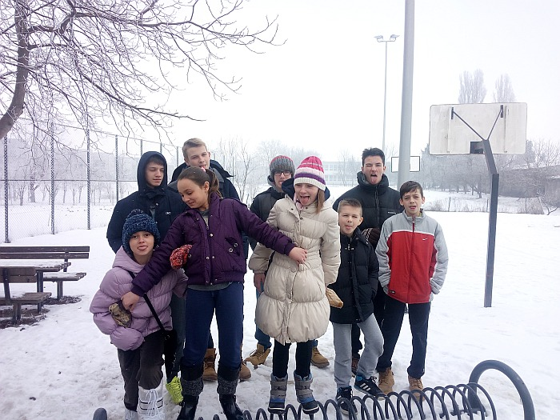
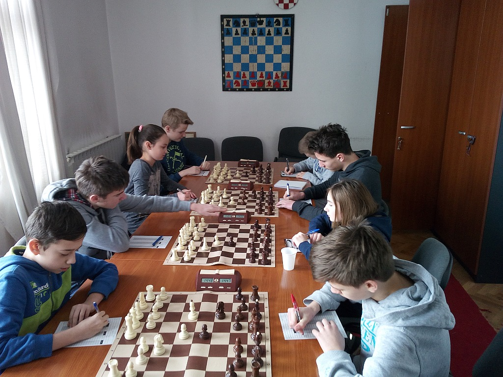

Danas su veliki dečki, uz Luku Fiolića, odigrali kvalifikacijski turnir za mušku školsku ekipu koja će za tjedan dana predstavljati školu na Prvenstvu osnovnih škola Grada Zagreba. To prvenstvo počinje u 8.30 u sljedeću subotu, a igrat će se u OŠ Frana Krste Frankopana u Ivanićgradskoj 24. Na turniru su nastupile i trenutačno dvije najbolje kadetkinje, koje su svoje kvalifikacije završile jučer, kako bi se još malo utrenirale protiv jačih protivnika. Turnir je pratila i Lucija kao promatrač, kako bi i sama ponešto naučila. Ekipu će predstavljati najboljih pet s današnjeg turnira. Luka se ni ove godine nije uspio nametnuti, ali nije bio toliko loš kako to rezultat prikazuje. U prvom kolu nadigrao je Vranešu, protiv Katarine je ispustio mat u potezu i na kraju izgubio s topom više… Kljujev je ostvario dobar rezultat, iskoristio je nezagrijanost Ivana u prvom kolu i ubilježio važnu pobjedu za samopouzdanje. Vraneša je bodovno uvjerljivo osvojio turnir, ali mu je igra bila katastrofalna. Dobio je nekoliko izgubljenih pozicija samo zahvaljujući grubim previdima protivnika, a najgore je odigrao posljednje kolo, kada nije znao dobiti topovsku završnicu s pješakom više. Monika je lijepo nadigrala Luku, Bruno je sestri održao lekciju iz trikova u otvaranju, Katarina je na samom kraju partije ispustila remi protiv Kljujeva u završnici raznobojnih lovaca, a Božo se pokazao kao vrlo dobar na ovaj ubrzani tempo (15+0), kojim će se igrati i kvalifikacije prvenstva škola. Remiji su bili zabranjeni, osim djevojkama, koje su to iskoristile u posljednjem kolu. Uglavnom, dečki nisu pokazali baš zavidnu formu, možemo se samo nadati da će biti bolje za tjedan dana. I, zanimljivo, svi su prilično respektirali djevojke, vjerojatno i više nego što su trebali…

|   | Ime | 1 | 2 | 3 | 4 | 5 | 6 | 7 | 8 | Bodovi | Mjesto |
| --- | --- | --- | --- | --- | --- | --- | --- | --- | --- | --- | --- |
| 1 | Vraneša |  | 1 | 1 | 1 | 1 | 1 | 0.5 | 1 | **6.5** | 1. |
| 2 | Monika | 0 |  | 0 | 0 | 0 | 0.5 | 0 | 1 | **1.5** |  |
| 3 | Ivan | 0 | 1 |  | 1 | 1 | 1 | 0 | 1 | **5** | 2. |
| 4 | Božo | 0 | 1 | 0 |  | 1 | 1 | 1 | 1 | **5** | 3. |
| 5 | Bruno | 0 | 1 | 0 | 0 |  | 1 | 1 | 1 | **4** | 5. |
| 6 | Katarina | 0 | 0.5 | 0 | 0 | 0 |  | 0 | 1 | **1.5** |  |
| 7 | Kljujev | 0.5 | 1 | 1 | 0 | 0 | 1 |  | 1 | **4.5** | 4. |
| 8 | Luka F. | 0 | 0 | 0 | 0 | 0 | 0 | 0 |  | **0** |  |
