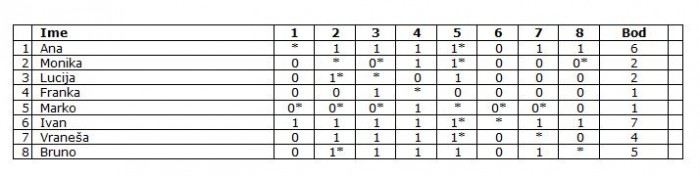
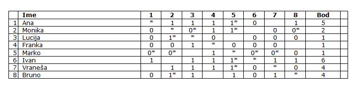
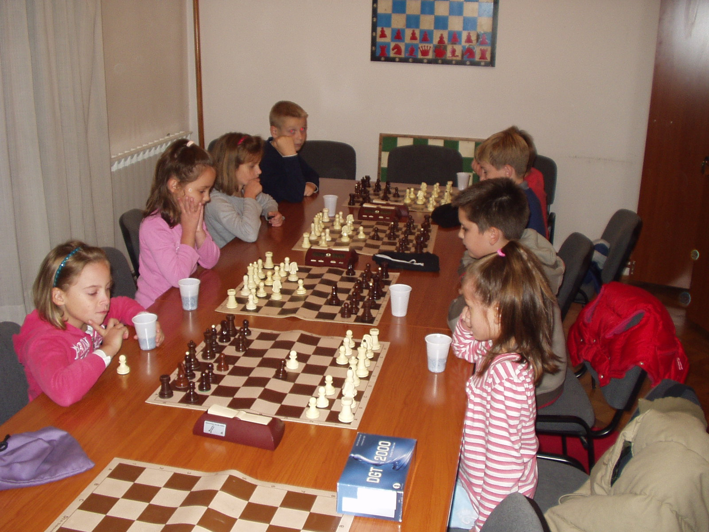
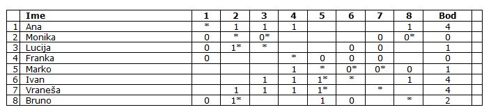
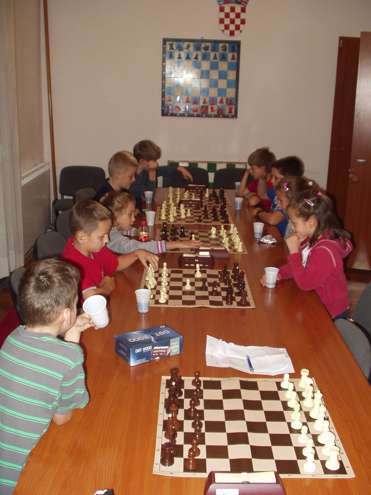
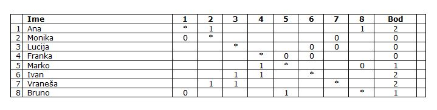
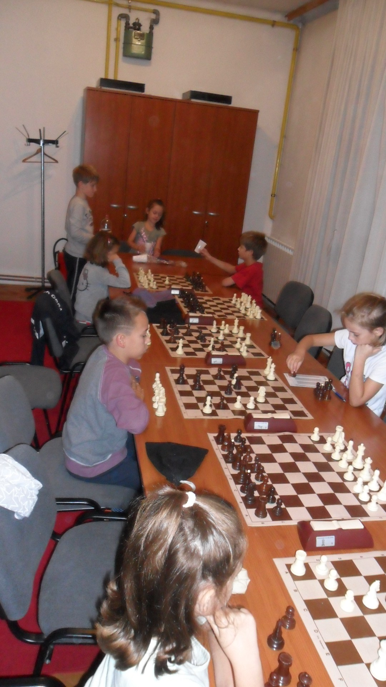
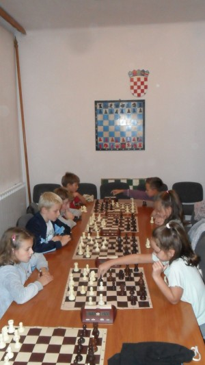
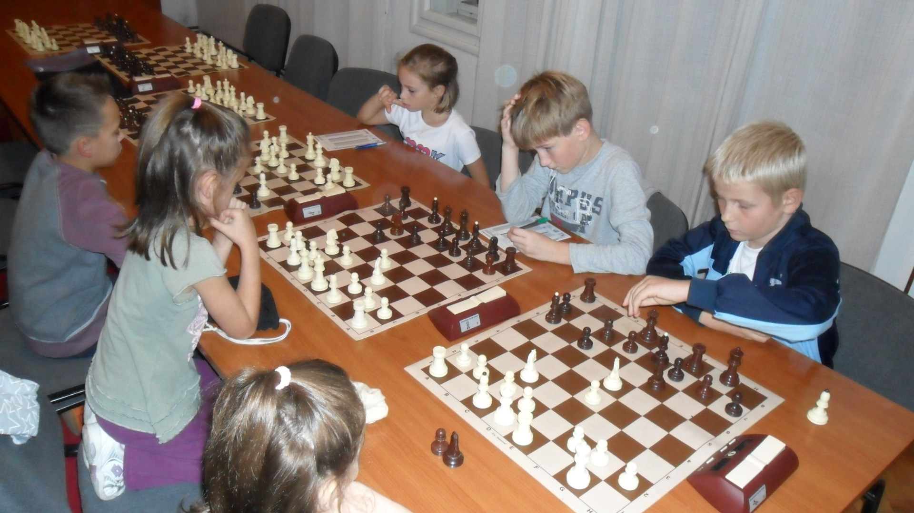

Odigrano je i zadnje kolo.  Nije došao Tilio, ali je došao Božo koji je odigrao partiju protiv Lucije. Izgubio.  
Isto tako Vraneša je izgubio od Ane. Meni je to  malo čudno… Uglavnom, očekivano prvo mjesto pripalo je  
Ivanu, drugo mjesto (zahvaljujući pobjedama nad Brunom  i Vranešom) osvojila je Ana, a na treće mjesto  
ugurao se (sasvim zasluženo) Bruno koji je na kraju pokazao lijep i ozbiljan pristup.

Posebno sam zadovoljan sa Lucijom i Frankom jer se vidi da polako napreduju. Samo će se morati malo  
više potruditi i paziti na početku partije. Ali to će doći vremenom. Samo treba igrati.

Monika i Ana već igraju kao velike! A dečki se dobro zabavljaju, kao i uvijek. 🙂

Evo i tablice:

Sljedeći petak igra se turnir za učenice OŠ Novog Zagreba. Igra se u OŠ Gustav Krklec.

Nadam se da će sve djevojke igrati. (Vrijedi i za Emmu!) Raspis i poziv su u privitku. Prijave do srijede!

[Pravilnik](/files/wp/2013/09/Pravilnik.docx)  +  [Poziv](/files/wp/2013/09/Poziv.docx)

———————————————————————————————–

Jučer (4. listopada) su odigrana još dva kola. Monika i Franka su osvojile prve bodove! Ani je Ivan ipak  bio prevelik zalogaj.  
Sljedeći petak igra se zadnje kolo.

27\. rujna odigrana su još dva kola. Nažalost, nisu se pojavili Marko V. i Monika, ali vjerujem da će sljedeći petak biti tu. Na sreću, došli su Božo, Marko Zagorec bez brata (!?), što mi je žao, i novi učenik Tilio te su uskočili pa nije bilo praznog hoda. Božo je standardan, a za Marka i Tilija se nadam da će postati redoviti.

Tablica nakon 4. kola:

U petak, 20.rujna 2013. smo započeli kadetsko prvenstvo Kluba. Vidi se da je ljetna stanka uzela danak i partije su bile znatno lošije nego na početku ljeta. Vraneša i Ana su loše igrali, ali su zahvaljujući svojoj mašti i brzopletosti protivnika ipak uzeli oba boda, Ivanu nedostaje ozbiljnosti, Franki i Luciji koncentracije, Moniki malo sreće, a Marku iskustva, nadam se ne i upornosti. Zato igramo šah da bismo sve to stekli i naučili.

Općenito, zadovoljan sam s koliko su ozbiljnosti  prionuli igri! 🙂

Nastavak je sljedeći petak u 18:30 kako bi i Bruno uspio stići.

Tablica:

