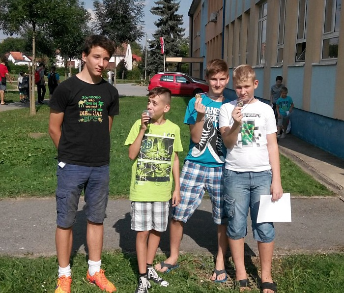

Jučer je u Rovišču u organizaciji Šahovskog saveza Bjelovarsko-Bilogorske županije i ŠK Ivan Dvoržak odigrano pojedinačno kadetsko i juniorsko prvenstvo Zajednice županije centar, čiji je član i ŠK Odra. Igralo se sedam kola ubrzanim tempom igre 15+5. Od naših članova nastupili su Ivan Kljujev i Božo Cvetković, koji su nastupili u skupini [do 20 godina](http://chess-results.com/tnr236998.aspx?lan=13&art=1&wi=821), te Ivan Maravić i Ivan Vraneša, u skupini [do 12 godina](http://chess-results.com/tnr236999.aspx?lan=13&art=1&fed=CRO&wi=821). Ivan **Maravić** osvojio je **treće mjesto** u svojoj konkurenciji, dok je **Vraneša** završio na četvrtom mjestu**!** Za Kljujeva i Božu konkurencija u starijoj skupini ipak je bila malo prejaka. Zasad! Prijevoz su odradili tata Vraneša i Stipe.  
Sve zajedno, nastupilo je 47 kadeta i juniora. Veći je odaziv izostao, možda zbog skorašnjeg početka škole, možda zbog prilične udaljenosti. Bitno je da su dečki odradili još jedan turnir i još malo popravili formu. Uskoro nas očekuju i redovita druženja petkom i nadam se dolasku svih članova. 🙂
