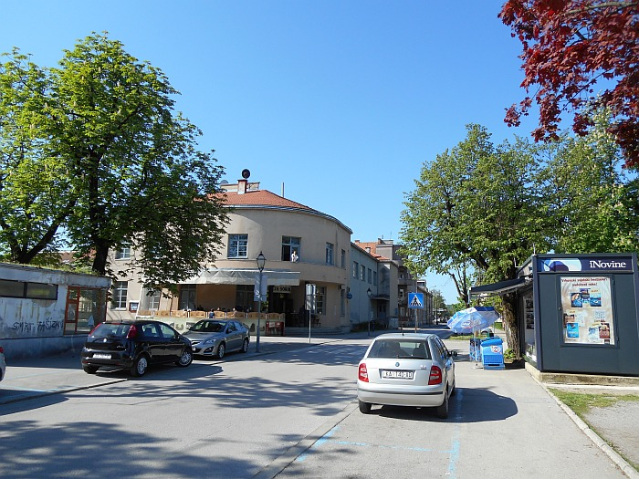
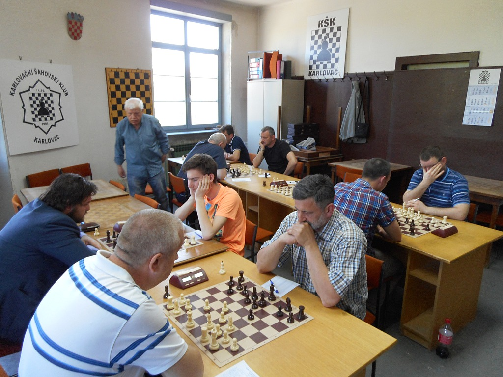

**Seniori, 4. kolo  
  
**Zasluženu pobjedu odnijela je ekipa Karlovačkog šahovskog kluba u četvrtom kolu seniorske lige. Igrači obje ekipe su bili prilično rastreseni u današnjem meču. Na prvoj ploči Jura je nekorektno dao kvalitetu. Pješaka je ostavio Stipe zbog krivog izračuna. Darkov protivnik na trećoj ploči je također nepotrebno dao kvalitetu. Zvjezdanov protivnik je pak zaboravio ugasiti mobitel. Cvetko je remizirao nakon samo desetak poteza, a Ivan je na šestoj ploči pogrešno ocijenio poziciju jer je uprkos lovačkom paru bio u podređenoj poziciji. Uz to, opet je ušao u vremenski tjesnac. Time smo ubilježili i drugi poraz i nakon četiri kola imamo samo dva meč-boda. Vrijeme je bilo lijepo i sunčano, a nakon meča smo uz klopu i cugu proslavili ovogodišnje Jurjevo. Sljedeći meč igra se 6. svibnja kada nam u goste dolazi ŠK Silent.

<table><tbody><tr><td></td><td></td><td>&nbsp;<strong>&nbsp;Karlovački šahovski klub, Karlovac</strong></td><td><strong>–</strong></td><td><strong>&nbsp;</strong></td><td><strong>&nbsp;&nbsp;ŠK Odra, Zagreb</strong></td><td><strong>3½:2½</strong></td></tr><tr><td>1.</td><td>MK</td><td><table><tbody><tr><td></td><td>Brkić, Đorđe</td></tr></tbody></table></td><td>–</td><td>MK</td><td><table><tbody><tr><td></td><td>Bačurin, Juraj</td></tr></tbody></table></td><td>1 – 0</td></tr><tr><td>2.</td><td>MK</td><td><table><tbody><tr><td></td><td>Bedić, Željko</td></tr></tbody></table></td><td>–</td><td>MK</td><td><table><tbody><tr><td></td><td>Maravić, Stjepan</td></tr></tbody></table></td><td>1 – 0</td></tr><tr><td>3.</td><td>I</td><td><table><tbody><tr><td></td><td>Conjar, Velimir</td></tr></tbody></table></td><td>–</td><td>MK</td><td><table><tbody><tr><td></td><td>Vidaković, Darko</td></tr></tbody></table></td><td>0 – 1</td></tr><tr><td>4.</td><td>II</td><td><table><tbody><tr><td></td><td>Drvar, Izidor</td></tr></tbody></table></td><td>–</td><td>MK</td><td><table><tbody><tr><td></td><td>Karlić, Zvjezdan</td></tr></tbody></table></td><td>0 – 1</td></tr><tr><td>5.</td><td>II</td><td><table><tbody><tr><td></td><td>Jusufi, Denis</td></tr></tbody></table></td><td>–</td><td>MK</td><td><table><tbody><tr><td></td><td>Cvetković, Ivan</td></tr></tbody></table></td><td>½ – ½</td></tr><tr><td>6.</td><td>III</td><td><table><tbody><tr><td></td><td>Žibrat, Matija</td></tr></tbody></table></td><td>–</td><td>II</td><td><table><tbody><tr><td></td><td>Maravić, Ivan</td></tr></tbody></table></td><td>1 – 0</td></tr></tbody></table>
