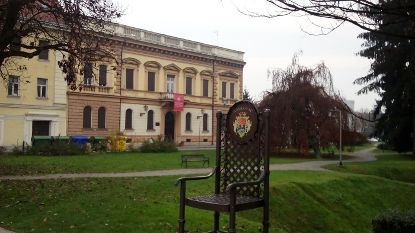
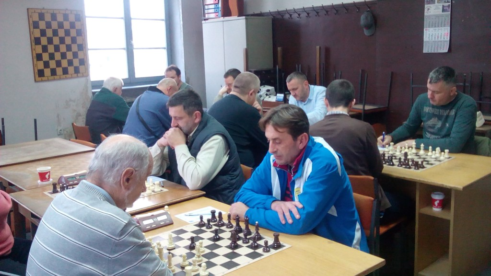
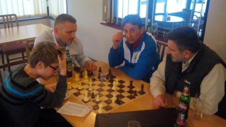
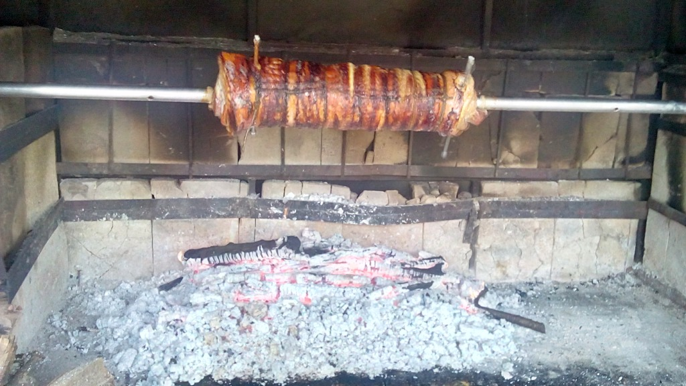

**Seniori, 11. kolo  
  
**Težak poraz doživjela je danas seniorska ekipa ŠK Odra. Na gostovanju u Karlovcu domaćin je zasluženo odnio meč-bodove pokazavši ipak više znanja, strpljivosti i šahovskog umijeća. Poraz nam je teško pao jer smo bili uvjereni u veće mogućnosti prve ekipe te da pobjedom u posljednjem kolu osiguravamo ostanak u ligi. Ipak, ŠK Bosak, vodeća ekipa lige, neočekivano je poražen od našega glavnoga konkurenta u borbi za ostanak, ŠK Vrbani, tako da ni pobjeda nad Karlovcem ne bi promijenila stanje na tablici.   
Jura je nekako uspio izjednačiti, ali tada nije uočio mogućnost da zaigra i na pobjedu te je sklopljen remi. Zvjezdan je danas ubilježio jedinu pobjedu uspjevši u središnjici dogurati pješaka do sedmog reda i staviti protivnika pred nerješive probleme. Cvetko je odigrao neuobičajeno loše, ne poštujući osnovna načela razvoja, i nakon toga još grubo previdio neobranjiv napad na f2. Ljubić je uspio previdjeti damu. Stipe je prihvatio remi u mnogo slabijoj poziciji. Darko je previdio uzeti besplatnog pješaka, poslije ipak stekao materijalnu prednost, ali to nije bilo dovoljno za više od podjele bodova.  
Nakon meča analizirane su partije te je organiziran tradicionalni domjenak po završetku lige, okvirno su dogovarani planovi za V. ligu glede sastava, u koji bi možda trebalo početi i više nego ove godine uključivati mlađu generaciju. Ove godine ligu su sa solidnim rezultatima uglavnom iznijeli Stipe, Jura, Darko i Cvetko, dok su preostali članovi ili nedovoljno igrali ili podbacili u rezultatu. Zasad moramo čekati da  mlađi igrači sazriju i počnu donositi bodove.

KARLOVAČKI ŠK – ŠK ODRA  3,5:2,5

1.MK Brkić, Đorđe – MK Ljubić, Ivan 1:0  
2.MK Drvodelić, Miroslav – MK Karlić, Zvjezdan 0:1  
3.II Jusufi, Denis – MK Maravić, Stjepan 1/2  
4.II Drvar, Izidor – MK Vidaković, Darko  1/2  
5.III Gojmerac, Dragutin – MK Bačurin, Juraj 1/2  
6.I Gržičić, Zlatko – MK Cvetković, Ivan 1:0

   

Tablica lige, 2015.

| Mj. | Momčad | 1 | 2 | 3 | 4 | 5 | 6 | 7 | 8 | 9 | 10 | 11 | 12 |  MB | PB |
| --- | --- | --- | --- | --- | --- | --- | --- | --- | --- | --- | --- | --- | --- | --- | --- |
| 1 | ŠK Stjepan Bosak |  \*  | 3 | 6 | 4½ | 4½ | 5 | 4 | 4 | 3 | 2½ | 5 | 4½ | 18 | 46 |
| 2 | ŠK Končar | 3 |  \*  | 3½ | 2½ | 2 | 3½ | 3½ | 4 | 5 | 4 | 4½ | 4½ | 17 | 40 |
| 3 | ŠK INA | 0 | 2½ |  \*  | 3½ | 4 | 3½ | 4½ | 3 | 4½ | 3½ | ½ | 4½ | 15 | 34 |
| 4 | ŠK Dugo Selo | 1½ | 3½ | 2½ |  \*  | 2½ | 2½ | 4 | 3 | 3½ | 3½ | 4½ | 4 | 13 | 35 |
| 5 | ŠK Špansko | 1½ | 4 | 2 | 3½ |  \*  | 2½ | 2 | 4½ | 3½ | 2½ | 3 | 4 | 11 | 33 |
| 6 | Karlovački ŠK | 1 | 2½ | 2½ | 3½ | 3½ |  \*  | 2 | 1½ | 4 | 3½ | 3½ | 3 | 11 | 30.5 |
| 7 | ŠK Prigorje | 2 | 2½ | 1½ | 2 | 4 | 4 |  \*  | 4 | 2 | 2½ | 4½ | 4½ | 10 | 33.5 |
| 8 | ŠK Silent | 2 | 2 | 3 | 3 | 1½ | 4½ | 2 |  \*  | 3 | 4 | 4 | 3 | 10 | 32 |
| 9 | ŠK Klaka | 3 | 1 | 1½ | 2½ | 2½ | 2 | 4 | 3 |  \*  | 3½ | 4 | 4½ | 10 | 31.5 |
| 10 | ŠK Vrbani | 3½ | 2 | 2½ | 2½ | 3½ | 2½ | 3½ | 2 | 2½ |  \*  | 1 | 3½ | 8 | 29 |
| 11 | ŠK Odra | 1 | 1½ | 5½ | 1½ | 3 | 2½ | 1½ | 2 | 2 | 5 |  \*  | 2½ | 5 | 28 |
| 12 | ŠK Jaska | 1½ | 1½ | 1½ | 2 | 2 | 3 | 1½ | 3 | 1½ | 2½ | 3½ |  \*  | 4 | 23.5 |

Pojedinačni rezultati, liga 2015.

| Bo. |   | Ime | RtgI | RtgN | 1 | 2 | 3 | 4 | 5 | 6 | 7 | 8 | 9 | 10 | 11 | Bod. | Partije |
| --- | --- | --- | --- | --- | --- | --- | --- | --- | --- | --- | --- | --- | --- | --- | --- | --- | --- |
| 1 | MK | Ljubić Ivan | 2201 | 2148 |  | 0 |  |  |  |  | 0 |  |  | 1 | 0 | 1 | 4 |
| 2 | MK | Karlić Zvjezdan | 2182 | 2150 | 1 |  |  |  |  | 0 | ½ |  |  | 1 | 1 | 3.5 | 5 |
| 3 | MK | Maravić Stjepan | 2099 | 2088 | ½ | 1 | ½ | 0 | 0 | ½ | 0 | 0 | ½ | 1 | ½ | 4.5 | 11 |
| 4 | MK | Vidaković Darko | 2121 | 2096 | 1 | ½ |  | 0 | 1 | ½ | 1 | ½ | 0 | 1 | ½ | 6 | 10 |
| 5 | MK | Bačurin Juraj | 2082 | 2056 | 1 |  | 1 | ½ | 1 | 0 |  | ½ | 1 | ½ | ½ | 6 | 9 |
| 7 | MK | Cvetković Ivan | 1970 | 1960 | ½ | 0 |  | 0 | 1 | ½ | 1 | ½ | ½ | 1 | 0 | 5 | 10 |
| 8 | IV | Kobali Borislav | 1645 | 1678 |  | 0 | 0 | 0 |  |  |  | 0 | 0 |  |  | 0 | 5 |
| 9 | IV | Maravić Ivan | 1442 | 1683 | 1 | 0 | 0 | ½ | 0 | ½ | 0 | 0 | 0 |  |  | 2 | 9 |
| 10 |  | Furčić Tin | 0 | 1658 |  |  | 0 |  |  |  |  |  |  |  |  | 0 | 1 |
| 13 |  | Cvetković Božo | 0 | 1639 |  |  | 0 |  | 0 |  |  |  |  |  |  | 0 | 2 |
