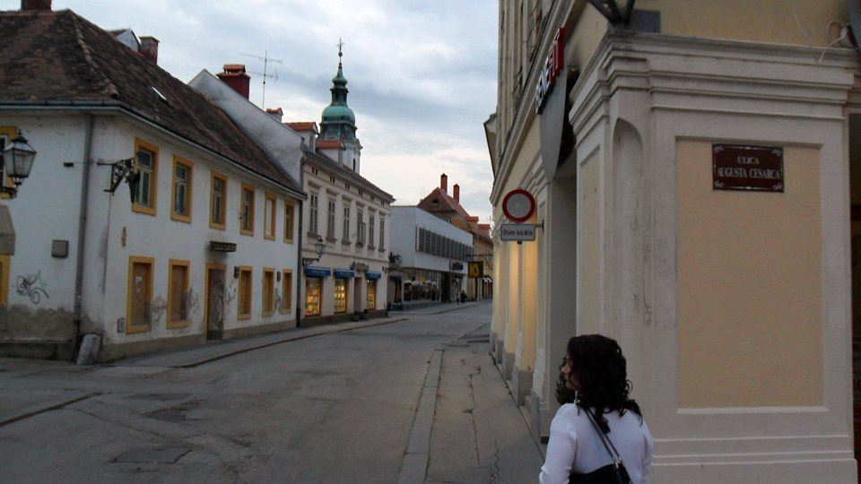
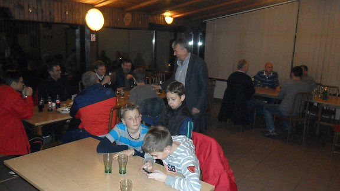
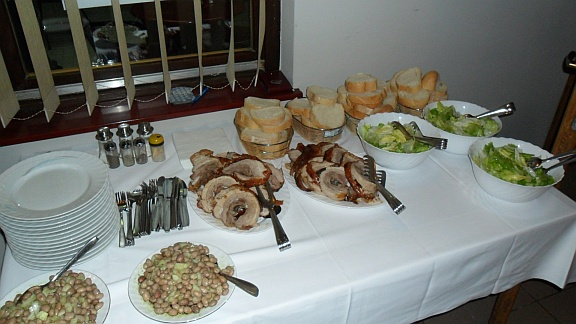

**Seniori, 11. kolo**

U prošlu nedjelju završena je seniorska liga za 2014. Bez previše zalaganja standardnih igrača, ekipa je doživjela poraz od iskusne ekipe Karlovačkoga ŠK. Ipak, konačni rezultat time se nije znatno promijenio i liga je završena u gornjoj polovici tablice. U finišu se ekipa iz Zaprešića uspjela, uz HRT, probiti u viši rang natjecanja. U petak je u Maloj Mlaki održana mala zakuska (carsko s ražnja!) i druženje u povodu završetka lige. Sljedeće godine nadamo se ulasku u viši rang i, umjesto carskoga, nečemu što je blejalo! 🙂

**Karlovački ŠK, Karlovac –  ŠK Odra, Zagreb    4 : 2**  
1\. MK Brkić, Đorđe 2109 – MK Maravić, Stjepan 2115 ½ – ½  
2. II Jusufi, Denis 1932 – MK Brajdić, Danko 2125 ½ – ½  
3. MK Drvodelić, Miroslav 2037 – MK Cvetković, Ivan 1981 ½ – ½  
4\. II Drvar, Izidor 1892 – MK Bačurin, Juraj 2063 ½ – ½  
5\. II Conjar, Velimir 1943 – Kobali, Borislav 1668 1 – 0  
6\. Žibrat, Matija 1802 – IV Maravić, Ivan 1538 1 – 0

 

| Mj. | Momčad | 1 | 2 | 3 | 4 | 5 | 6 | 7 | 8 | 9 | 10 | 11 | 12 | TB1 | TB2 |
| --- | --- | --- | --- | --- | --- | --- | --- | --- | --- | --- | --- | --- | --- | --- | --- |
| 1 | ŠK HRT | \* | 3 | 4 | 3 | 3½ | 4 | 3 | 4 | 4 | 3½ | 4½ | 4½ | 19 | 41.0 |
| 2 | ŠK Zaprešić | 3 | \* | 1½ | 3 | 6 | 4½ | 4½ | 3 | 4 | 4½ | 4 | 3½ | 17 | 41.5 |
| 3 | ŠK Končar | 2 | 4½ | \* | 4 | 1½ | 3½ | 4 | 3½ | 4½ | 3 | 4 | 4½ | 17 | 39.0 |
| 4 | **ŠK Odra** | 3 | 3 | 2 | \* | 5 | 2 | 5 | 3½ | 2 | 5 | 4 | 4 | 14 | 38.5 |
| 5 | ŠK Dugo Selo | 2½ | 0 | 4½ | 1 | \* | 2 | 4½ | 5½ | 5 | 4½ | 4 | 4 | 14 | 37.5 |
| 6 | ŠK Špansko | 2 | 1½ | 2½ | 4 | 4 | \* | 3 | 1½ | 4½ | 5 | 4½ | 4½ | 13 | 37.0 |
| 7 | ŠK INA | 3 | 1½ | 2 | 1 | 1½ | 3 | \* | 3 | 4½ | 4½ | 3 | 4½ | 10 | 31.5 |
| 8 | ŠK Vrbani, Zagreb | 2 | 3 | 2½ | 2½ | ½ | 4½ | 3 | \* | 2½ | 4 | 4½ | 3 | 9 | 32.0 |
| 9 | Karlovački ŠK | 2 | 2 | 1½ | 4 | 1 | 1½ | 1½ | 3½ | \* | 3 | 4½ | 4½ | 9 | 29.0 |
| 10 | ŠK Jaska | 2½ | 1½ | 3 | 1 | 1½ | 1 | 1½ | 2 | 3 | \* | 3 | 3½ | 5 | 23.5 |
| 11 | ŠK Ban Jelačić | 1½ | 2 | 2 | 2 | 2 | 1½ | 3 | 1½ | 1½ | 3 | \* | 4½ | 4 | 24.5 |
| 12 | ŠK Maksimir | 1½ | 2½ | 1½ | 2 | 2 | 1½ | 1½ | 3 | 1½ | 2½ | 1½ | \* | 1 | 21.0 |

v.d.
