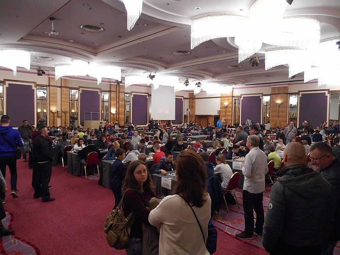
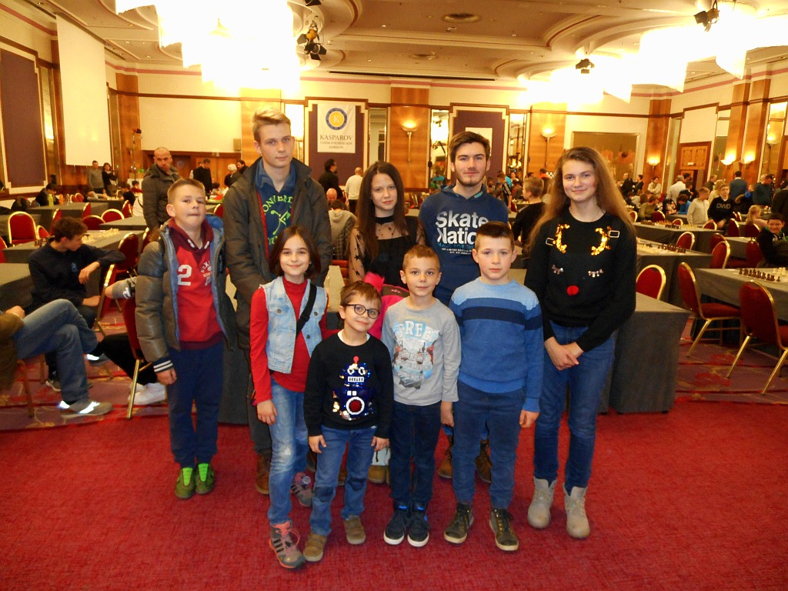
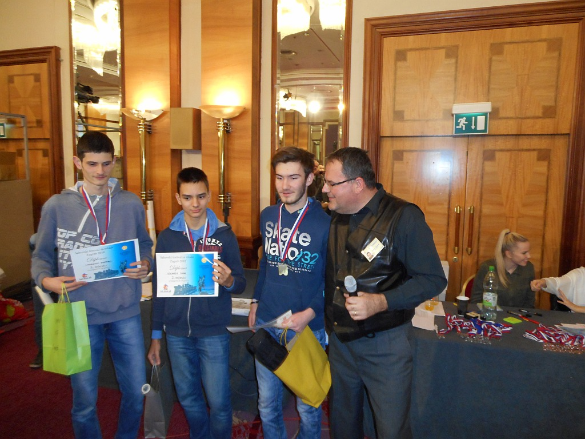

U subotu, 29. prosinca, u Kristalnoj dvorani hotela Westin u Zagrebu održan je Šahovski festival za mlade, Zagreb 2018. Ovaj festival pod pokroviteljstvom [Kasparov šahovske zaklade Adriatic](http://kcfadriatic.com/hr/pocetna/)  činilo je šest turinira. Tri rapid turnira; U10, U13 i U16 na tempo igre 10+0 te tri turnira “Šah uz školu”, U9, U12 i U15 gdje su partije igrane bez vremenske kontrole, a partije su bile ograničene na 20 minuta. Rezultati svih turnira mogu se naći na [Chess-result serveru](http://chess-results.com/tnr403045.aspx?lan=1&art=4). Od naših igrača nastupili su Višeslav, Ivan P., Antonio, Slavko, Botica, Luka F., Samanta, Ana, Vraneša i Ivan M. Od važnijih rezultata treba istaknuti impresivnih tri boda koje je ostvario Slavko na turniru U9, zatim tri boda Luke F. na turniru U13 te svakako, najveći uspjeh, **prvo mjesto Ivana Maravića na turniru U16** ispred imenjaka iz Bugarske, Ivana Kochieva i BiH predstavnika Marka Ninkovića.  Ivan je i [prošle godine](/novosti/medunarodni-sahovski-festival-za-mlade-zagreb-2017/) bio pobjednik, ali na turniru U13. Ana i Samanta su uvidjele da moraju još pojačati trening i više nastupati na turnirima. Višeslav je uspješno odradio sve partije bez odustajanja, ali još uvijek igra prebrzo. Braća Matašić i sestre Kolovrat ovaj puta nisu nastupili, ali se nadam da neće propustiti prvu sljedeću priliku.  
     
