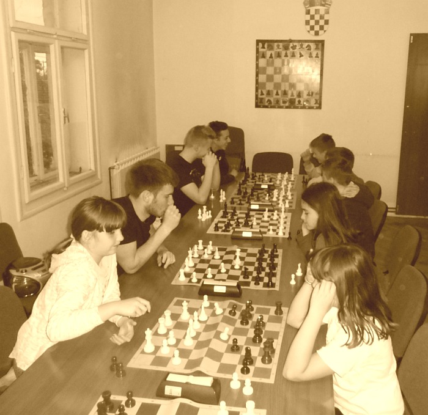
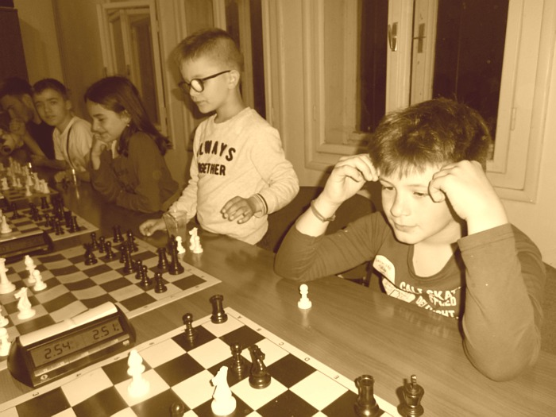

<table><tbody><tr><td><strong>&nbsp;KJ</strong></td><td><strong>IME</strong></td><td><strong>1.</strong></td><td><strong>2.</strong></td><td><strong>3.</strong></td><td><strong>4.</strong></td><td><strong>5.</strong></td><td><strong>6.</strong></td><td><strong>7.</strong></td><td><strong>8.</strong></td><td><strong>9.</strong></td><td><strong>10.</strong></td><td><strong>BOD.</strong></td><td><strong>MJESTO</strong></td></tr><tr><td><strong>1.</strong></td><td>&nbsp;Luka F</td><td></td><td>1</td><td>1</td><td>0</td><td>1</td><td>1</td><td>1</td><td>1</td><td>1</td><td>0</td><td>6</td><td>I.</td></tr><tr><td><strong>2.</strong></td><td>&nbsp;Vraneša</td><td>0</td><td></td><td>1</td><td>0</td><td>1</td><td>1</td><td>1</td><td>1</td><td>1</td><td>1</td><td>1</td><td>II.</td></tr><tr><td><strong>3.</strong></td><td>&nbsp;Filip</td><td>0</td><td>0</td><td></td><td>1/2</td><td>0</td><td>1</td><td>0</td><td>0</td><td>1</td><td>0</td><td>2</td><td></td></tr><tr><td><strong>4.</strong></td><td>&nbsp;Maravić</td><td>1</td><td>1</td><td>1/2</td><td></td><td>1</td><td>1/2</td><td>1</td><td>1</td><td>1</td><td>1</td><td>2</td><td>I.</td></tr><tr><td><strong>5.</strong></td><td>&nbsp;F&nbsp;Ivana</td><td>0</td><td>0</td><td>1</td><td>0</td><td></td><td>1</td><td>1</td><td>0</td><td>1</td><td>0</td><td>4</td><td>II.</td></tr><tr><td><strong>6.</strong></td><td>&nbsp;F Lucija</td><td>0</td><td>0</td><td>0</td><td>1/2</td><td>0</td><td></td><td>0</td><td>1/2</td><td>1</td><td>0</td><td>1,5</td><td></td></tr><tr><td><strong>7.</strong></td><td>&nbsp;Botica</td><td>0</td><td>0</td><td>1</td><td>0</td><td>0</td><td>1</td><td></td><td>1</td><td>1</td><td>0</td><td>4</td><td>III.</td></tr><tr><td><strong>8.</strong></td><td>&nbsp;Visko</td><td>0</td><td>0</td><td>1</td><td>0</td><td>1</td><td>1/2</td><td>0</td><td></td><td>1</td><td>0</td><td>3,5</td><td></td></tr><tr><td><strong>9.</strong></td><td>&nbsp;Slavko</td><td>0</td><td>0</td><td>0</td><td>0</td><td>0</td><td>0</td><td>0</td><td>0</td><td></td><td>0</td><td>0</td><td></td></tr><tr><td><strong>10.</strong></td><td>&nbsp;Božo</td><td>1</td><td>0</td><td>1</td><td>0</td><td>1</td><td>1</td><td>1</td><td>1</td><td>1</td><td></td><td>0</td><td>III.</td></tr></tbody></table>

Jučer je odigran pozivni kadetsko juniorski turnir na tempo 3+2. Nastupilo je deset članova, a iako je turnir bio zajednički, bodovale su se dvije skupine, juniori i kadeti. Vraneša i Maravić su hrabro uskočili na juniorski turnir te se uz to čak i popeli na postolje! U kadetskoj skupini Luka je bio uvjerljivo najbolji te osvojio kekse za prvo mjesto, koje je velikodušno podijelio sa ostalim učesnicima, posebno sa Vranešom koji je bio neutješan nakon poraza u međusobnom ogledu.  
Još se nisu svi priključili, ali se nadam da će se i ostatak ekipe uskoro ohrabriti. Raspoloženje je bilo dobro, igralo se po modificiranim FIDE pravilima gdje suza protivnika donosi duple bodove, ali nitko nije uspio iskoristiti taj bonus. Nepravilan potez je umjesto dodatne minute donosio čvoku protivniku, a taj bonus su mnogi iskoristili.  🙂 Čestitke svima na hrabroj igri, a posebno pobjednicima, Luki i Maraviću.

