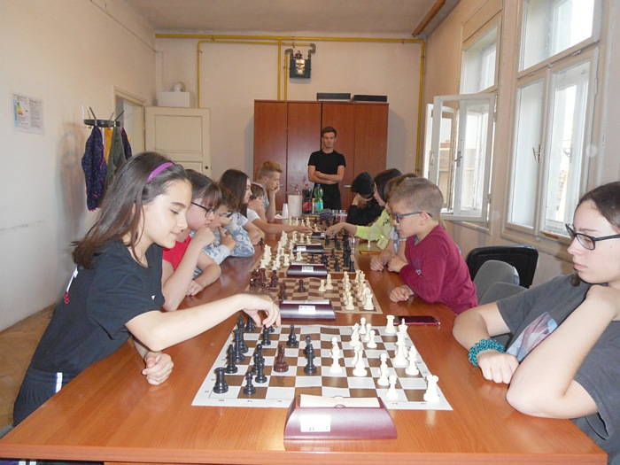
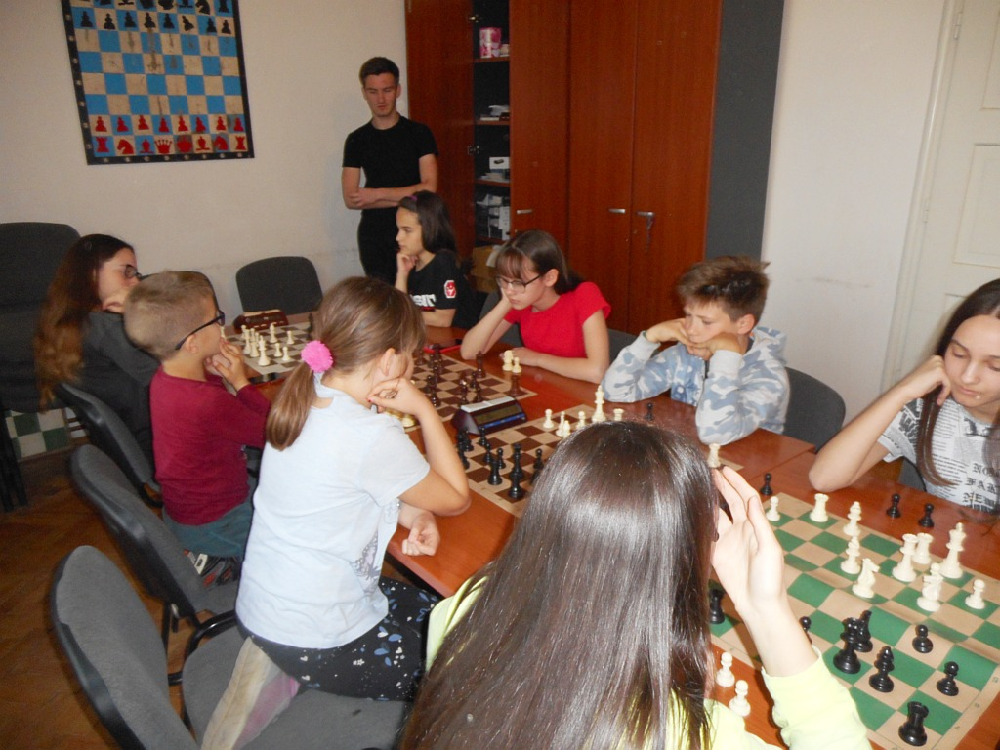
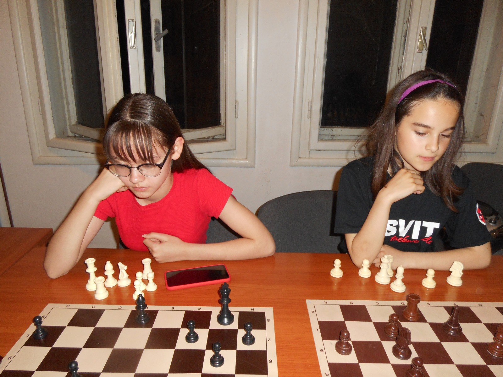

<table><tbody><tr><td><strong>&nbsp;KK</strong></td><td><strong>IME</strong></td><td><strong>1.</strong></td><td><strong>2.</strong></td><td><strong>3.</strong></td><td><strong>4.</strong></td><td><strong>5.</strong></td><td><strong>6.</strong></td><td><strong>7.</strong></td><td><strong>8.</strong></td><td><strong>9.</strong></td><td><strong>10.</strong></td><td><strong>11.</strong></td><td><strong>12.</strong></td><td><strong>BOD.</strong></td><td><strong>MJESTO</strong></td></tr><tr><td><strong>1.</strong></td><td>&nbsp;Vraneša</td><td></td><td>1</td><td>1</td><td>1</td><td>1</td><td>1</td><td>1</td><td>0</td><td>1</td><td>1</td><td>1</td><td>1</td><td><strong>10</strong></td><td>I.</td></tr><tr><td><strong>2.</strong></td><td>&nbsp;Ana</td><td>0</td><td></td><td>1</td><td>1</td><td>0</td><td>1</td><td>1</td><td>1</td><td>1</td><td>0</td><td>1</td><td>0</td><td><strong>7</strong></td><td></td></tr><tr><td><strong>3.</strong></td><td>&nbsp;Filip</td><td>0</td><td>0</td><td></td><td>0</td><td>0</td><td>1</td><td>1</td><td>0</td><td>0</td><td>0</td><td>1</td><td>1/2</td><td><strong>3,5</strong></td><td></td></tr><tr><td><strong>4.</strong></td><td>&nbsp;Samanta</td><td>0</td><td>0</td><td>1</td><td></td><td>1</td><td>1</td><td>1</td><td>0</td><td>1</td><td>1</td><td>1</td><td>0</td><td><strong>7</strong></td><td></td></tr><tr><td><strong>5.</strong></td><td>&nbsp;F&nbsp;Ivana</td><td>0</td><td>1</td><td>1</td><td>0</td><td></td><td>1</td><td>1</td><td>1</td><td>1</td><td>1/2</td><td>0</td><td>1</td><td><strong>7,5</strong></td><td>II.-III.</td></tr><tr><td><strong>6.</strong></td><td>&nbsp;Lucija</td><td>0</td><td>0</td><td>0</td><td>0</td><td>0</td><td></td><td>1</td><td>0</td><td>0</td><td>0</td><td>1</td><td>1</td><td><strong>3</strong></td><td></td></tr><tr><td><strong>7.</strong></td><td>&nbsp;Botica</td><td>0</td><td>0</td><td>0</td><td>0</td><td>0</td><td>0</td><td></td><td>0</td><td>0</td><td>1</td><td>1</td><td>0</td><td><strong>2</strong></td><td></td></tr><tr><td><strong>8.</strong></td><td>&nbsp;Visko</td><td>1</td><td>0</td><td>1</td><td>1</td><td>0</td><td>1</td><td>1</td><td></td><td>1</td><td>0</td><td>0</td><td>0</td><td><strong>6</strong></td><td></td></tr><tr><td><strong>9.</strong></td><td>&nbsp;Slavko</td><td>0</td><td>0</td><td>1</td><td>0</td><td>0</td><td>1</td><td>1</td><td>0</td><td></td><td>0</td><td>0</td><td>0</td><td><strong>3</strong></td><td></td></tr><tr><td><strong>10.</strong></td><td>&nbsp;Monika</td><td>0</td><td>1</td><td>1</td><td>0</td><td>1/2</td><td>1</td><td>0</td><td>1</td><td>1</td><td></td><td>1</td><td>1</td><td><strong>7,5</strong></td><td>II.-III.</td></tr><tr><td><strong>11.</strong></td><td>&nbsp;F Lucija</td><td>0</td><td>0</td><td>0</td><td>0</td><td>1</td><td>0</td><td>0</td><td>1</td><td>1</td><td>0</td><td></td><td>1</td><td><strong>4</strong></td><td></td></tr><tr><td><strong>12.</strong></td><td>&nbsp;Franka</td><td>0</td><td>1</td><td>1/2</td><td>1</td><td>0</td><td>0</td><td>1</td><td>1</td><td>1</td><td>0</td><td>0</td><td></td><td><strong>5,5</strong></td><td></td></tr></tbody></table>

Na jučer odigranom Klupskom turniru kadeta (i kadetkinja!) Vraneša je iskoristio činjenicu da na turniru nije nastupio Luka Fiolić te se lagano prošetao do postolja i osvojio čokoladu, koju nije želio podijeliti. Jedini poraz pretrpio je od Višeslava, ne zbog loše igre, nego iz neopreznosti. Pala mu je zastavica. Višeslav se izvukao iz teške pozicije i protiv Samante i glasno proslavio neočekivani mat. Botica je imala loš dan i iako je na prošlom turniru bila na postolju, na ovom je završila na dnu ljestvice. Za neupućene neočekivano, na postolje se popela Ivana koja je podijelila 2.-3. mjesto sa Monikom. Slavko je uspio uzvratiti Filipu za prošlotjedni poraz i napokon upisati prve bodove. Ana je bila loše volje, ali je svejedno odigrala dobar turnir.  
Kvaliteta odigranih partija je bila nešto lošija, jer zadnjih mjeseci mnogi nisu vježbali. Turnir je sudio Ivan, premda još uvijek bez sudačke licence. U posljednje vrijeme pokazuje ozbiljne ambicije za suđenje koje je na ovom turniru bilo na visokoj razini. Postignut je i okvirni dogovor oko nastupa na kadetskom PH pa se možda svi malo trgnu i počnu ozbiljnije pripreme.  
  
