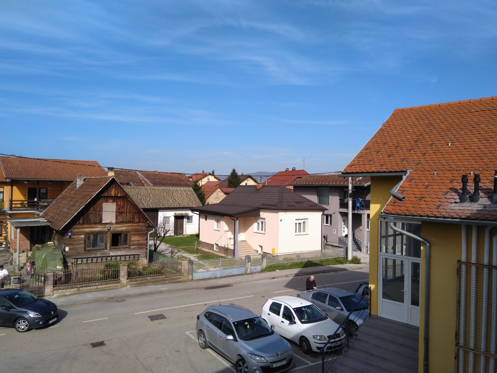

  
Prošlu nedjelju je završila [seniorska liga](https://chess-results.com/tnr886630.aspx?lan=13) u kojoj smo ostali s dva remija u zadnja dva kola. Iako smo i ove godine bili u grčevitoj borbi za opstanak, bolje smo ju odradili nego prošlih godina. Igra je bila nešto bolja, samo je rezultat izostajao. Dobili smo dva velika pojačanja u Ivi Pahljini i Ivani Mikić. Također, od ostalih naših igrača, rezultatski su se u pozitivnom smislu istaknuli Darko, Mladen i donekle Ivan Maravić. Podbacili su Zvjezdan, Hrvoje i Stjepko. Ivan Vraneša je pokazao puno više zalaganja i želje nego prošlih godina te se vidi i određen napredak u igri. Nadamo se da će tako nastaviti. Cvetko i Jura nisu pokazali dovoljno zalaganja te vjerujemo da ćemo ih već iduće godine vidjeti češće za pločom. Nakon zadnjega kola smo imali tradicionalnu zakusku. Nadamo se da ćemo iduće godine biti bolji nego ove te da nećemo (već tradicionalno) morati strepiti do zadnjega kola o našoj budućnosti.

##### 9\. ŠK Odra, Zagreb (TB1:9 / TB2:32)

<table><tbody><tr><td><strong>Pl.</strong></td><td></td><td><strong>Ime</strong></td><td><strong>1</strong></td><td><strong>2</strong></td><td><strong>3</strong></td><td><strong>4</strong></td><td><strong>5</strong></td><td><strong>6</strong></td><td><strong>7</strong></td><td><strong>8</strong></td><td><strong>9</strong></td><td><strong>10</strong></td><td><strong>11</strong></td><td><strong>Bod.</strong></td><td><strong>Partije</strong></td></tr><tr><td>1</td><td>MK</td><td>Karlić Zvjezdan</td><td>0</td><td></td><td>0</td><td>0</td><td></td><td>0</td><td>½</td><td>½</td><td>1</td><td></td><td>½</td><td>2,5</td><td>8</td></tr><tr><td>2</td><td>MK</td><td>Maravić Ivan</td><td>½</td><td>½</td><td>1</td><td></td><td>½</td><td>1</td><td>½</td><td>½</td><td>½</td><td>0</td><td>½</td><td>5,5</td><td>10</td></tr><tr><td>3</td><td>MK</td><td>Maravić Stjepan</td><td>½</td><td>½</td><td>½</td><td></td><td>½</td><td>½</td><td>0</td><td>½</td><td>0</td><td>½</td><td>½</td><td>4</td><td>10</td></tr><tr><td>4</td><td>MK</td><td>Sliepčević Mladen</td><td></td><td>1</td><td></td><td>½</td><td>1</td><td>0</td><td>½</td><td>1</td><td>0</td><td>1</td><td>½</td><td>5,5</td><td>9</td></tr><tr><td>5</td><td>MK</td><td>Vidaković Darko</td><td>1</td><td>0</td><td>0</td><td>1</td><td></td><td>1</td><td>1</td><td></td><td></td><td>1</td><td>½</td><td>5,5</td><td>8</td></tr><tr><td>6</td><td>MK</td><td>Kovač Hrvoje</td><td>0</td><td>0</td><td></td><td></td><td></td><td></td><td></td><td></td><td>0</td><td></td><td>½</td><td>0,5</td><td>4</td></tr><tr><td>7</td><td>MK</td><td>Cvetković Ivan</td><td></td><td></td><td></td><td></td><td>½</td><td></td><td>0</td><td></td><td></td><td></td><td></td><td>0,5</td><td>2</td></tr><tr><td>8</td><td>MK</td><td>Bačurin Juraj</td><td></td><td>0</td><td></td><td></td><td></td><td></td><td></td><td></td><td></td><td></td><td></td><td>0</td><td>1</td></tr><tr><td>10</td><td></td><td>Mikić Ivana</td><td></td><td></td><td></td><td>1</td><td>0</td><td></td><td></td><td>1</td><td></td><td></td><td></td><td>2</td><td>3</td></tr><tr><td>11</td><td>II</td><td>Pahljina Ivo</td><td></td><td></td><td>½</td><td>1</td><td>0</td><td>1</td><td></td><td></td><td></td><td>0</td><td></td><td>2,5</td><td>5</td></tr><tr><td>12</td><td>II</td><td>Vraneša Ivan</td><td>1</td><td></td><td>0</td><td>1</td><td></td><td></td><td></td><td>1</td><td>0</td><td>½</td><td></td><td>3,5</td><td>6</td></tr></tbody></table>

*IvanM*
