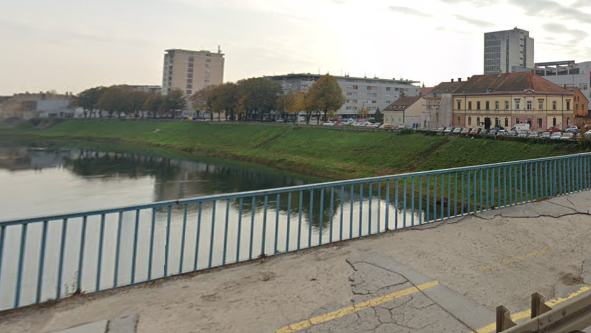

###### Seniori – II. ekipa, 4.kolo



Ove nedjelje ŠK Odra II gostovala je kod ekipe ŠK Karlovac II. Iako su krenuli puni nade i energije, rezultat na kraju nije bio na njihovoj strani – domaćini su slavili rezultatom 3.5:2.5. Ukratko – potop.

Ekipa je nastupila u sastavu: Božo, Luka Fiolić, Ivana Fiolić, Lucija Fiolić, Goran Fiolić i Slavko. Kapetan Božo, inspiriran morskim ugođajem, zaboravlja svoje otvaranje i već u ranoj fazi partije dopušta protivniku prednost. No, kao pravi kapetan, ne tone odmah – malo po malo vraća se u igru te pobjeđuje partiju. Njegovu partiju donosimo u prilogu.

Luka je remizirao u jednakoj poziciji. Korektno, ali znamo da može više – iduću partiju očekujemo više hrabrosti i borbenosti! Ivana, nažalost, gubi svoju partiju, ali zato Lucija blista – rano osvaja damu i brzo završava posao.

Goran je također pokazao odličnu igru i nadigrao protivnika, no manjak iskustva i vremena na satu stvaraju probleme. U vremenskoj stisci radi nekoliko ključnih pogrešaka i gubi partiju. Slavko je odigrao svoju prvu seniorsku partiju – i to se vidjelo. Dugo je razmišljao, trudio se igrati odgovorno, ali nekoliko pozicijskih pogrešaka i jedan previd vode ga u poraz.

Sve u svemu – teška i naporna nedjelja za drugu ekipu Odre. Ovim porazom padaju na 5. mjesto na tablici. No, prilika za iskupljenje dolazi već iduće kolo, kada igraju doma protiv ŠK Jakovlje. Nadamo se pobjedi, hrabrijim nastupima i povratku na vrh ljestvice!

<table><tbody><tr><td>Pl.</td><td></td><td><strong>KŠK Karlovac II</strong></td><td>–</td><td></td><td><strong>ŠK Odra II</strong></td><td><b>3.5 – 2.5</b></td></tr><tr><td>1.</td><td>&nbsp;IV</td><td>Felić, Dino</td><td>–</td><td>III</td><td>Cvetković, Božo</td><td>0-1</td></tr><tr><td>2.</td><td>&nbsp;IV</td><td>Bradac, Ivor</td><td>–</td><td>IV</td><td>Fiolić, Luka</td><td>1/2-1/2</td></tr><tr><td>3.</td><td>&nbsp;IV</td><td>Bjelivuk, Andrija</td><td>–</td><td>&nbsp;II</td><td>Fiolić, Ivana</td><td>1-0</td></tr><tr><td>4.</td><td></td><td>Bosiljevac, Bruno</td><td>–</td><td>III</td><td>Fiolić, Lucija</td><td>0-1</td></tr><tr><td>5.</td><td>&nbsp;IV</td><td>Blažina, Leo</td><td>–</td><td>&nbsp;II</td><td>&nbsp;Fiolić, Goran</td><td>1-0</td></tr><tr><td>6.</td><td></td><td>Pulja, Branimir</td><td>–</td><td></td><td>Biondić, Slavko</td><td>1-0</td></tr></tbody></table>

```pgn
[Event "5. Liga ŠZŽ Centar 2025"]

[Site "Karlovac"]
[Date "2025.04.27"]
[Round "4"]
[White "IV Felić, Dino (1969)"]
[Black "III Cvetković Božo (1684)"]
[Result "0-1"]

1. e4 Nf6 2. e5 Nd5 3. c4 Nb6 4. d4 d6 5. f4 dxe5 6. fxe5 e6 7. Nf3 c5 8. Nc3 cxd4 9. Bg5 Be7 10. Bxe7 Qxe7 11. Qxd4 Nc6 12. Qg4 g6 13. O-O-O Nd7 14. Qf4 f6 15. exf6 Qxf6 16. Qc7 Qd8 17. Nb5 a6 18. Nd6+ Ke7 19. Nxc8+ Rxc8 20. Qd6+ Ke8 21. Qxe6+ Qe7 22. Qg4 Kd8 23. Be2 Kc7 24. Rhe1 Nc5 25. Bf1 Qf6 26. Qg3+ Kb6 27. Qf2 Rhd8 28. Kb1 Qf5+ 29. Ka1 Nb4 30. Rc1 Rd2 31. Nxd2 { Bijeli nije smio uzeti damom na d2 jer bi dobio forsirani mat u tri poteza!  } (31. Qxd2 Nb3+ 32. axb3 Qa5+ 33. Kb1 Qa2) 31... Qxf2 0-1
```

IvanV
