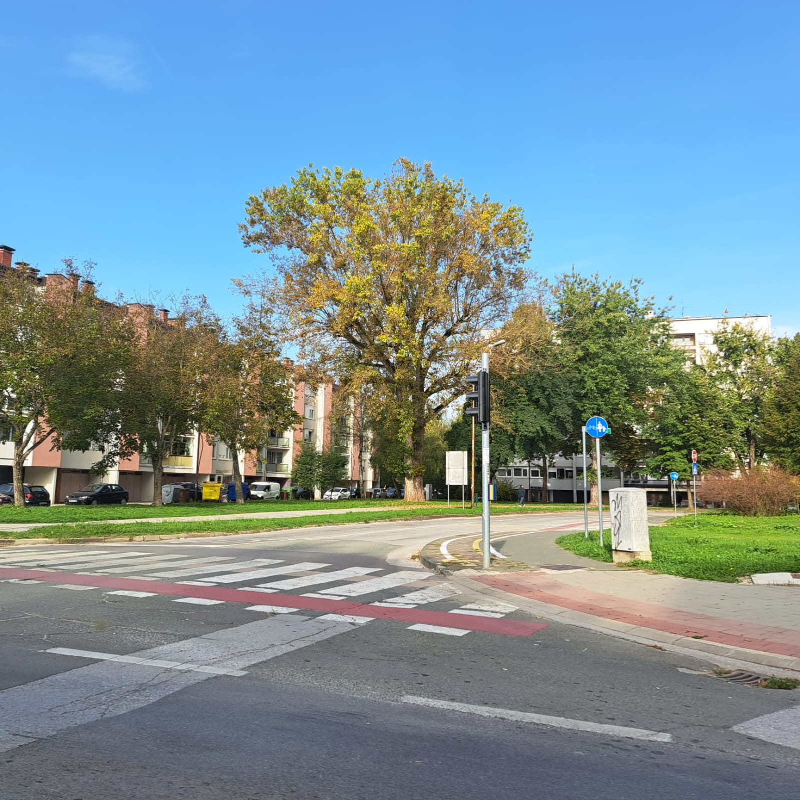

**Seniori, 9. kolo**  

<table><tbody><tr><td>Pl.</td><td></td><td><strong>KŠK Karlovac</strong></td><td>–</td><td></td><td><strong>ŠK Odra</strong></td><td><strong>4,5-1,5</strong></td></tr><tr><td>1.</td><td></td><td>Roška, Branislav 2091</td><td>–</td><td>MK</td><td>Maravić, Ivan 2071</td><td>½–½</td></tr><tr><td>2.</td><td>MK</td><td>Bedić, Željko 2125</td><td>–</td><td>MK</td><td>Maravić, Stjepan 2112</td><td>½–½</td></tr><tr><td>3.</td><td>MK</td><td>Radić, Goran 2102</td><td>–</td><td>MK</td><td>Sliepčević, Mladen 2086</td><td>1-0</td></tr><tr><td>4.</td><td>I</td><td>Conjar, Velimir 2020</td><td>–</td><td>MK</td><td>Cvetković, Ivan 1962</td><td>1-0</td></tr><tr><td>5.</td><td>II</td><td>Jusufi, Denis 1960</td><td>–</td><td>MK</td><td>Bačurin, Juraj 2010</td><td>½–½</td></tr><tr><td>6.</td><td>II</td><td>Žibrat, Matija 1968</td><td>–</td><td>II</td><td>Šutić, Darko 1909</td><td>1-0</td></tr></tbody></table>

Pretpošle nedjelje, po lijepom i sunčanom vremenu, pobijedila nas je ekipa Karlovca kojoj smo redovna mušterija. Tim porazom naše šanse za ostanak u [ligi](https://chess-results.com/tnr730961.aspx?lan=13&art=0) svedene su na minimum. Sada malo o samom tijeku meča, prvi je završio Jura koji je sklopio remi odmah nakon otvaranja. Drugi je završio Stjepko koji je stajao nešto bolje, ali je vjerovao da će ostatak ekipe iznjedriti dobar rezultat. Ivan ubrzo nakon toga gubi zbog previđanja taktike kojom protivnik ostaje s dvije figure protiv topa. Ivan Maravić je na prvoj ploči remizirao, stajao je nešto bolje u jednom dijelu partije, ali to je bilo nedovoljno za cijeli bod. Mladen je ostao na malo vremena u oštroj poziciji, nekorektno je žrtvovao, ali je imao šansu zakomplicirati partiju do razine u kojoj su sva tri rezultata u igri, međutim, bira krivi nastavak i dopušta protivniku izmjenu dama što znači kraj partije. Zadnji je ostao Šutić koji je nakon otvaranja imao podjednaku poziciju, ali je igrao malo neplanski te je oslabio kralja što je njegov protivnik iskoristio. Predzadnje kolo igramo u Maloj Mlaki 22. listopada protiv Oroslavja.
