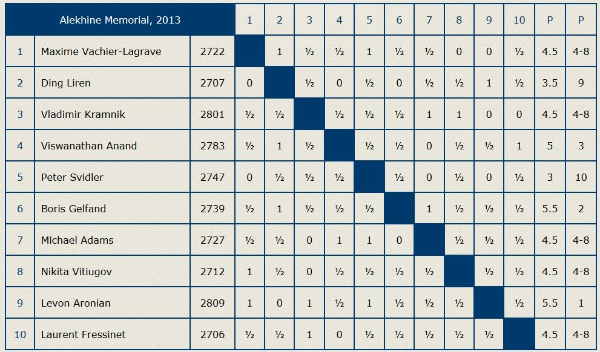

**Levon Aronian** pobjednik je *Aljehinovog memorijala*. Za to ostvarenje bilo mu je potrebno 5,5 bodova, koliko je skupio i **Boris Gelfand,** no presudio je dodatni kriterij (veći broj partija sa crnim figurama i veći broj pobjeda). Treći je **Anand** sa 5 bodova. Uz novčane nagrade dodjeljena su i priznanja: **Laurent Fressinet** za najbolju partiju u Aljehinovom stilu (protiv Kramnika), **Ding Liren** za najbolju kombinatornu partiju (protiv pobjednika turnira), **Gelfand** za najbolju tehniku…

