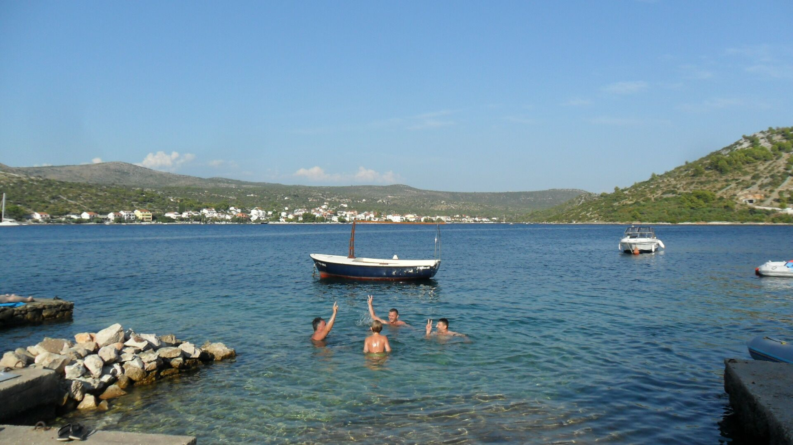
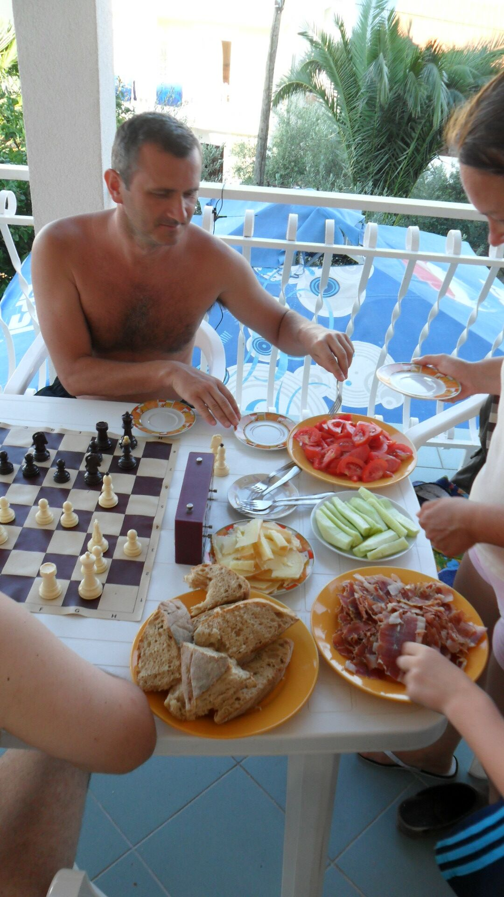

Iako je ljeto predviđeno za odmor, radna tijela ŠK Odra marljivo i bez predaha rade na rješavanju ključnih problema, a sve za boljitak Kluba. Tako je danas u okolici Šibenika održana važna sjednica Predjsedništva na kojoj je opet bila uočljiva međusobna potpora i razumijevanje među članovima uprave, te su se važne odluke donosile jednoglasno. Sjednicu je vodio potpredsjednik Kluba, prof. Stjepan Maravić.

Nakon teške i naporne sjednice slijedila je mala stanka uz prigodni domjenak s drniškim pršutom i paškim sirom. Izraženo je veliko žaljenje što sjednici nisu mogli prisustvovati i ostali članovi… 

