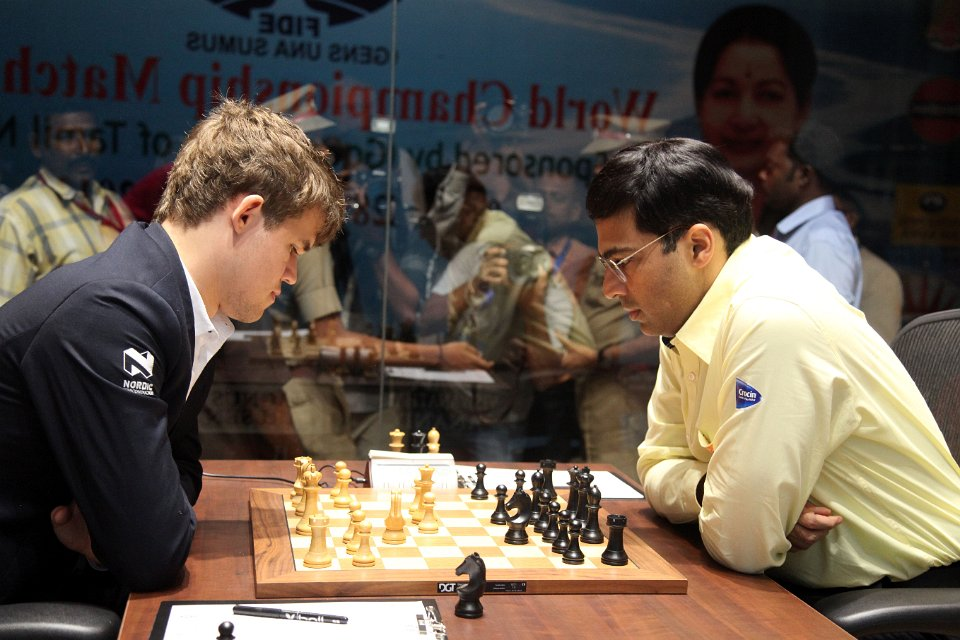

**Magnus Carlsen** je novi svjetski prvak u šahu. Svjetski broj jedan se sa 3 pobjede i bez poraza neočekivano lako obračunao s braniteljem naslova, te već nakon desete partije zaključio meč u svoju korist ukupnim rezultatom 6,5 : 3,5.

Što je sljedeći izazov za njega? Ne znamo, valjda da prebaci rejting 2900 😉
