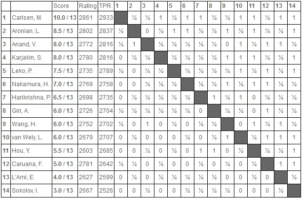

**Magnus Carlsen** pobjednik je turnira *[Tata Steel 2013](http://en.wikipedia.org/wiki/Tata_Steel_Chess_Tournament)*  održanog po 75-i put u *Wijk aan Zee*\-u. Sa osvojenih 10/13 bodova, ukupno 7 pobjeda uz 6 remija, uvjerljivo je osvojio prvo mjesto, čime je izjednačio rekord **Garry Kasparova** iz 1999. godine. Drugo mjesto osvojio je **Lev Aronian** sa 8,5 bodova, slijede **Anand** i **Karjakin** sa po 8 bodova, pa **Leko** sa 7,5 … (vidi tablicu).

