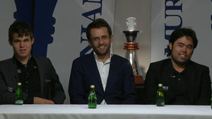

Bez izgubljene partije i sa tri odlučene u svoju korist (4,5/6) **Magnus Carlsen** je pobjednik *Sinquefield* kupa. U zadnjem kolu kao bijeli svladao je Aroniana, iako je bio nadigran u otvaranju. Osim Aroniana dvaput je nastradao Kamsky i to je bilo dovoljno za uvjerljivo prvo mjesto. Testiranje forme prije meča za prvaka svijeta protiv Ananda u studenom je prošlo dobro.

Organizator je najavio turnir i za sljedeću godinu i sa više igrača, te izrazio želju da Carlsen opet nastupi, na što je ovaj načelno pristao, ako mu bude odgovarao datum.
