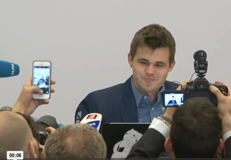

**Magnus Carlsen** je novi stari prvak. Jedanaesta partija meča završila je u njegovu korist čime je dosegao 6,5 bodova potrebnih za ukupnu pobjedu u meču, a time i izbjegao neizvjesnost dvanaeste partije s crnim figurama. **Anand** je imao svoj trenutak i dobru šansu da se stvari zakompliciraju, ali je donio krivu odluku. Sa remijem, prekosutra bi kao bijeli mogao pokušati igrati na pobjedu i izboriti produžetke, a Carlsenu sigurno ne bi bilo lako. Ovako, to je to za ovaj put. Intervju poslije meča bio je odvojen, prvo je odgovarao Anand, pa Carlsen.

**Anand**:

\[P\] Što se dogodilo u zadnjoj partiji i što nam možete reći o tome? \[O\] Bila je vrlo napeta pozicija … ocjenio sam da je pozicija jednaka i odlučio sam se na izmjenu sa žrtvom jer nisam vidio ništa jako brzo za bijelog, ali ok, to je bilo loše kockanje za koje sam kažnjen.

\[P\] Da li poslije ovog neuspjeha mislite ostaviti šah? \[O\] Ne. (smijeh i aplauz)

\[P\] Što mislite o Magnusu Carlsenu? \[O\] Vrlo je jak, to ne trebam posebno objašnjavati …

\[P\] Kako mislite da će se pamtiti ovaj meč? \[O\] Nemam pojma. (smijeh)

\[P\] Puno se pričalo o živcima u ovom meču, kako ste vi stajali s time? \[O\] Da budem iskren … mislim da je on bio puno stabilniji.

**Carlsen**:

\[P\] Što osjećate nakon meča? \[O\] Sreću i olakšanje. Težak meč, gotovo od početka, a danas je bio jedan od najtežih dana i sretan sam što sam uspio proći kroz to.

\[P\] Što nam možete reći o današnjoj partiji i jeste li imali osjećaj da će to biti zadnji dan meča? \[O\] Možda malo. Nisam se htio boriti za meč crnim figurama u zadnjoj partiji. Bilo je kompliciranije nego u prijašnjim partijama, ovaj dan je bio stvarno borben. Imao sam inicijativu, ali on je kreirao protušanse.

\[P\] Kad govorimo o kritičnom momentu u partiji- Tb4 – što ste osjećali kad je odigrao taj potez? Kako ste ocjenili poziciju? \[O\] Općenito, vjerujem da sam materijalist  i više volim uzeti …

\[P\] Koga vidite kao sljedećeg izazivača? \[O\] Ne znam. Prije ovog meča mislio sam da nema šanse da se Anand vrati i igramo još jedan meč. Puno je vremena, vidjet ćemo.

Cijeli intervju možete pogledati [ovdje](http://www.sochi2014.fide.com/video-archive "Press Conference with Anand and Carlsen").

```pgn
[Event "The World Chess Championship"]
[Site "sahovki-klub.com"]
[Date "2014.11.23"]
[Round "11"]
[White "Magnus , Carlsen 2863"]
[Black "Viswanathan, Anand 2792"]
[Result "1-0"]
[ECO "C67"]
[PlyCount "89"]

1. e4 e5 2. Nf3 Nc6 3. Bb5 Nf6 4. O-O Nxe4 5. d4 Nd6 6. Bxc6 dxc6 7. dxe5 Nf5
8. Qxd8+ Kxd8 9. h3 Bd7 10. Nc3 h6 11. b3 Kc8 12. Bb2 c5 13. Rad1 b6 14. Rfe1
Be6 15. Nd5 g5 16. c4 Kb7 17. Kh2 a5 18. a4 Ne7 19. g4 Ng6 20. Kg3 Be7 21. Nd2
Rhd8 22. Ne4 Bf8 23. Nef6 b5 24. Bc3 bxa4 25. bxa4 Kc6 26. Kf3 Rdb8 27. Ke4 Rb4
28. Bxb4 cxb4 29. Nh5 Kb7 30. f4 gxf4 31. Nhxf4 Nxf4 32. Nxf4 Bxc4 33. Rd7 Ra6
34. Nd5 Rc6 35. Rxf7 Bc5 36. Rxc7+ Rxc7 37. Nxc7 Kc6 38. Nb5 Bxb5 39. axb5+
Kxb5 40. e6 b3 41. Kd3 Be7 42. h4 a4 43. g5 hxg5 44. hxg5 a3 45. Kc3 1-0
```
