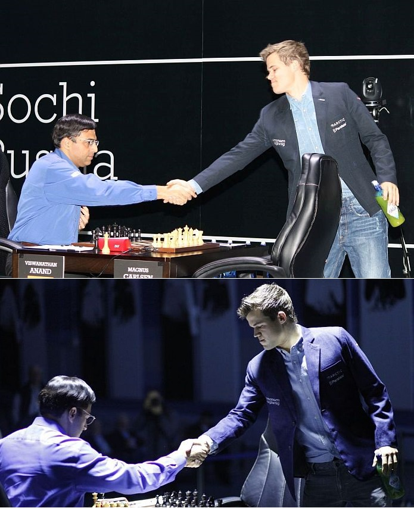
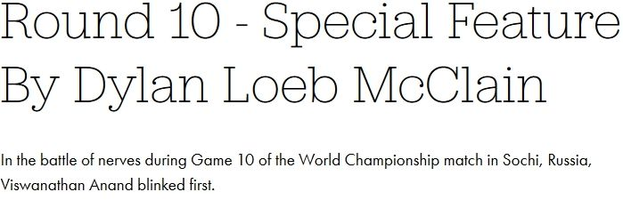

Ovo su fotografije devete i desete partije. Kako to vama izgleda? Kao nervoza? Samo se ne vole ili se boje jedan drugog? “Rekli su da se moramo rukovat na početku…” 😉

U svakom slučaju ovaj meč je puno neizvjesniji od prošlog. Iako se odnos snaga vjerojatno nije promjenio, Anand se očito bolje pripremao – koliko je to moguće za takvog protivnika – i puno je oprezniji a čini se i da izbjegava sukob u pozicijama koje više leže Carlsenu, kao npr. u desetoj partiji gdje sa 28. Lxb7 praktički forsira remi kao bijeli, što bi trebalo biti čudno obzirom da gubi u meču, a u toj partiji još nisu bile iscrpljene sve mogućnosti, bijeli je stajao dobro. Možda je to bilo zbog manjka vremena ili možda Anand misli da završnice nisu njegova najbolja šansa?

S druge strane, Carlsen ne može napraviti bolji rezultat nego prošli put, pa je i on oprezniji.

Deveta i deseta partija završile su remijem. Do kraja su ostale još dvije partije u kojima Anandu treba jedan i pol bod da bi mogao nastaviti borbu za povratak krune. Ako je na početku meča Carlsen bio favorit onda je sada veliki favorit.
