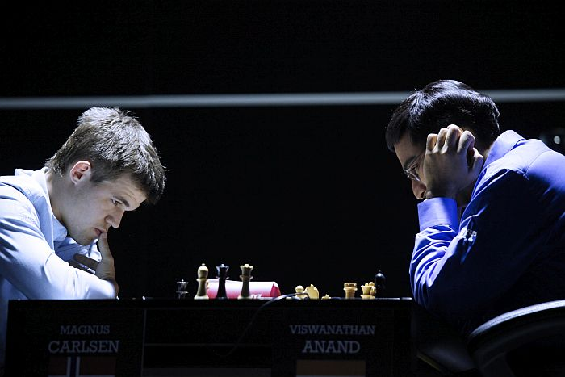

**

*The Tiger is back*, naslov je koji se može pronaći na ponekoj web stranici koja prati ovogodišnji meč **Carlsen – Anand**. Peterostruki svjetski prvak ima veliku bazu navijača – pristranih, a kakvi bi inače bili dobri navijači – i nacionalni je heroj u svojoj zemlji, a sad su napokon došli na svoje jer je to prva Anandova pobjeda protiv Carlsena još od 2010. godine. Zanimljivo je bilo gledati pljuvaonu po **[Shortu](https://twitter.com/nigelshortchess "Twiter @nigelshortchess")** nakon što je dao neku ocjenu pozicije koja *anandovcima* nije legla 🙂 .

Kako god, činjenica je da je Anand uspio! I to uspio je na svoj provjereni način kako to radi već dvadeset godina. Uvukao je Carlsena u dobro pripremljenu varijantu. Otvaranje je očito bilo u njegovu korist, igrao je puno brže od Carlsena, što ranije uglavnom nije bio slučaj i ostalo mu je dosta vremena za završnicu. Bit će zanimljivo vidjeti hoće li ova partija utjecati na tijek meča i vratiti Anandu poljuljano samopouzdanje? Ima li *Tigar* snage za još jedan naslov?

Spomenimo i da je četvrta partija završila remijem. Iako je Carlsen imao inicijativu veći dio partije, nije uspio napraviti ništa konkretno.

```pgn
[Event "World Championship Match 2014"]
[Site "Sochi RUS"]
[Date "2014.11.11"]
[Round "3"]
[White "Anand, Viswanathan"]
[Black "Carlsen, Magnus"]
[Result "1-0"]
[ECO "D37"]
[WhiteElo "2792"]
[BlackElo "2863"]
[PlyCount "67"]
[EventDate "2014.11.08"]

1. d4 Nf6 2. c4 e6 3. Nf3 d5 4. Nc3 Be7 5. Bf4 O-O 6. e3 Nbd7 7. c5 c6 8. Bd3 b6 9. b4 a5 10. a3 Ba6
11. Bxa6 Rxa6 12. b5 cxb5 13. c6 Qc8 14. c7 b4 15. Nb5 a4 16. Rc1 Ne4 17. Ng5 Ndf6 18. Nxe4 Nxe4 19. f3 Ra5 20. fxe4 Rxb5
21. Qxa4 Ra5 22. Qc6 bxa3 23. exd5 Rxd5 24. Qxb6 Qd7 25. O-O Rc8 26. Rc6 g5 27. Bg3 Bb4 28. Ra1 Ba5 29. Qa6 Bxc7 30. Qc4 e5
31. Bxe5 Rxe5 32. dxe5 Qe7 33. e6 Kf8 34. Rc1 1-0
```
