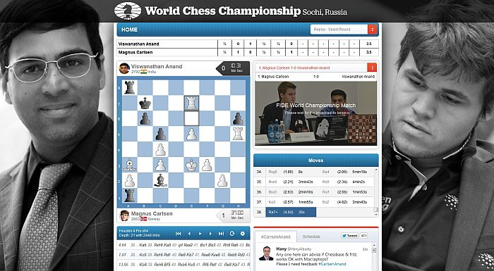
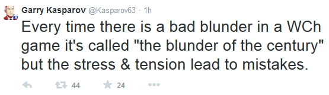

Nakon šest partija **Carlsen** je ponovo u vodstvu.

Peta partija igrala se prilično brzo a brzo je došlo i do redukcije materijala, pa je završila podjelom bodova. Možda je zanimljivo spomenuti da je to bilo peto različito otvaranje u pet partija.

U šestoj partiji ponovo se igrala sicilijanka ([*ECO B41*](http://www.365chess.com/eco/B41_Sicilian_Kan_Maroczy_bind_%28Reti_variation%29 "ECO B41: Sicilian, Kan, Maroczy bind (Reti variation)")). Ovaj put Carlsen je uspio provesti svoj plan i dovesti igru u tip pozicije kakav mu najviše odgovara, a to je složena završnica sa strateškim nadmudrivanjem. I bila bi to sigurno još jedna od njegovih sjajnih izvedbi da ju nije mrvičak zasjenio 26. potez bijelog (26. Kd2??), no Anand previđa relativno jednostavan taktički udar kojim bi bijelog iz izgledne napadačke pozicije postavio u prilično lošu obrambenu. Igrači su na presici poslije partije objasnili da jednostavno nisu bili u taktičkom modu da bi nešto tako vidjeli*.* No, Anand za razliku od Carlsena ima za čime žaliti jer ga je taj previd stajao partije, a mogao je čak igrati na pobjedu.



```pgn
[Event "World Championship Match 2014"]
[Site "Sochi RUS"]
[Date "2014.11.15"]
[Round "6"]
[White "Carlsen, M."]
[Black "Anand, V."]
[Result "1-0"]
[ECO "B41"]
[WhiteElo "2863"]
[BlackElo "2792"]
[PlyCount "75"]
[EventDate "2014.11.08"]

1. e4 c5 2. Nf3 e6 3. d4 cxd4 4. Nxd4 a6 5. c4 Nf6 6. Nc3 Bb4 7. Qd3 Nc6 8. Nxc6 dxc6 9. Qxd8+ Kxd8 10. e5 Nd7
11. Bf4 Bxc3+ 12. bxc3 Kc7 13. h4 b6 14. h5 h6 15. O-O-O Bb7 16. Rd3 c5 17. Rg3 Rag8 18. Bd3 Nf8 19. Be3 g6 20. hxg6 Nxg6
21. Rh5 Bc6 22. Bc2 Kb7 23. Rg4 a5 24. Bd1 Rd8 25. Bc2 Rdg8 26. Kd2? a4? (26...Nxe5! 27.Rxg8 Nxc4+) 27. Ke2 a3 28. f3 Rd8 29. Ke1 Rd7 30. Bc1 Ra8
31. Ke2 Ba4 32. Be4+ Bc6 33. Bxg6 fxg6 34. Rxg6 Ba4 35. Rxe6 Rd1 36. Bxa3 Ra1 37. Ke3 Bc2 38. Re7+ 1-0
```
