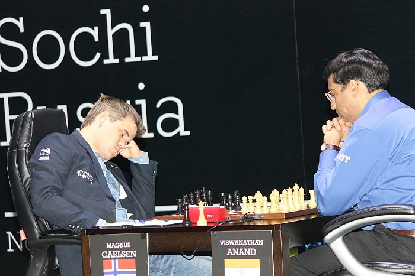

Mora se priznati, a što se možda ne bi dalo zaključiti prema prizorima iz osme partije kao ni prema rezultatu, da je ova mini-dionica bila prilično zanimljiva.

Počeo je drugi dio meča i **Carlsen** je u sedmoj partiji, prema pravilima, ponovo bio bijeli. Igrala se španjolska sa varijantom koja je prvi put viđena prije nešto manje od mjesec dana u partiji **Giri – Radjebov** na *[FIDE Grand Prix, Tashkent](http://tashkent2014.fide.com/ "FIDE Grand Prix, Tashkent 2014")*. Carlsen je očito pronašao poboljšanje, ali je **Anand** skrenuo iz glavne varijate pa ga nismo uspjeli vidjeti. Ovaj krug donio nam je drugu najdužu partiju u povijesti šahovskih mečeva za prvaka svijeta, a da su akteri bili svjesni toga možda bi odigrali još ta dva poteza do rekorda, ali sama partiji bila bi jednako vrijedna i bez zadnjih pedesetak. No, možda je izmaranje Ananda dio Carslenove strategije, a možda mu je samo bilo krivo što se Anand izvukao lijepom žrtvom lovca za dva pješaka, pa ga je još neko vrijeme ganjao po tabli u završnici top + skakač protiv topa. Nije da nikog nije uspio na taj način dobiti, ali ipak je to bilo malo vjerojatno protiv bišeg peterostrukog prvaka svijeta.

Osma partija i damin gambit – očekivalo se da će Anand pokušati izjednačiti, no vrlo brzo uplovili su u mirne vode. Carlsen je već u desetom potezu skrenuo iz glavne varijante u liniju koja se ~navodno~ (EDIT: nije navodno, [evo te partije](https://twitter.com/OlimpiuUrcan/status/534686152410677250/photo/1) iz 1898. godine) zadnji put službeno igrala u 19. stoljeću i Anand je potrošio dosta vremena da shvati kamo to vodi. Kad je uvidio da ne može igrati na pobjedu brzo su uslijedile izmjene i remi.

Rezime bi bio da je Carsen kao bijeli prilično namučio Ananda, a kao crni lako remizirao. Jest da je skor ove mini-dionice neriješen, ali za meč su važne i stvari koje nisu na semaforu.
