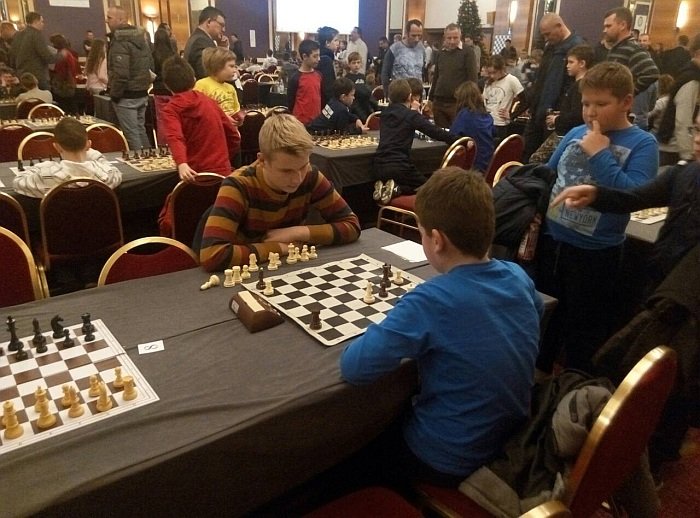
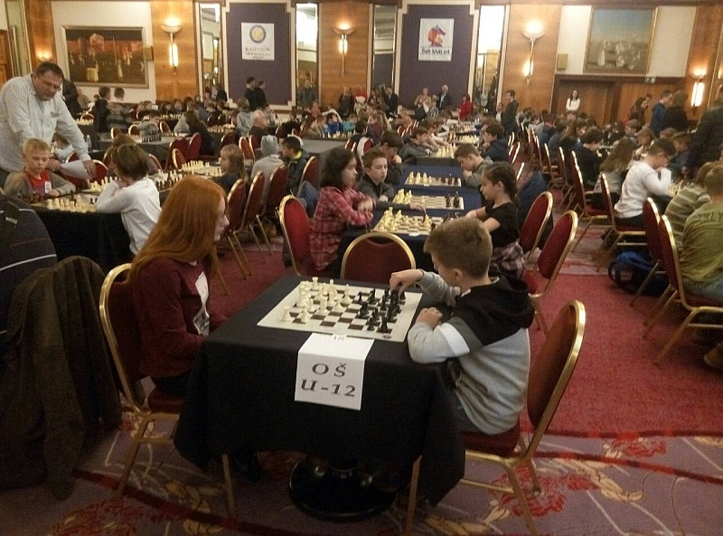
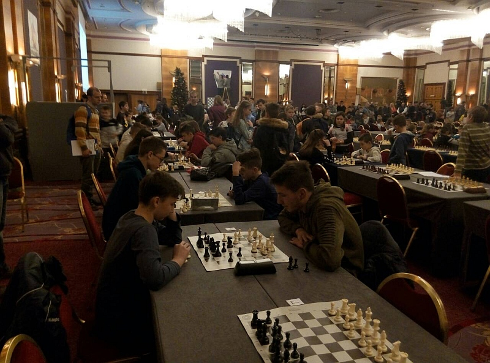

  
Organizatori [Fond Kasparov Chess Adriatic](http://kcfadriatic.com/) i [Šahovski klub e4](http://www.sahklube4.hr/) i ove godine privukli su veliki broj mladih šahista na šahovski festival koji se odigran u hotelu [Westin](http://www.westinzagreb.com/) u Zagrebu, 28. i 29. prosinca. Brojni turniri, podijeljeni po dobnim skupinama dali su priliku i početnicima i onima koji su malo više u šahu da odmjere snage sa vršnjacima iz cijele zemlje pa i nekima iz inozemstva. Prvi dan turnira igrao se rapid (10+5) i brzopotezni turnir za sve, a drugi dan brzopotezni za kadete (5+3) i turnir osnovnoškolaca koji je bio namijenjen početnicima i igrao se bez sata. Šteta je samo što organizatori nisu iskoristili web stranicu za više detalja o turnirima pa je bilo puno nedoumica oko prava igranja na više turnira, pripadnosti dobnoj skupini i o tempu igre na turniru “Šah uz školu”. Ni prijave nisu jednostavne koliko bi mogle biti. Uprkos svemu, pet naših članova uspjelo se samostalno prijaviti, a igrali su na pet različitih turnira. Ivan i Vraneša nastupili su na [rapidu](http://chess-results.com/tnr318937.aspx?lan=1&art=4&turdet=YES&flag=30&wi=821) i brzopoteznom turniru U13, Kljujev i Božo na rapidu i brzopoteznom turniru U16, a Luka Fiolić na turniru Šah uz školu. Pokazalo se da su dečki ipak nešto bolji na sporiji tempo. **Ivan Maravić** se “lagano” prošetao **na rapid turniru U13 i osvojio prvo mjesto**, dok je Vraneša izgubio partiju prvog kola i na kraju završio na 15. mjestu. Od zanimljivosti, vrijedi spomenuti da je Vraneša na turniru uspio i dati i dobiti pat, a njih dvojica, iako su  na brzopoteznom turniru U13 završili među prvih deset, zaboravili su preuzeti osvojene predmetne nagrade. 🙂

**U13 – RAPID 10+5**  
1\. II Ivan Maravić 1895, ŠK Odra, 6,0  
2\. II Leon Putar 1822, ŠK Brestje, 5,5  
3\. III Šimun Dumančić 1899, ŠK Sljeme-Agroproteinka, 5,5

  
