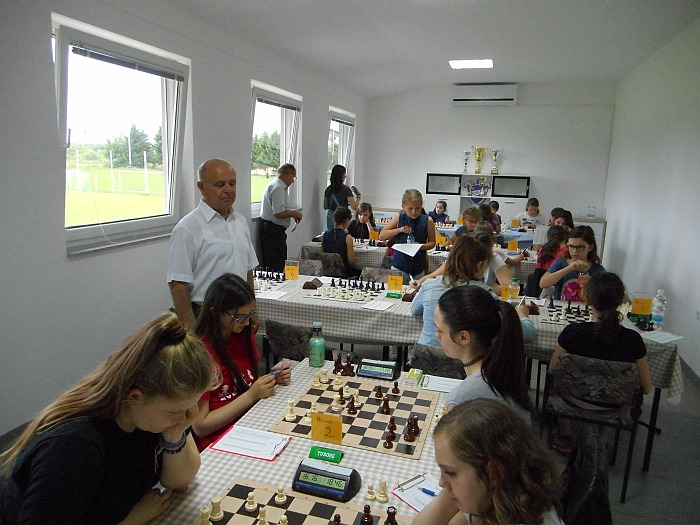  
Za vikend je odigran 16. Međunarodni turnir juniorki “Buševec 2017.” Ove su godine prvi put nastupile i naše djevojke, i to na nešto lakšem B-turniru. A-turnir bio je rezerviran za elo 1450 ili viši. Turnir se igrao u prostorijama sportskog društva Polet iz Buševca, u jako lijepo uređenu prostoru za igru, kako za A, tako i za B-turnir. Na A-turniru igralo se sedam kola, a na B-turniru šest kola. Tempo je bio prilično sličan, 25+15 i 30+30. Glavni direktor turnira gospodin Zlatko Rožić nadzirao je oba turnira, organizirao i besplatni ručak za sve natjecateljice (44 igračice) i njihovu pratnju. Na otvaranju turnira otpjevana je himna, a uvodni govori bili su prihvatljivo kratki. 🙂 Uvjeti za igru bili su i više nego dobri, pogotovo kada se sjetimo prostora u Domu sportova. Organizator je pribavio garniture, satove, zapisnike, podloške za zapisivanje, čak i olovke za zaboravne šahistice. Osiguran je i prostor za odmor između kola, a dobro je došlo i obližnje igralište na kojem su najmlađe sudionice kratile vrijeme između partija. Igralo se u ležernoj atmosferi, igračice nisu ometane, a nije se stvarao ni problem oko kratkog ulaska u salu za igru radi slikanja ili slično. Baš onako kako bi amaterski šah i trebao izgledati. Sve pohvale organizatoru i sucima.  
**A-turnir**  
Na A-turniru nastupilo je 16 igračica, a osvojila ga je mlada slovenska FIDE majstorica iz Kranja, 17-godišnja **Monika Rozman**. Drugo mjesto pripalo je 16-godišnjoj Riječanki s titulom nacionalnog majstora, **Eni Cvitan**. Treće mjesto osvojila je **Roklicer Heike**, nacionalni majstor iz Donjeg Miholjca.  
Nadamo se da će i naše djevojke brzo napredovati i za koju godinu moći odmjeriti snage s konkurencijom na  A-turniru.  
**B-turnir**  
Pobjednica B-turnira, na kojem je nastupilo 28 igračica, domaća je igračica, **Marta Trgovac**, članica ŠK Polet iz Buševca. Zanimljivo, i pohvalno za Martu, jest da je konkurenciju ostavila na cijelom bodu razlike, što je u švicarcu uistinu mnogo. Drugo mjesto pripalo je **Lari Putar** iz ŠK Brestje, a treće mjesto osvojila je **Mira Trgovac**, također iz ŠK Polet Buševec.  
Naše igračice **Monika, Katarina, Samanta, Lucija** i **Ana** i više su nego ugodno iznenadile rezultatom. Iako im je ovo prvi nastup, svaka je ubilježila barem po jednu pobjedu. Po prikazanome, Ana se najviše držala uputa, a ostvarila je i najbolji rezultat, 2,5 boda. Samanta je uspjela pobjediti trećekategornicu, a Lucija se jednu partiju mučila realizirati top viška, ali se uspjela sjetiti naučenoga! Katarina i dalje odbija slušati (isto vrijedi i za Moniku) pa, iako igra dobro, sve sporije napreduje. U posljednjem kolu sestre su igrale međusobno i sestrinski remizirale. 🙂  
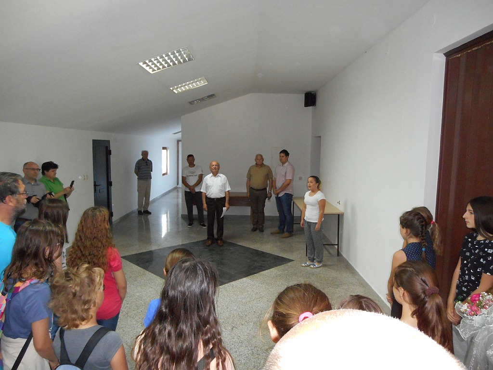 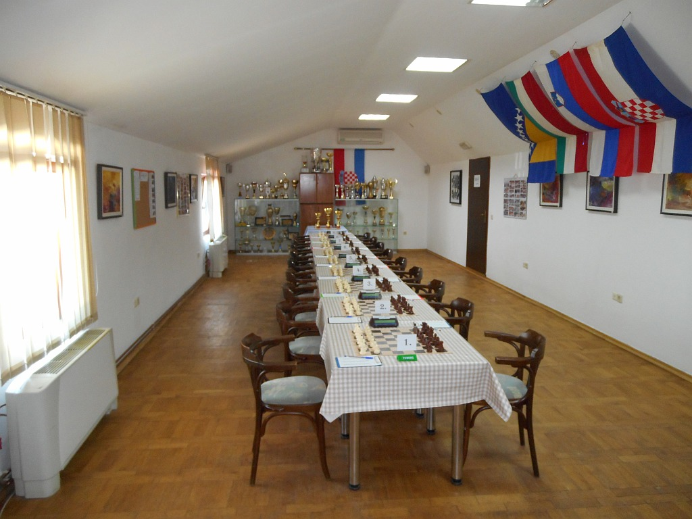 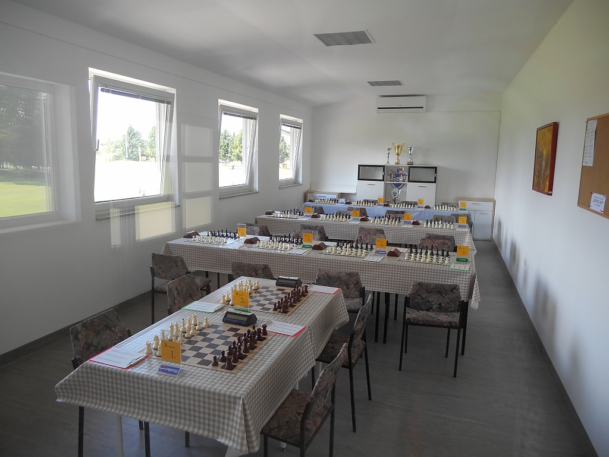 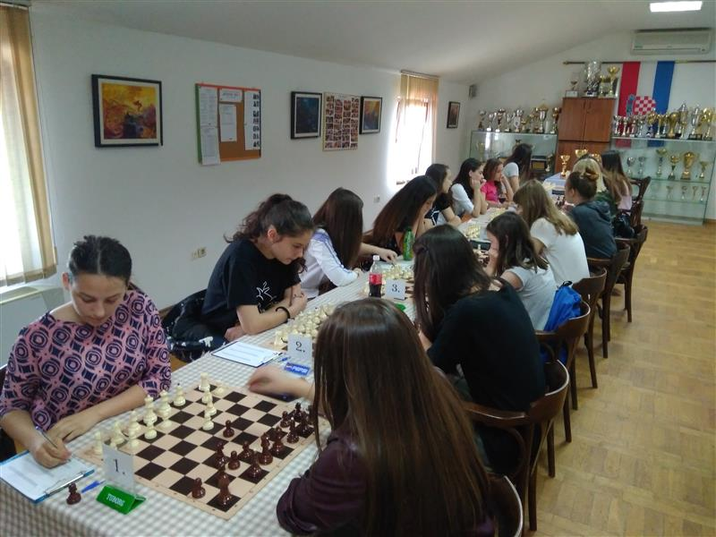  
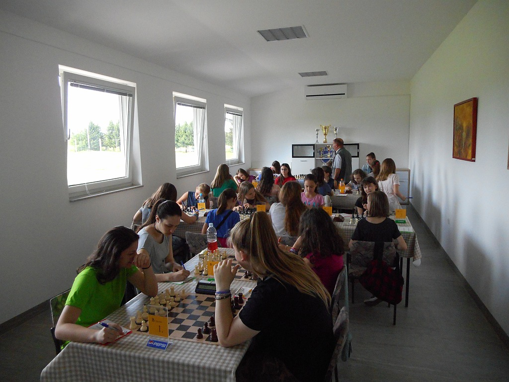 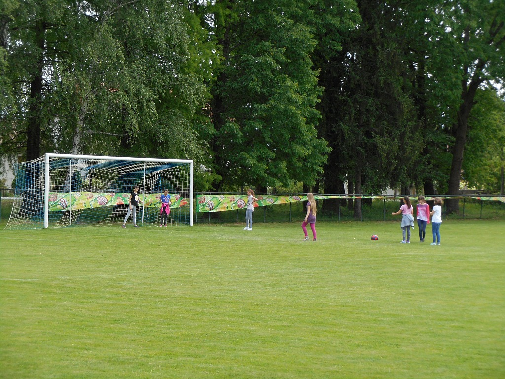 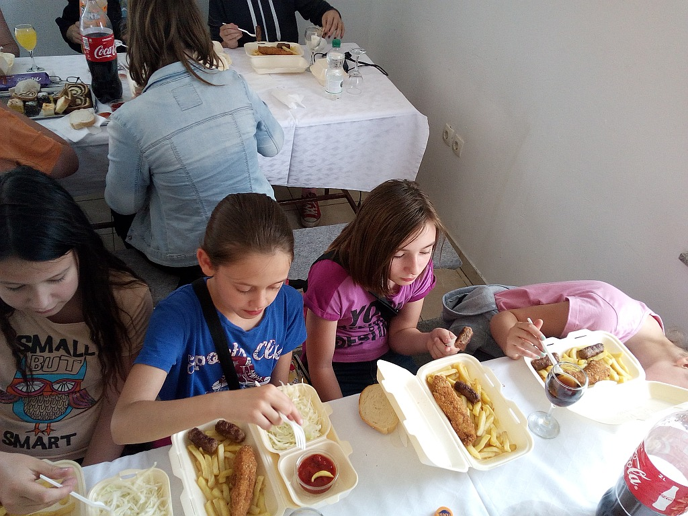 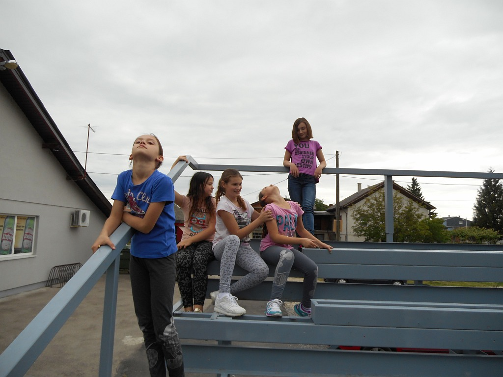  
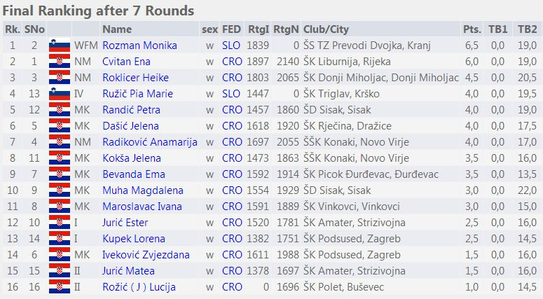    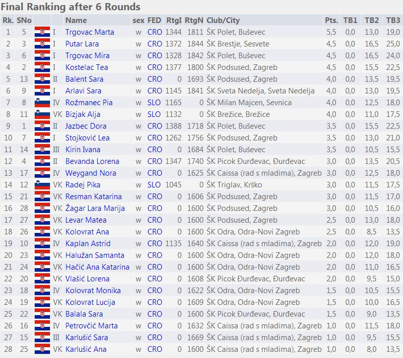
