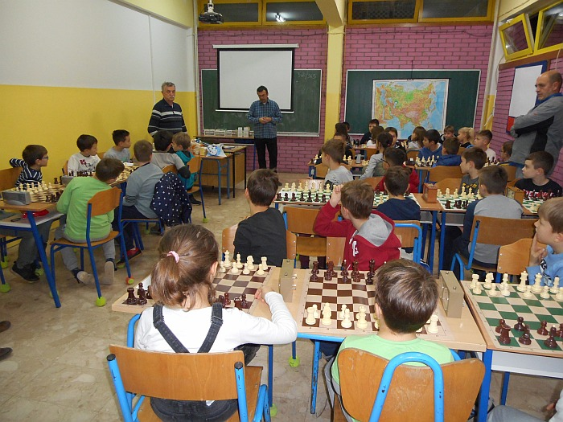
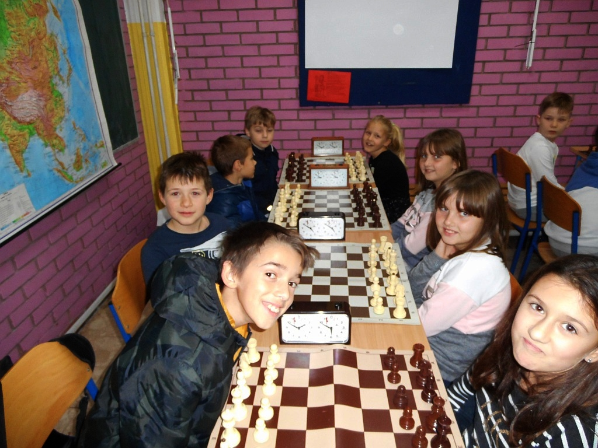
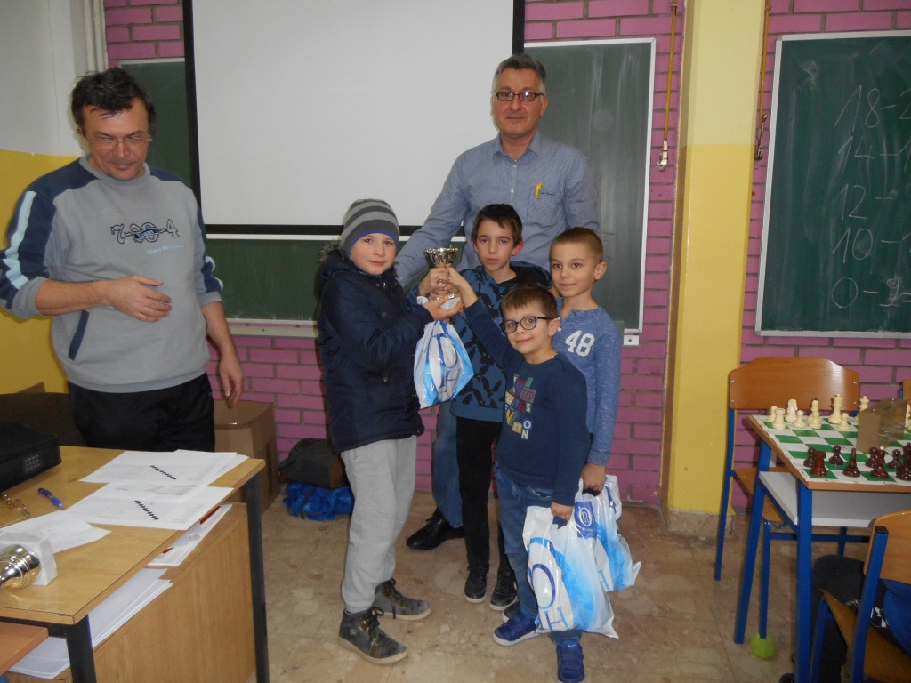
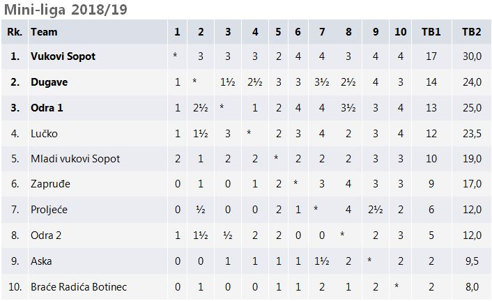
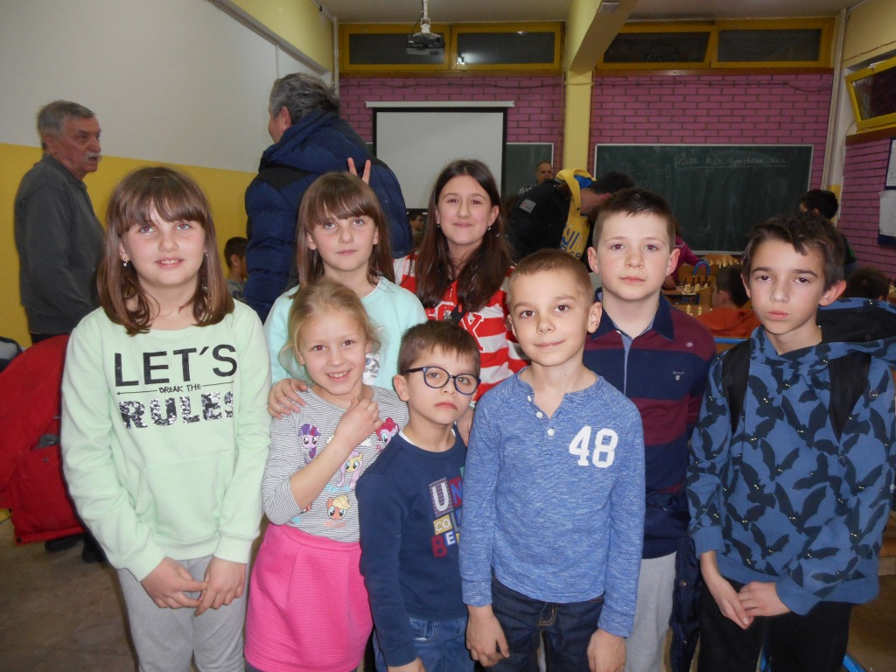
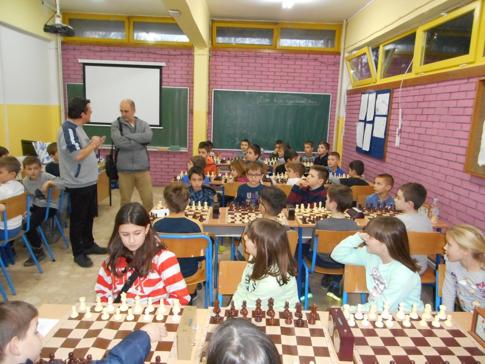
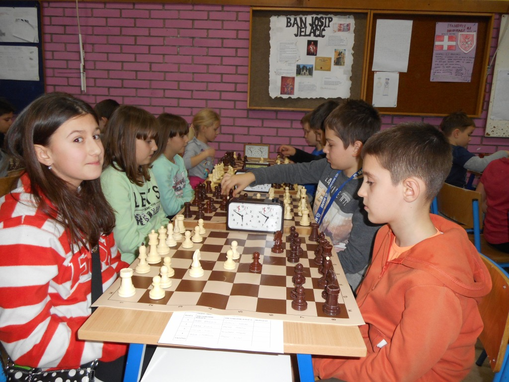
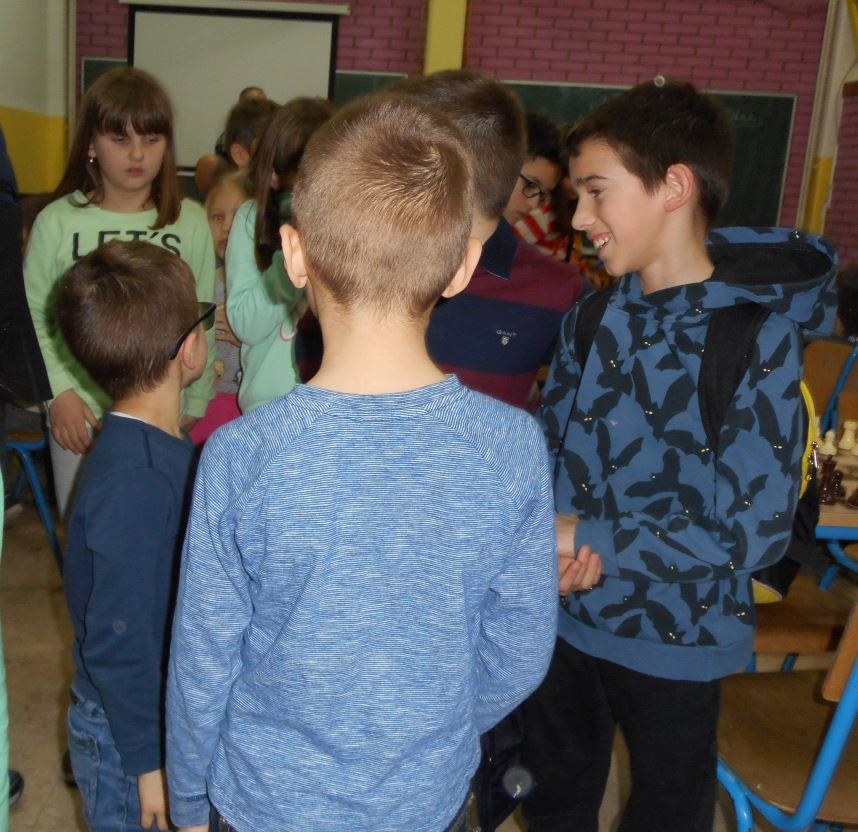
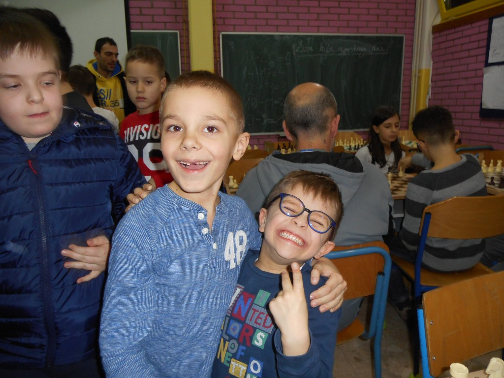
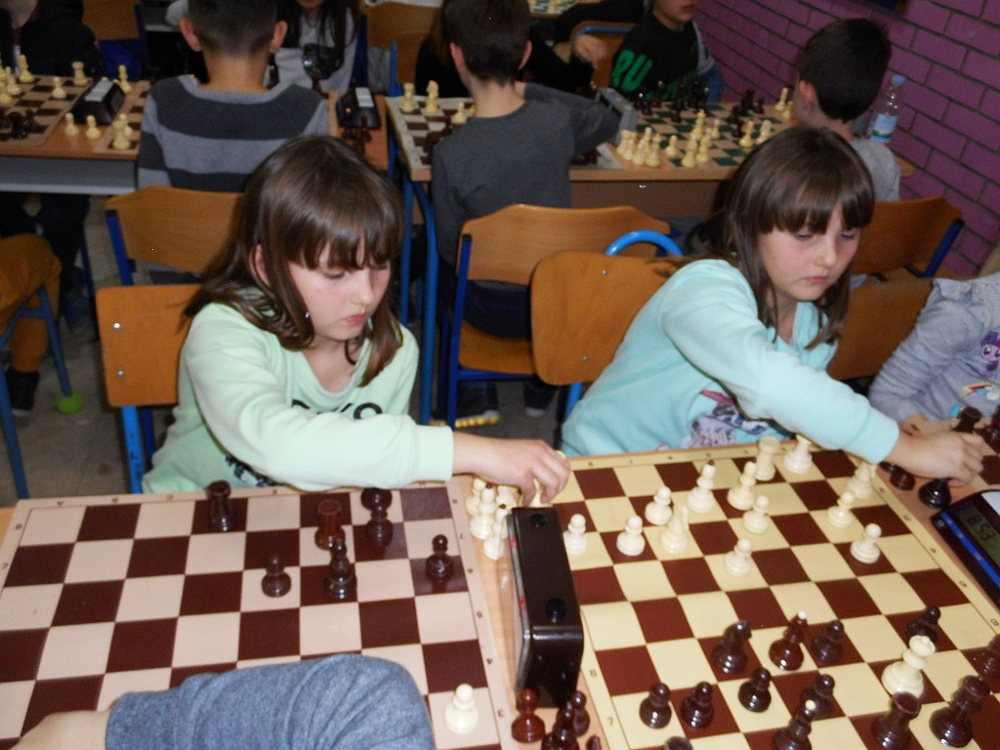

  
U srijedu, 12. prosinca, odigran je prvi krug MINI-LIGE 2017/18. To je ekipno natjecanje učenika osnovnih škola Novog Zagreba, do četvrtog razreda. Prvenstvo se igra pod pokroviteljstvom ravnateljice osnovne škole Ive Andrića, gospođe Dubravke Miklec, a voditelj prvenstva je Jelenko Mikacinić, voditelj Šahovske škole OŠ Ive Andrića.  Prvenstvo se igra na četiri ploče, tempo igre je 10+0, a dopuštena su dva nemoguća poteza. U prvom krugu odigrana su četiri kola, a sljedeći krug igrat će se 13. veljače 2019., također u OŠ Ive Andrića kada će se odigrati preostalih pet kola. OŠ Odra nastupa s dvije ekipe.  Kapetani ekipa su Dora i Luka, članovi ekipe koja je prošle godine osvojila ovaj [turnir](/novosti/ekipno-prvenstvo-os-n-zagreba-do-cetvrtog-razreda-2017-2018-mini-liga-prvi-krug/). Ostali učesnici su po prvi puta na ovom turniru, dok je za neke ovo bio i prvi službeni nastup. Na prvenstvu nastupa deset ekipa, a u našim ekipama posebno lijep rezultat ostvarili su Slavko i Ivan koji najviše i vježbaju. Veliku volju i hrabrost pokazala je Ivana koja je igrala bolesna te ostvarila i prvu službenu pobjedu!   [REZULTATI](http://chess-results.com/tnr399826.aspx?lan=13)

<table class="CRs1"><tbody><tr class="CRg1b"><td class="none" colspan="18"><strong>&nbsp;Odra 1</strong> ( TB1: 13 / TB2: 25)</td></tr><tr class="CRg1b"><td class="CRc">Bo.</td><td class="CR"></td><td class="CR">Ime</td><td class="CRr"></td><td class="CR"></td><td class="CRr"></td><td class="CRc">1</td><td class="CRc">2</td><td class="CRc">3</td><td class="CRc">4</td><td class="CRc">5</td><td class="CRc">6</td><td class="CRc">7</td><td class="CRc">8</td><td class="CRc">9</td><td class="CRc">Bod.</td><td class="CRc">Partije</td><td class="CRr"></td></tr><tr class="CRg2 CRO"><td class="CRc">1.</td><td class="CR"></td><td class="CR">Matašić Luka (K)</td><td class="CRr"></td><td class="CR"></td><td></td><td class="CRc">1</td><td class="CRc">1</td><td class="CRc">0</td><td class="CRc">1</td><td class="CRc">&nbsp;1</td><td class="CRc">&nbsp;1</td><td class="CRc">&nbsp;1</td><td class="CRc">&nbsp;1</td><td class="CRc">&nbsp;1</td><td class="CRc">8,0</td><td class="CRc">9</td><td class="CRr"></td></tr><tr class="CRg1 CRO"><td class="CRc">2.</td><td class="CR"></td><td class="CR">Botica Višeslav</td><td class="CRr"></td><td class="CR"></td><td></td><td class="CRc"></td><td class="CRc"></td><td class="CRc"></td><td class="CRc"></td><td class="CRc">&nbsp;0</td><td class="CRc">&nbsp;0</td><td class="CRc">&nbsp;1</td><td class="CRc">&nbsp;1</td><td class="CRc">&nbsp;1</td><td class="CRc">3,0</td><td class="CRc">5</td><td class="CRr"></td></tr><tr class="CRg1 CRO"><td class="CRc">3.</td><td class="CR"></td><td class="CR">Biondić Slavko</td><td class="CRr"></td><td class="CR"></td><td></td><td class="CRc">1</td><td class="CRc">1</td><td class="CRc">1</td><td class="CRc">0</td><td class="CRc">&nbsp;1</td><td class="CRc">½</td><td class="CRc">&nbsp;0</td><td class="CRc">&nbsp;1</td><td class="CRc">&nbsp;1</td><td class="CRc">6,5</td><td class="CRc">9</td><td class="CRr"></td></tr><tr class="CRg2 CRO"><td class="CRc">4.</td><td class="CR"></td><td class="CR">Pisačić Ivan</td><td class="CRr"></td><td class="CR"></td><td></td><td class="CRc">1</td><td class="CRc">1</td><td class="CRc">0</td><td class="CRc">0</td><td class="CRc">&nbsp;0</td><td class="CRc">&nbsp;1</td><td class="CRc">&nbsp;1</td><td class="CRc">&nbsp;1</td><td class="CRc">&nbsp;1</td><td class="CRc">6,0</td><td class="CRc">9</td><td class="CRr"></td></tr><tr class="CRg1 CRO"><td class="CRc">5.</td><td class="CR"></td><td class="CR">Petrović Matija</td><td class="CRr"></td><td class="CR"></td><td></td><td class="CRc">½</td><td class="CRc">1</td><td class="CRc">0</td><td class="CRc">0</td><td class="CRc"></td><td class="CRc"></td><td class="CRc"></td><td class="CRc"></td><td class="CRc"></td><td class="CRc">1,5</td><td class="CRc">4</td><td class="CRr"></td></tr></tbody></table>

<table class="CRs1"><tbody><tr class="CRg1b"><td class="none" colspan="18">&nbsp;<strong>Odra 2</strong> (TB1: 5 / TB2: 12)</td></tr><tr class="CRg1b"><td class="CRc">Bo.</td><td class="CR"></td><td class="CR">Ime</td><td class="CRr"></td><td class="CR"></td><td class="CRr"></td><td class="CRc">1</td><td class="CRc">2</td><td class="CRc">3</td><td class="CRc">4</td><td class="CRc">5</td><td class="CRc">6</td><td class="CRc">7</td><td class="CRc">8</td><td class="CRc">9</td><td class="CRc">Bod.</td><td class="CRc">Partije</td><td class="CRr"></td></tr><tr class="CRg2 CRO"><td class="CRc">1.</td><td class="CR"></td><td class="CR">Bačurin Dora (K)</td><td class="CRr"></td><td class="CR"></td><td></td><td class="CRc">0</td><td class="CRc">0</td><td class="CRc">0</td><td class="CRc">1</td><td class="CRc">&nbsp;1</td><td class="CRc">&nbsp;0</td><td class="CRc">1</td><td class="CRc">&nbsp;1</td><td class="CRc">½</td><td class="CRc">4,5</td><td class="CRc">9</td><td class="CRr"></td></tr><tr class="CRg1 CRO"><td class="CRc">2.</td><td class="CR"></td><td class="CR">Fiolić Ivana</td><td class="CRr"></td><td class="CR"></td><td></td><td class="CRc">0</td><td class="CRc">0</td><td class="CRc">0</td><td class="CRc">1</td><td class="CRc">&nbsp;1</td><td class="CRc">&nbsp;1</td><td class="CRc">&nbsp;0</td><td class="CRc">&nbsp;1</td><td class="CRc">&nbsp;0</td><td class="CRc">4,0</td><td class="CRc">9</td><td class="CRr"></td></tr><tr class="CRg2 CRO"><td class="CRc">3.</td><td class="CR"></td><td class="CR">Fiolić Lucija</td><td class="CRr"></td><td class="CR"></td><td></td><td class="CRc">0</td><td class="CRc">0</td><td class="CRc">0</td><td class="CRc">0</td><td class="CRc">&nbsp;1</td><td class="CRc">&nbsp;1</td><td class="CRc">&nbsp;0</td><td class="CRc">&nbsp;0</td><td class="CRc">&nbsp;1</td><td class="CRc">3,0</td><td class="CRc">9</td><td class="CRr"></td></tr><tr class="CRg1 CRO"><td class="CRc">4.</td><td class="CR"></td><td class="CR">Lozić Nola</td><td class="CRr"></td><td class="CR"></td><td></td><td class="CRc">½</td><td class="CRc">0</td><td class="CRc">0</td><td class="CRc">0</td><td class="CRc">&nbsp;0</td><td class="CRc">&nbsp;0</td><td class="CRc">&nbsp;0</td><td class="CRc">&nbsp;0</td><td class="CRc">&nbsp;0</td><td class="CRc">0,5</td><td class="CRc">9</td><td class="CRr"></td></tr></tbody></table>

---

13\. veljače 2019.  
Danas je odigrano preostalih pet kola. Imali smo jednu promjenu, u ekipu dečkiju uskočio je Visko umjesto Matije i dobro odigrao. I inače, kod svih igrača i igračica vidi se napredak, a posebno impresivni bili su kapetani ekipa, Luka Matašić koji je napravio 100% i Dora koja je napravila 3,5/5, oboje na prvoj ploči. Dečki su imali posebno impresivan finiš, kada su u zadnja dva meča pobijedili s 4:0! i na kraju uspjeli uloviti [**broncu**](http://chess-results.com/tnr399826.aspx?lan=1&art=0). Cure su završile na osmom mjestu ,a ugodno su iznenadile kvalitetom igre. Još čekamo Nolu, a obzirom da je najmlađa u ekipi, ne sumnjam da će i ona uskoro početi pobjeđivati. Svi klinci dobili su poklone, ove godine pobjedničke ekipe dobile su i pehare, suza nije bilo previše i sve je prošlo u redu. Zahvaljujem roditeljima, a posebno gosp. Mikaciniću na pozivu i na lijepo odrađenom turniru.

     
   

darko
