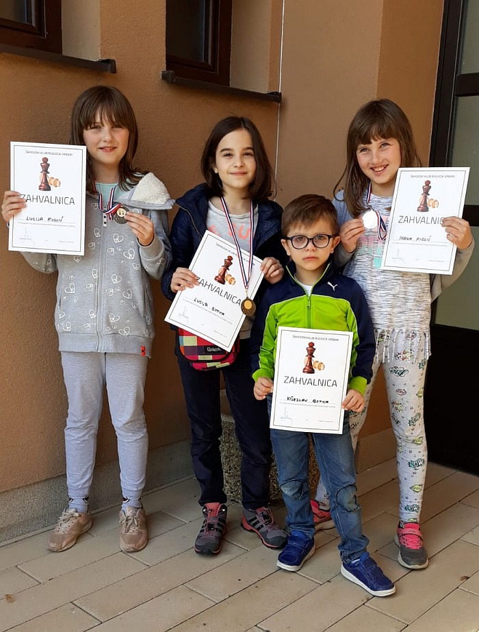
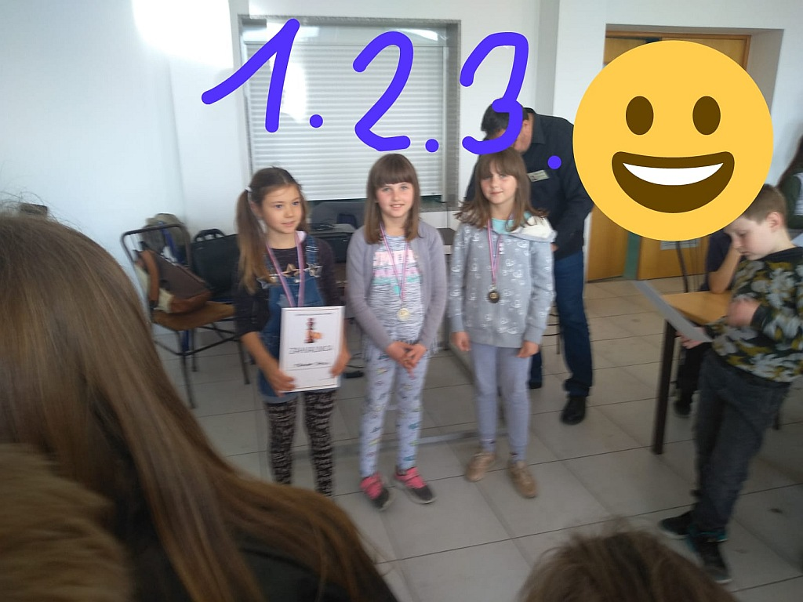
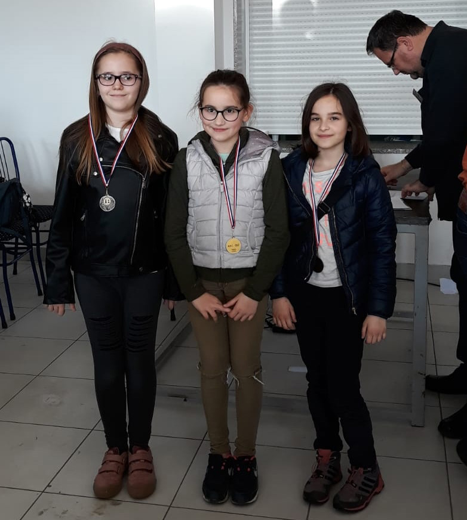

  
Četvoro naših predstavnika sudjelovalo je na mjesečnom kadetskom turniru u organizaciji Šahovskog saveza Zagrebačke županije. Turnir se odigrao u Rugvici, a pamti ćemo ga po prvoj osvojenoj medalji naše mlade nade Ivane Fiolić Fivane. Prvo mjesto u konkurenciju [U9](http://chess-results.com/tnr421727.aspx?lan=13&art=4) osvojio je Domink Đurašin. U istoj konkurenciji, najbolja djevojčica bila je Franka Paulić.  Fivana i Flucija osvojile su drugo, odnosno treće mjesto. Višeslavu, drugom sa ovogodišnjeg prvenstva Zagreba u konkurenciji U9, danas nije baš išlo i ostao je bez postolja, ali se zato pokazao kao veliki džentlmen i prijateljski je remizirao peto kolo sa Flucijom. Fivana je posljednje kolo pobijedila sestru i tako se uspela stepenicu više. Sliku na postolju poslala nam je Fivana. U konkurenciji [U12](http://chess-results.com/tnr421731.aspx?lan=13&art=4&turdet=YES) nastupila je Botica i osvojila treće mjesto. Prvi u toj skupini bio je Ivan Horvat, a najbolja djevojčica Žagar Lara Marija. Sutra se nastavljaju kadetska prvenstva Zagreba U13 i U15 te se i tamo nadamo dobrim rezultatima.

