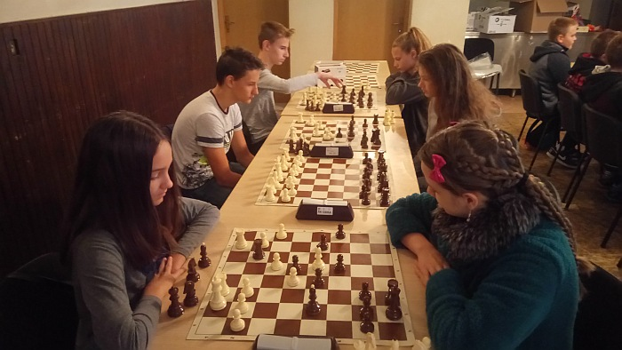
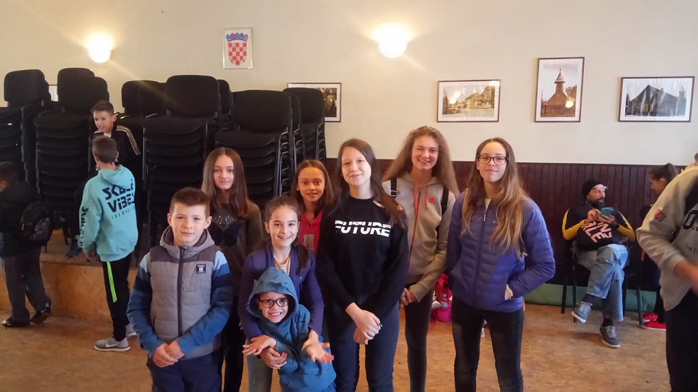

  
Jučer je u Buševcu odigran mjesečni kadetski turnir. Igralo se u skupinama do 9, 12 i 15 godina. Nastupilo je 59 igrača i igračica. Cure su ozbiljne ove godine u namjeri da opet osvoje prvenstvo OŠ Zagreba i sve su došle na turnir. Dečki su malo suzdržaniji i više daju prednost nogometu, a i manje vježbaju. Od najmlađih, došli su Slavko i Višeslav. Monika je igrala u starijoj skupini i osvojila treće mjesto. U toj istoj skupini, U15, Ivan je očekivano opet osvojio prvo mjesto. Ana je završila četvrta. Samantu čekamo da se malo uozbilji. Uredno vježba i to je dobro, ali joj je teško prebaciti se u ozbiljniji mod skupljanja bodova. U mlađoj grupi, U12, Lucija je, kao i Ivan, ponovila prošlomjesečni uspjeh i osvojila prvo mjesto, a Franka je uzela broncu. Botica se ovaj put nije uspjela domoći postolja. U skupini najmlađih, U9, Slavko i Višeslav su također skupili po nekoliko bodova (Slavko čak tri!). Ostale početnike još čekamo, da svladaju osnovne matove pa će im se i oni uskoro pridružiti. Treneri, Ivan i Vraneša kažu da su djevojke već spremne okušati se i na seniorskom turniru (Zagreb open igra se od 1. do 8. prosinca), ali to znači dosta obaveza i roditeljima. Klinci jedini ozbiljniji turnir igraju pojedinačno kadetsko PH i još jedan turnir bi im dobro došao. Vidjet ćemo…  
Ivanu zahvaljujemo na slikama ,a Moniki na izvještaju.

[U-9 s partijama- Buševec -20.10.2018](/files/wp/2018/10/U-9-s-partijama-Bu-evec-20.10.2018.pdf)  
[U-12 s partijama- Buševec – 20.10.2018](/files/wp/2018/10/U-12-s-partijama-Bu-evec-20.10.2018.pdf)  
[U-15 Buševec 20.10.2018](/files/wp/2018/10/U-15-Bu-evec20.10.2018.pdf)
