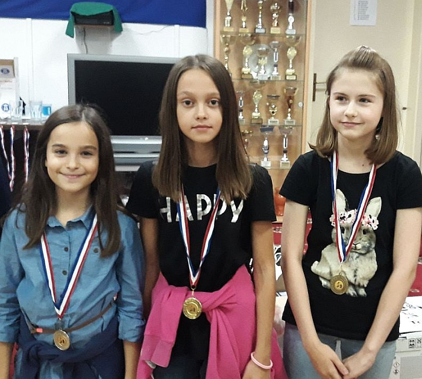
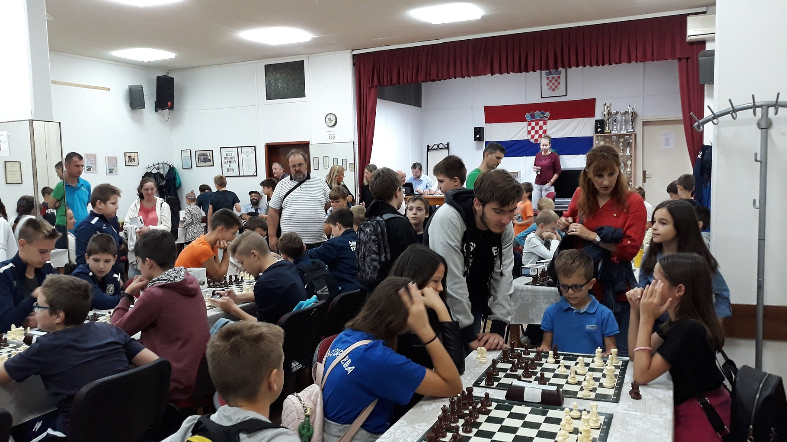
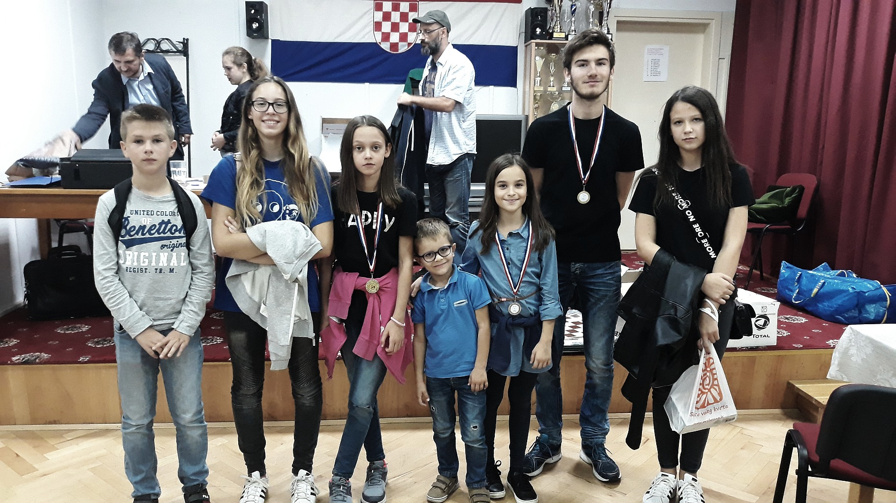

  
U organizaciji Šahovskog saveza Zagrebačke županije i ŠK Samobor, 22. rujna, održan je mjesečni kadetski turnir, jedan u nizu. Turnir se igrao u Samoboru u Domu umirovljenika, nastupilo je 49 igrača i igračica, a od toga deset naših članova, osvojili smo tri medalje, od toga dvije zlatne! Ivan Maravić osvojio je prvo mjesto u konkurenciji do 15 godina, a Lucija Kolovrat prvo mjesto u konkurenciji do 12 godina. Kako je u posljednje vrijeme počela ozbiljnije vježbati, a upala je i u školsku ekipu, njen uspjeh ne čudi. Lucija Botica okitila se srebrom, također u konkurenciji do 12 godina. Njena prva šahovska medalja! Nakon lijepog uspjeha na PH (12. mjesto) ovo je potvrda da i dalje radi na šahu. Treće mjesto u ovoj konkurenciji osvojila je također Lucija, Šimec, iz ŠK Sveta Nedelja. Organizacija je bila na nivou, zahvaljujući vrijednim šahovskim djelatnicima, a klinci su posebno bili zadovoljni prof. Kupekom i njegovim animatorskim vještinama. Upisnina je bila simboličnih 20 kn., kako i treba biti za popularizaciju šaha, a djeca su počašćena i sokovima. Sve se više djece okuplja petkom u Klubu pa vjerujem u još brojniji nastup već na sljedećem turniru iz ove serije, koji je na rasporedu 20. listopada u Buševcu. Tati Botici zahvaljujemo na fotografijama. U prilogu donosimo rezultate po skupinama.  
    
[Samobor\_22092018\_U9](/files/wp/2018/10/Samobor_22092018_U9.pdf)[Samobor\_22092018\_U12](/files/wp/2018/10/Samobor_22092018_U12.pdf)[Samobor\_22092018\_U15](/files/wp/2018/10/Samobor_22092018_U15.pdf)
