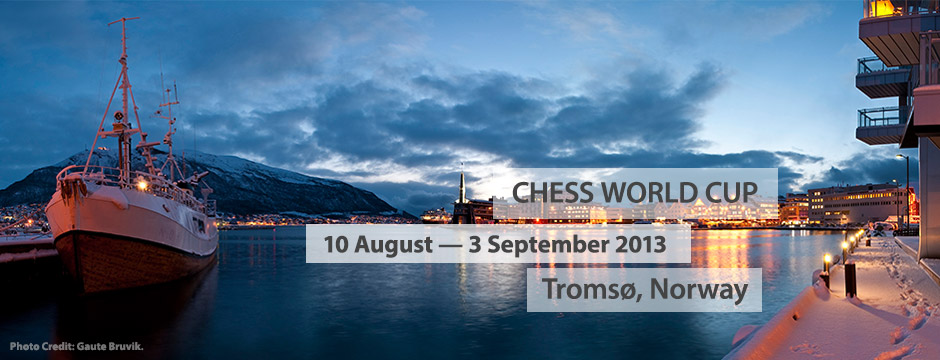

Norveška je sve češće domaćin velikih šahovskih događaja; nakon *Norway Chess Super Tournament 2013* na redu je ***FIDE Chess World Cup**,*  jedan od najznačajnijih šahovskih turnira u godini – ne samo zbog velikog nagradnog fonda od 1,6 mil. $ od čega će 120.000 $ pripasti pobjedniku, a ostatak će prema plasmanu podjeliti svi ostali, već i zbog činjenice da prvo mjesto osigurava nastup na turniru kandidata sljedeće godine, odnosno pobjednika stavlja u poziciju da se izbori za titulu izazivača. Pravo sudjelovanja na turniru određuje FIDE, a cijelu listu od 128 igrača  možete vidjeti **[ovdje](http://www.chessworldcup2013.com/players "FIDE World Chess Cup 2013")**. Osim Ananda i Carlsena koji se spremaju za meč za prvaka svijeta krajem godine, tu je cijela ostala šahovska elita.

Naravno, mi ćemo kao i obično objaviti najinteresantnije partije i zanimljivosti s turnira.
