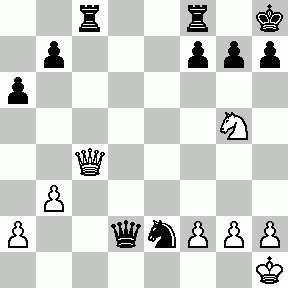
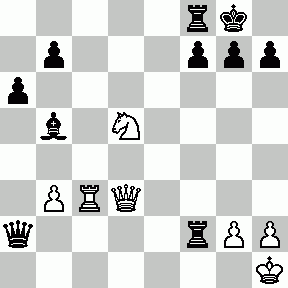

                 
Ozbiljnija natjecanja počinju u veljači sljedeće godine, Pojedinačno prvenstvo Zagreba, Kadetska klupska liga i Prvenstvo osnovnih škola. To su natjecanja koja niti jedan član ne bi smio propustiti. Liga se igra subotom, a ostala natjecanja subotom i nedjeljom. U međuvremenu, potrebno je iskoristiti svaku priliku i igrati turnire koji se pojave, a prikladni su za kadetski uzrast, kako bi napredovali i bili što spremniji za navedena natjecanja.

Prva takva prilika je prvenstvo Hrvatske za dječake i djevojčice do 8 godina na kojem mogu nastupiti svi koji znaju zapisivati poteze, dati osnovne matove (topom, damom…) i koji su 2007. godište ili mlađi. Prvenstvo se igra **14\. i 15. studenoga** u Sisku. Taj turnir prošle godine igrali su Monika, Lucija, Franka i Luka. Ove godine očekujem nastup Luke, Josipa, Noe i Petra. Svi su isto godište i vjerujem da će se skompati i činiti dobru ekipu u skoroj budućnosti. Raspis turnira je u prilogu. Prijevoz ćemo dogovoriti tako da ne idu svi roditelji, jer je ionako roditeljima i voditeljima zabranjen ulaz u salu za igru. Svi igrači moraju biti registrirani pri HŠS-u i imati uz sebe ispravan šahovski sat.

Sljedeći turnir je za sve naše članove, a to je Mikronis kup, odnosno Pojedinačno prvenstvo Novog Zagreba za kadete. Taj turnir igra se **5\. prosinca** u Dugavama, Novi Zagreb. OŠ Odra dobila je i ove godine pozivnicu koja je u prilogu.

U Klubu će se odigrati turnir kadeta početnika, **21\. studenoga**, a na njemu bi trebali nastupiti svi koji nisu nastupili na prva dva klupska turnira, MK2015 i SK2015, te još nekoliko kadeta sa pozivnicom, kako bi oni koji još nisu nastupali na turnirima stekli malo iskustva igranja, upoznali pravila, te usput ponešto i naučili.

01 Poziv mikronis kup 2015 *(dokument nije dostupan ni na staroj stranici)*  
Raspis-pojed-8-god.-2015. *(dokument nije dostupan ni na staroj stranici)*

darko
