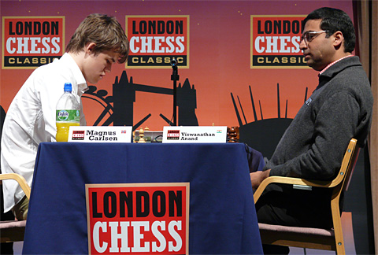

Novi izazivač za titulu svjetskog šahovskog prvaka, **[Magnus Carlsen,](http://en.wikipedia.org/wiki/Magnus_Carlsen "Wiki: Magnus Carlsen")** propustio je osvojiti prvo mjesto na posljednja dva turnira, ali 22-godišnji svjetski broj 1 je optimističan o svom nadolazećem meču protiv aktualnog svjetskog prvaka [**Ananda**](http://en.wikipedia.org/wiki/Viswanathan_Anand "Wiki: Viswanathan Anand"). U prilog mu svakako ide mladost i Anandove loše izvedbe u posljednje vrijeme.

**Anand** je bio, činilo se, na putu za prevladavanje loše forme. Nakon što je u veljači osvojio [Grenke Chess Classic 2013](/novosti/grenke-chess-classic-2013/ "Grenke Chess Classic 2013"), propušta prvo mjesto na turniru četvorice [Zurich Chess Challenge](http://www.zurich-cc.com/reports.html "Rezultat: Zurich Chess Challenge 2013"), zatim je treći na Aljehinovom memorijalu krajem travnja, te šesti na  [Norway Chess 2013](http://norwaychess.com/en/supertournament/resultsstandings/ "Rezultat: Norway Chess 2013") u svibnju. Na posljednjem turniru, Taljevom memorijalu u Moskvi indijski je velemajstor završio pretposljednji i samo potvrdio svoju silaznu formu, a da stvar bude gora, usput je glatko izgubio od novog izazivača.

Svjetski prvak ima 43 godine i uspješno je branio svoju krunu u tri meča, a u svima njima ključ pobjede bila je duboka i opsežna (kompjuterska) priprema kojom je osigurao barem jednu partiju od samog otvaranja. Carlsen je po mnogima favorit, a Anandova najveća šansa je u gušenju kreativnosti mladog norvežana. Anand je izjavio da neće igrati više turnire prije meča s Carlsenom. To je bila hrabra odluka, da se suzdrži od praktične igre ​​na pet mjeseci, no Anand vjeruje da je to, uz domaći teren i njegovo iskustvo u mečevima, njegova najbolja šansa.

Meč za prvaka svijeta u studenom počinje u [Chennai](http://hr.wikipedia.org/wiki/Chennai "Wiki: Chennai, Indija"), glavnom gradu indijske savezne države [Tamil Nadu](http://hr.wikipedia.org/wiki/Tamil_Nadu "Wiki: Tamil Nadu"). Lokacija je dogovorena [ne bez malo natezanja](http://articles.timesofindia.indiatimes.com/2013-05-07/chess/39090155_1_fide-world-championship-match-2013-match "The Times of India - Anand's challenger Carlsen resigned to Chennai as venue?"), jer je Carlsenov tim htio da se igra na neutralnom terenu. S druge strane, Anand je branio titulu protiv Topalova u Bugarskoj i protiv Gelfanda u Rusiji (iako igra pod izraelskom zastavom, [Boris Abramovich Gelfand je ustvari bjelorus](http://en.wikipedia.org/wiki/Boris_Gelfand "Wiki: Boris Gelfand"), tako da je to za njega bio domaći teren o.a.), pa se čini fer da napokon sad Anand igra u udobnosti svog doma.

**Carlsenove** pripreme za susret će biti aktivnije. On će imati svoju američku premijeru na Sinquefield kupu u rujnu, sa nagradnim fondom od 170.000 $ koji će se održati u St. Louisu, a gdje će nastupiti i svjetski broj 2, [**Levon Aronian**](http://en.wikipedia.org/wiki/Levon_Aronian "Wiki: Levon Aronian"), te američki top-dvojac Hikaru Nakamura (8) i Gata Kamsky (11).
