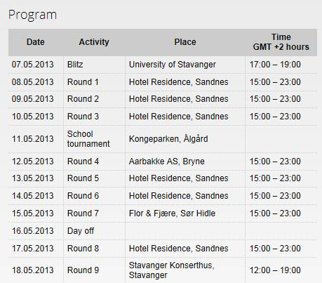
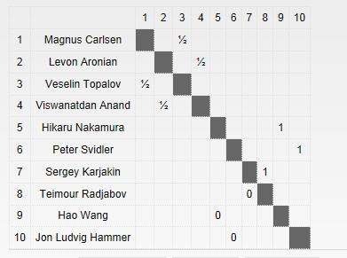

Jučer je odigran prvi krug [turnira](http://norwaychess.com/en/ "Norway Chess 2013") koji je najavljivao pojavljivanje prvih osam igrača na svijetu po rejtingu. Međutim, Vladimir Kramnik se povukao, a i rejting lista se nešto u međuvremenu promjenila, pa to više nije slučaj. Ipak, to je i dalje vrlo jak turnir – umjesto Kramnika uskočio je **Svidler**, a od top 10 igrača nedostaju, osim Kramnika, još samo Grischuk i Caruana.

Kao najava glavnog turnira održan je brzopotezni. Slavio je **Karjakin** sa 6,5/9 bodova. Poredak: 1. **Karjakin** (6,5) 2. **Carlsen** (6) 3. **Anand** (6) 4. **Nakamura** (6) 5. **Svidler** (5,5) 6. **Radjabov** (5) 7. **Hammer** (3,5) 8. **Wang** (3) 9. **Aronian** (2,5) 10. **Topalov** (1) 

Stanje nakon prvog kruga:

