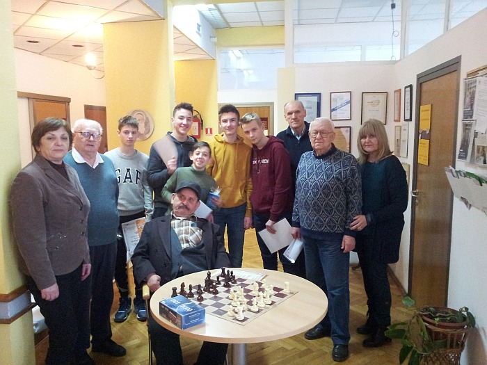
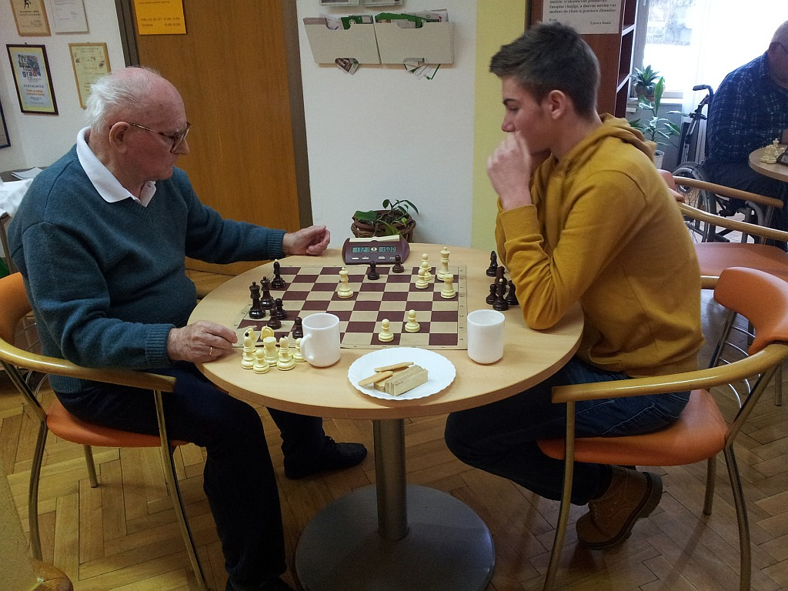
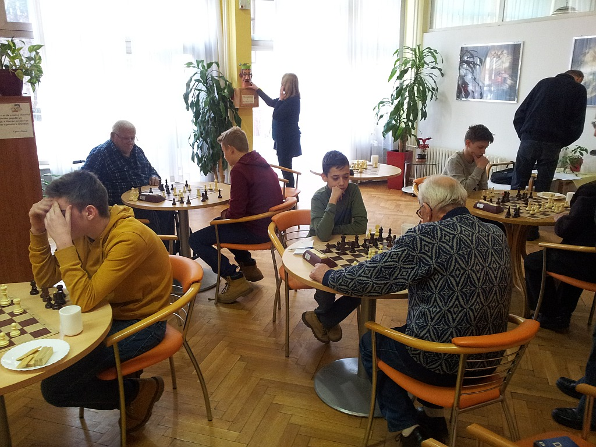
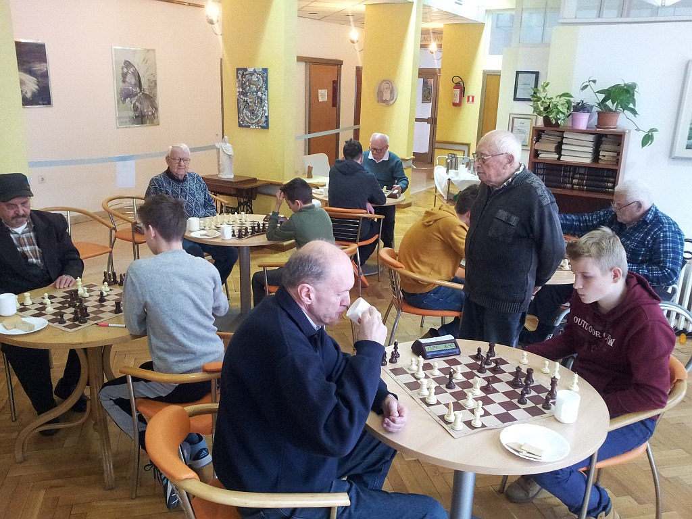
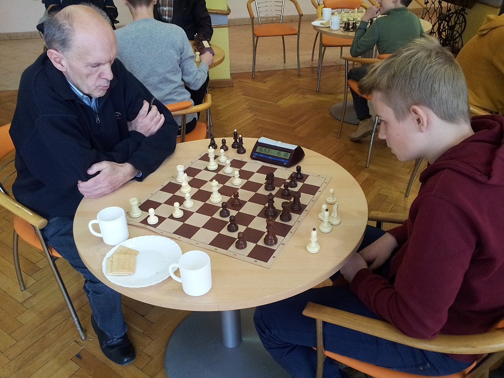
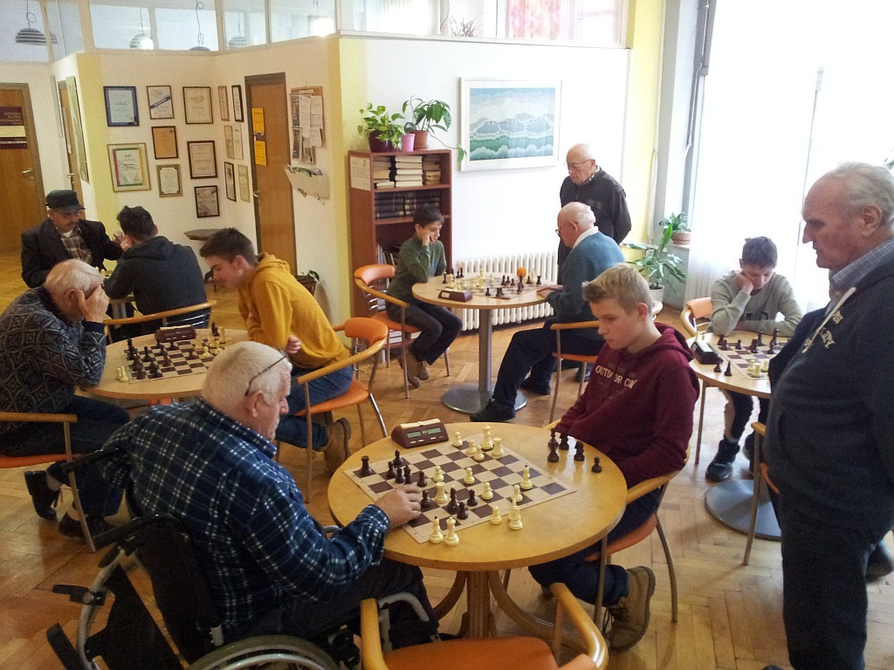
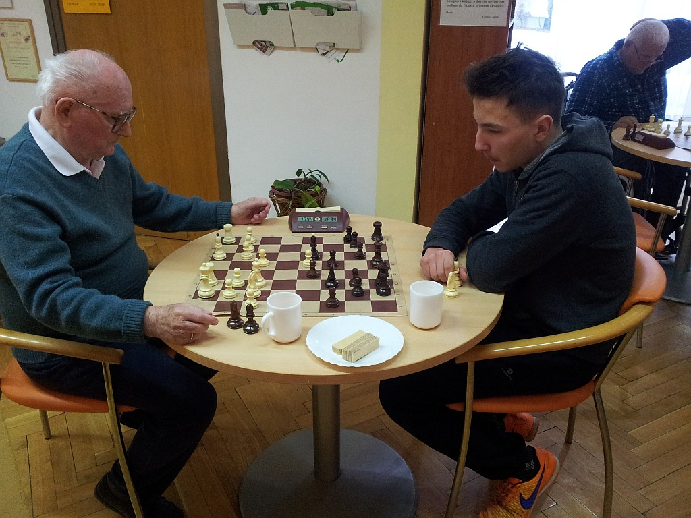
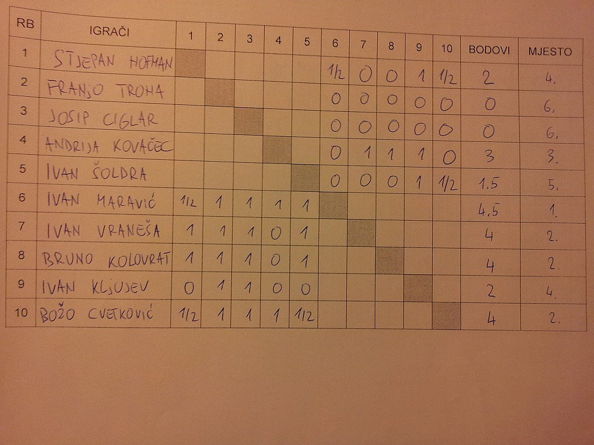
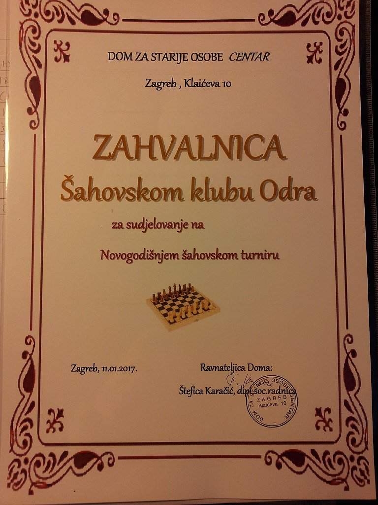

  
Danas je ŠK Odra, u pomlađenom sastavu, na pet ploča, na poziv [Doma za starije osobe Centar](http://dom-centar.hr/web/) i mag. socijalnog rada gospođe Slavice Mandić, sudjelovao na Novogodišnjem turniru koji je odigran u prostorima Doma u Klaićevoj 10 u Zagrebu. Meč je sudio klupski sudac Tin Furčić. Dečke su lijepo primili, a i dobro nahranili. Vraneša je bio zadovoljan, a on je ipak vjerodostojan glede hrane. 🙂 Dečki su bili zadovoljni i protivnicima, a to znači da su im partije bile izazov. Ne znam kako su u tri sata uspjeli odigrati pet partija i ručati, ali je Tin očito bio dobar organizator. Bitno je da je sve odrađeno na vrijeme. Dečki su dobili i lijepu zahvalnicu od Doma. Zahvaljujemo tati Boži na prijevozu, Tinu na suđenju i fotografijama te gospođi Slavici Mandić i ravnateljici Doma gospođi Štefici Karačić na pozivu i gostoprimstvu. U nastavku donosimo rezultat turnira, koji je ovaj put malo prevagnuo na stranu mladosti protiv iskustva, te nekoliko fotki sa susreta.  
     
     
darko
