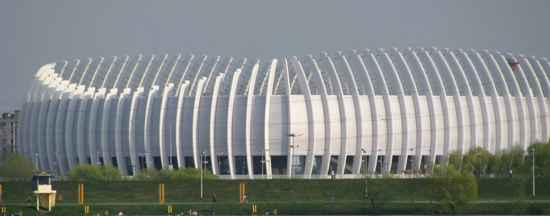

Pojavila se još jedna super prilika za naše kadete! U organizaciji ZŠS-a, sljedećeg vikenda u Arena centru održat će se turnir za kadete. Igraju sve dobne skupine zajedno, zapisivanje je obvezatno i to je prava prilika za vježbu: za mlađe kadete da usavršavaju tehniku zapisivanja poteza, za starije da usavrše igru. Uskoro će i Liga, treba biti u formi! Turnir nije daleko, u pretprijavi upisnina je 80 kn i potrebno je donijeti šahovski sat. (Može se u petak prije turnira uzeti iz Kluba.)

Knjižice su još kod roditelja odnosno za dečke kod Stjepka. Molim roditelje da **HITNO** obave prijave i/ili barem jave meni da to učinim.

\*\*\* Napomenuo bih u ovoj najavi da još ima djece koja bi uskoro trebala nastupiti na školskim natjecanjima, ali njihovi roditelji još nisu poslali ni kontakt, a kamoli potrebne podatke za izradu iskaznica Školskoga sportskog saveza.

RASPIS: [kadetski open arena centar 2014](/files/wp/2014/11/kadetski-open-arena-centar-2014.pdf)

[Prijavljeni igrači.](http://chess-results.com/tnr150712.aspx?lan=13 "prijave")
