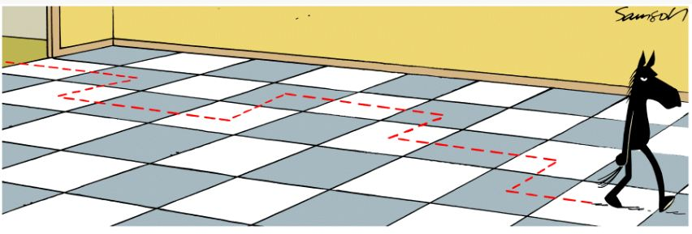

Počela je nova kalendarska, ali i šahovska 2014. godina! Neke promjene već su nastupile, neke još očekujemo. **DOM**: Ove godine mijenja se domar. Klub je dobio pravo korištenja prostora i za ovu godinu te se za nas ništa ne mijenja. Moramo još dogovoriti detalje oko otključavanja prostora. Iz tog razloga ovog petka, 3\. siječnja 2014., neće biti **ŠAHOVSKE ŠKOLE**, ali ću iskoristiti priliku i podsjetiti roditelje da za Božu i Franku nisu dostavljeni svi podaci potrebni za izradu iskaznica za službena školska natjecanja. Obično u školi postoje dežurstva i tijekom praznika pa apeliram na roditelje da nazovu i telefonom pribave potrebne podatke te ih pošalju elektroničkom poštom. **ŠAHOVSKI SAVEZ** od ove godine izrađuje plastificirane iskaznice koje će vrijediti do pet godina. Usto je skraćen rok za registraciju klubova do kraja siječnja.  Za izradu iskaznica **potrebne su fotografije svih članova Kluba u digitalnom obliku**. Za kadete i kadetkinje uglavnom već imamo slike. Podsjećam Tina, koji ima takvu sliku koju je slao u HUS, da sliku pošalje i u Klub! To također očekujem od članova koji rjeđe dolaze u klub: Zvjezdan, Ljubić, Emma, Golub… Tko ne dostavi sliku, neće biti registriran. **ISPISNICU IZ KLUBA** zatražio je, pismeno obrazložio i dobio Vjekoslav. Nedostajat će nam, ali se nadam da ćemo i dalje uspješno surađivati.  
**Želim svima uspješnu 2014., a Ivanu SRETAN ROĐENDAN!**

Darko

