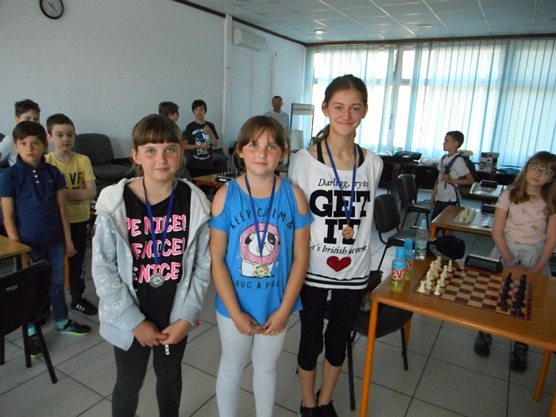
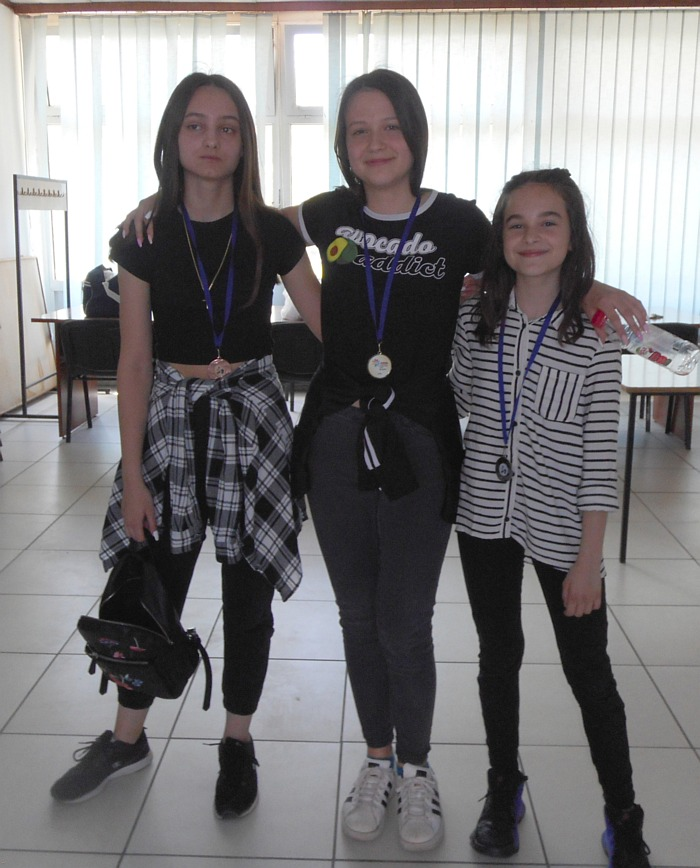

  
**Lucija Fiolić** i **Samanta Halužan** osvojile su prva mjesta na danas održanom natjecanju Plazma SPORTSKE IGRE MLADIH – Zagreb.

Tako su ujedno osvojile i put na finale SIM koje će se ovog ljeta održati u Splitu. Turnir se igrao u zagrebačkom kvartu Travno, a  bio je podjeljen u četiri skupine, do 11 i do 15 godina starosti, posebno za dječake, posebno za djevojčice. Tempo igre bio je 10+0. U mlađoj skupini sestre Fiolić su pomele konkurenciju te se okitile zlatom i srebrom. Po dodatnim kriterijima, zlato je pripalo Luciji, a srebro Ivani. U starijoj skupini prvo mjesto osvojila je Samanta. S istim bodovnim učinkom, ali mrvicu slabijim dodatnim kriterijima, srebro je pripalo Botici. Treće mjesto osvojila je Monika. U muškoj konkurenciji do 15, Luka Fiolić je na kraju završio četvrti, iako je po igri zaslužio i postolje. Dosta je napredovao u posljednje vrijeme. Četvrti, ali u mlađoj konkurenciji također je naš član, Višeslav Botica, koji je na turniru bio i najmlađi sudionik.  
Čestitke pobjednicama i želimo im puno sreće i sportskih uspjeha u finalu!

## Plazma SIM grada Zagreba – djevojčice  do 11

<table class="CRs1"><tbody><tr class="CRg1b"><td class="CRc">Mj.</td><td class="CR"></td><td class="CR">Ime</td><td class="CRr">Rtg</td><td class="CR">FED</td><td class="CRc">1</td><td class="CRc">2</td><td class="CRc">3</td><td class="CRc">4</td><td class="CRc">5</td><td class="CRc">6</td><td class="CRc">Bod.</td><td class="CRc">&nbsp;TB1</td><td class="CRc">&nbsp;TB2</td><td class="CRc">&nbsp;TB3</td></tr><tr class="CRg2 CRO"><td class="CRc">1</td><td class="CR"></td><td class="CR">Fiolić Lucija</td><td class="CRr">1600</td><td class="CR">CRO</td><td class="CRc">*</td><td class="CRc">½</td><td class="CRc">1</td><td class="CRc">1</td><td class="CRc">1</td><td class="CRc">1</td><td class="CRc">4,5</td><td class="CRc">0,5</td><td class="CRc">1,5</td><td class="CRc">8,25</td></tr><tr class="CRg1 CRO"><td class="CRc">2</td><td class="CR">IV</td><td class="CR">Fiolić Ivana</td><td class="CRr">1624</td><td class="CR">CRO</td><td class="CRc">½</td><td class="CRc">*</td><td class="CRc">1</td><td class="CRc">1</td><td class="CRc">1</td><td class="CRc">1</td><td class="CRc">4,5</td><td class="CRc">0,5</td><td class="CRc">1,5</td><td class="CRc">8,25</td></tr><tr class="CRg2 CRO"><td class="CRc">3</td><td class="CR"></td><td class="CR">Duvnjak Ema</td><td class="CRr">0</td><td class="CR">CRO</td><td class="CRc">0</td><td class="CRc">0</td><td class="CRc">*</td><td class="CRc">1</td><td class="CRc">1</td><td class="CRc">1</td><td class="CRc">3,0</td><td class="CRc">0,0</td><td class="CRc">0,0</td><td class="CRc">3,00</td></tr><tr class="CRg1 CRO"><td class="CRc">4</td><td class="CR"></td><td class="CR">Lončar Marija</td><td class="CRr">0</td><td class="CR">CRO</td><td class="CRc">0</td><td class="CRc">0</td><td class="CRc">0</td><td class="CRc">*</td><td class="CRc">1</td><td class="CRc">1</td><td class="CRc">2,0</td><td class="CRc">0,0</td><td class="CRc">0,0</td><td class="CRc">1,00</td></tr><tr class="CRg2 CRO"><td class="CRc">5</td><td class="CR"></td><td class="CR">Fabrični Kiara</td><td class="CRr">0</td><td class="CR">CRO</td><td class="CRc">0</td><td class="CRc">0</td><td class="CRc">0</td><td class="CRc">0</td><td class="CRc">*</td><td class="CRc">1</td><td class="CRc">1,0</td><td class="CRc">0,0</td><td class="CRc">0,0</td><td class="CRc">0,00</td></tr><tr class="CRg1 CRO"><td class="CRc">6</td><td class="CR"></td><td class="CR">Marić Leonarda</td><td class="CRr">0</td><td class="CR">CRO</td><td class="CRc">0</td><td class="CRc">0</td><td class="CRc">0</td><td class="CRc">0</td><td class="CRc">0</td><td class="CRc">*</td><td class="CRc">0,0</td><td class="CRc">0,0</td><td class="CRc">0,0</td><td class="CRc">0,00</td></tr></tbody></table>

## Plazma SIM grada Zagreba – dječaci  do 11

<table class="CRs1"><tbody><tr class="CRng1b"><td class="CRc">Mj.</td><td class="CR"></td><td class="CR">Ime</td><td class="CRr">Rtg</td><td class="CR">FED</td><td class="CRc">1.Rd</td><td class="CRc">2.Rd</td><td class="CRc">3.Rd</td><td class="CRc">4.Rd</td><td class="CRc">5.Rd</td><td class="CRc">Bod.</td><td class="CRc">&nbsp;TB1</td><td class="CRc">&nbsp;TB2</td><td class="CRc">&nbsp;TB3</td></tr><tr class="CRng2 CRO"><td class="CRc">1</td><td class="CR">IV</td><td class="CR">Apostolovski Filip</td><td class="CRr">1720</td><td class="CR">CRO</td><td class="CRc">3w1</td><td class="CRc">5b1</td><td class="CRc">4w1</td><td class="CRc">2b1</td><td class="CRc">6w1</td><td class="CRc">5,0</td><td class="CRc">0,0</td><td class="CRc">14,0</td><td class="CRc">9,0</td></tr><tr class="CRng1 CRO"><td class="CRc">2</td><td class="CR"></td><td class="CR">Muha Martin</td><td class="CRr">1600</td><td class="CR">CRO</td><td class="CRc">4w0</td><td class="CRc">8w1</td><td class="CRc">5b1</td><td class="CRc">1w0</td><td class="CRc">3b1</td><td class="CRc">3,0</td><td class="CRc">0,0</td><td class="CRc">14,0</td><td class="CRc">9,0</td></tr><tr class="CRng2 CRO"><td class="CRc">3</td><td class="CR"></td><td class="CR">Jerončić Matija</td><td class="CRr">1600</td><td class="CR">CRO</td><td class="CRc">1b0</td><td class="CRc">6w1</td><td class="CRc">7b1</td><td class="CRc">4b1</td><td class="CRc">2w0</td><td class="CRc">3,0</td><td class="CRc">0,0</td><td class="CRc">14,0</td><td class="CRc">8,0</td></tr><tr class="CRng1 CRO"><td class="CRc">4</td><td class="CR"></td><td class="CR">Botica Višeslav</td><td class="CRr">1639</td><td class="CR">CRO</td><td class="CRc">2b1</td><td class="CRc">7w1</td><td class="CRc">1b0</td><td class="CRc">3w0</td><td class="CRc">8w1</td><td class="CRc">3,0</td><td class="CRc">0,0</td><td class="CRc">12,0</td><td class="CRc">7,0</td></tr><tr class="CRng2 CRO"><td class="CRc">5</td><td class="CR"></td><td class="CR">Glasnović Noa</td><td class="CRr">1600</td><td class="CR">CRO</td><td class="CRc">6b1</td><td class="CRc">1w0</td><td class="CRc">2w0</td><td class="CRc">8b1</td><td class="CRc">7b1</td><td class="CRc">3,0</td><td class="CRc">0,0</td><td class="CRc">11,0</td><td class="CRc">6,0</td></tr><tr class="CRng1 CRO"><td class="CRc">6</td><td class="CR"></td><td class="CR">Šprljan Toma</td><td class="CRr">0</td><td class="CR">CRO</td><td class="CRc">5w0</td><td class="CRc">3b0</td><td class="CRc">8b1</td><td class="CRc">7w1</td><td class="CRc">1b0</td><td class="CRc">2,0</td><td class="CRc">0,0</td><td class="CRc">12,0</td><td class="CRc">7,0</td></tr><tr class="CRng2 CRO"><td class="CRc">7</td><td class="CR"></td><td class="CR">Žužul Lovro</td><td class="CRr">1600</td><td class="CR">CRO</td><td class="CRc">8b1</td><td class="CRc">4b0</td><td class="CRc">3w0</td><td class="CRc">6b0</td><td class="CRc">5w0</td><td class="CRc">1,0</td><td class="CRc">0,0</td><td class="CRc">11,0</td><td class="CRc">8,0</td></tr><tr class="CRng1 CRO"><td class="CRc">8</td><td class="CR"></td><td class="CR">Barić Marin</td><td class="CRr">1600</td><td class="CR">CRO</td><td class="CRc">7w0</td><td class="CRc">2b0</td><td class="CRc">6w0</td><td class="CRc">5w0</td><td class="CRc">4b0</td><td class="CRc">0,0</td><td class="CRc">0,0</td><td class="CRc">12,0</td><td class="CRc">8,0</td></tr></tbody></table>

## Plazma SIM grada Zagreba – djevojke  do 15

<table class="CRs1"><tbody><tr class="CRg1b"><td class="CRc">Mj.</td><td class="CR"></td><td class="CR">Ime</td><td class="CRr">Rtg</td><td class="CR">FED</td><td class="CRc">1</td><td class="CRc">2</td><td class="CRc">3</td><td class="CRc">4</td><td class="CRc">5</td><td class="CRc">6</td><td class="CRc">7</td><td class="CRc">Bod.</td><td class="CRc">&nbsp;TB1</td><td class="CRc">&nbsp;TB2</td><td class="CRc">&nbsp;TB3</td></tr><tr class="CRg2 CRO"><td class="CRc">1</td><td class="CR">III</td><td class="CR">Halužan Samanta</td><td class="CRr">1179</td><td class="CR">CRO</td><td class="CRc">*</td><td class="CRc">½</td><td class="CRc">½</td><td class="CRc">1</td><td class="CRc">1</td><td class="CRc">½</td><td class="CRc">1</td><td class="CRc">4,5</td><td class="CRc">0,5</td><td class="CRc">2,0</td><td class="CRc">11,50</td></tr><tr class="CRg1 CRO"><td class="CRc">2</td><td class="CR">III</td><td class="CR">Botica Lucija</td><td class="CRr">1048</td><td class="CR">CRO</td><td class="CRc">½</td><td class="CRc">*</td><td class="CRc">0</td><td class="CRc">1</td><td class="CRc">1</td><td class="CRc">1</td><td class="CRc">1</td><td class="CRc">4,5</td><td class="CRc">0,5</td><td class="CRc">1,5</td><td class="CRc">10,25</td></tr><tr class="CRg2 CRO"><td class="CRc">3</td><td class="CR">II</td><td class="CR">Kolovrat Monika</td><td class="CRr">1189</td><td class="CR">CRO</td><td class="CRc">½</td><td class="CRc">1</td><td class="CRc">*</td><td class="CRc">0</td><td class="CRc">½</td><td class="CRc">1</td><td class="CRc">1</td><td class="CRc">4,0</td><td class="CRc">0,0</td><td class="CRc">1,5</td><td class="CRc">10,75</td></tr><tr class="CRg1 CRO"><td class="CRc">4</td><td class="CR">II</td><td class="CR">Kolovrat Ana</td><td class="CRr">1210</td><td class="CR">CRO</td><td class="CRc">0</td><td class="CRc">0</td><td class="CRc">1</td><td class="CRc">*</td><td class="CRc">1</td><td class="CRc">½</td><td class="CRc">½</td><td class="CRc">3,0</td><td class="CRc">0,0</td><td class="CRc">1,0</td><td class="CRc">7,50</td></tr><tr class="CRg2 CRO"><td class="CRc">5</td><td class="CR">I</td><td class="CR">Balent Sara</td><td class="CRr">1139</td><td class="CR">CRO</td><td class="CRc">0</td><td class="CRc">0</td><td class="CRc">½</td><td class="CRc">0</td><td class="CRc">*</td><td class="CRc">1</td><td class="CRc">½</td><td class="CRc">2,0</td><td class="CRc">0,0</td><td class="CRc">0,5</td><td class="CRc">4,25</td></tr><tr class="CRg1 CRO"><td class="CRc">6</td><td class="CR">II</td><td class="CR">Kolovrat Franka</td><td class="CRr">1664</td><td class="CR">CRO</td><td class="CRc">½</td><td class="CRc">0</td><td class="CRc">0</td><td class="CRc">½</td><td class="CRc">0</td><td class="CRc">*</td><td class="CRc">½</td><td class="CRc">1,5</td><td class="CRc">0,5</td><td class="CRc">1,0</td><td class="CRc">4,50</td></tr><tr class="CRg2 CRO"><td class="CRc">7</td><td class="CR">IV</td><td class="CR">Kolovrat Lucija</td><td class="CRr">1622</td><td class="CR">CRO</td><td class="CRc">0</td><td class="CRc">0</td><td class="CRc">0</td><td class="CRc">½</td><td class="CRc">½</td><td class="CRc">½</td><td class="CRc">*</td><td class="CRc">1,5</td><td class="CRc">0,5</td><td class="CRc">0,5</td><td class="CRc">3,25</td></tr></tbody></table>

## Plazma SIM grada Zagreba – dječaci  do 15

<table class="CRs1"><tbody><tr class="CRg1b"><td class="CRc">Mj.</td><td class="CR"></td><td class="CR">Ime</td><td class="CRr">Rtg</td><td class="CR">FED</td><td class="CRc">1.Rd</td><td class="CRc">2.Rd</td><td class="CRc">3.Rd</td><td class="CRc">4.Rd</td><td class="CRc">5.Rd</td><td class="CRc">&nbsp;TB1</td><td class="CRc">&nbsp;TB2</td><td class="CRc">&nbsp;TB3</td></tr><tr class="CRg2 CRO"><td class="CRc">1</td><td class="CR">III</td><td class="CR">Frouth Vibor</td><td class="CRr">1727</td><td class="CR">CRO</td><td class="CRc">9b1</td><td class="CRc">2w1</td><td class="CRc">3b1</td><td class="CRc">4b1</td><td class="CRc">7w1</td><td class="CRc">5,0</td><td class="CRc">13,0</td><td class="CRc">8,0</td></tr><tr class="CRg1 CRO"><td class="CRc">2</td><td class="CR">IV</td><td class="CR">Šimović Kristijan</td><td class="CRr">1693</td><td class="CR">CRO</td><td class="CRc">10w1</td><td class="CRc">1b0</td><td class="CRc">5w1</td><td class="CRc">6b1</td><td class="CRc">3w1</td><td class="CRc">4,0</td><td class="CRc">13,0</td><td class="CRc">7,0</td></tr><tr class="CRg2 CRO"><td class="CRc">3</td><td class="CR">IV</td><td class="CR">Mikacinić Mislav</td><td class="CRr">1600</td><td class="CR">CRO</td><td class="CRc">4b1</td><td class="CRc">9w1</td><td class="CRc">1w0</td><td class="CRc">5b1</td><td class="CRc">2b0</td><td class="CRc">3,0</td><td class="CRc">15,0</td><td class="CRc">9,0</td></tr><tr class="CRg1 CRO"><td class="CRc">4</td><td class="CR">IV</td><td class="CR">Fiolić Luka</td><td class="CRr">1627</td><td class="CR">CRO</td><td class="CRc">3w0</td><td class="CRc">10b1</td><td class="CRc">6b1</td><td class="CRc">1w0</td><td class="CRc">9b1</td><td class="CRc">3,0</td><td class="CRc">12,0</td><td class="CRc">6,0</td></tr><tr class="CRg2 CRO"><td class="CRc">5</td><td class="CR"></td><td class="CR">Tonković Bartol</td><td class="CRr">1662</td><td class="CR">CRO</td><td class="CRc">7b1</td><td class="CRc">6w1</td><td class="CRc">2b0</td><td class="CRc">3w0</td><td class="CRc">8b0</td><td class="CRc">2,0</td><td class="CRc">13,0</td><td class="CRc">7,0</td></tr><tr class="CRg1 CRO"><td class="CRc">6</td><td class="CR">IV</td><td class="CR">Pezer Petar</td><td class="CRr">1799</td><td class="CR">CRO</td><td class="CRc">8w1</td><td class="CRc">5b0</td><td class="CRc">4w0</td><td class="CRc">2w0</td><td class="CRc">10b1</td><td class="CRc">2,0</td><td class="CRc">12,0</td><td class="CRc">7,0</td></tr><tr class="CRg2 CRO"><td class="CRc">7</td><td class="CR"></td><td class="CR">Plukavac Petar</td><td class="CRr">1600</td><td class="CR">CRO</td><td class="CRc">5w0</td><td class="CRc">8b1</td><td class="CRc">10w0</td><td class="CRc">9w1</td><td class="CRc">1b0</td><td class="CRc">2,0</td><td class="CRc">11,0</td><td class="CRc">5,0</td></tr><tr class="CRg1 CRO"><td class="CRc">8</td><td class="CR"></td><td class="CR">Frouth Filip</td><td class="CRr">1624</td><td class="CR">CRO</td><td class="CRc">6b0</td><td class="CRc">7w0</td><td class="CRc">9b0</td><td class="CRc">10b1</td><td class="CRc">5w1</td><td class="CRc">2,0</td><td class="CRc">8,0</td><td class="CRc">5,0</td></tr><tr class="CRg2 CRO"><td class="CRc">9</td><td class="CR"></td><td class="CR">Frouth Robert</td><td class="CRr">1600</td><td class="CR">CRO</td><td class="CRc">1w0</td><td class="CRc">3b0</td><td class="CRc">8w1</td><td class="CRc">7b0</td><td class="CRc">4w0</td><td class="CRc">1,0</td><td class="CRc">15,0</td><td class="CRc">8,0</td></tr><tr class="CRg1 CRO"><td class="CRc">10</td><td class="CR"></td><td class="CR">Matašić Filip</td><td class="CRr">1600</td><td class="CR">CRO</td><td class="CRc">2b0</td><td class="CRc">4w0</td><td class="CRc">7b1</td><td class="CRc">8w0</td><td class="CRc">6w0</td><td class="CRc">1,0</td><td class="CRc">13,0</td><td class="CRc">7,0</td></tr></tbody></table>
