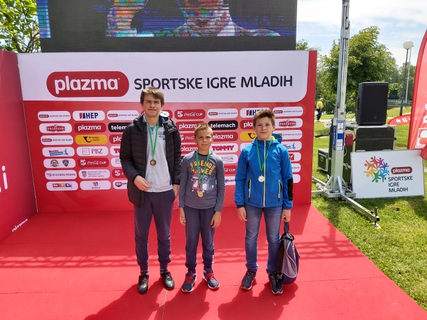

  
**N**akon dugo vremena bez šaha, odigrano je natjecanje “Sportske igre mladih” na sunčanom Jarunu. Lijepo vrijeme i atmosfera su obilježili natjecanje. Okupilo se ukupno 29 igrača i igračica. Igralo se u tri skupine: [dječaci do 15 godina](https://chess-results.com/tnr562333.aspx?lan=13&art=1), [djevojčice do 15 godina](https://chess-results.com/tnr562339.aspx?lan=13&art=4) i [dječaci do 11 godina](https://chess-results.com/tnr562323.aspx?lan=13&art=1). Zbog nedostatka prijavljenih djevojčica do 11, jedina natjecateljica koja je trebala biti u toj konkurenciji je prebačena u skupinu dječaka do 11. A sada idemo redom na naše članove, nastupilo ih je 9, od toga čak tri debitanta!  
**I**van je osvojio **prvo mjesto** u konkurenciji dječaka do 11 godina. Samouvjerenom, neustrašivom i najboljom igrom u konkurenciji je pobijedio **sve partije** i tako osvojio mjesto na državnoj završnici u Splitu!  
**S**lavko je osvojio **drugo mjesto** u istoj konkurenciji kao i Ivan. Igrao je jako dobro, nije puno previđao, treba mu samo više prakse da bi mogao vidjeti brže sitnu taktiku. Izgubio je jedino od pobjednika turnira, imao je jedan remi i s 3,5/5 zasluženo bio drugi.  
**L**uka je igrao u konkurenciji dječaka do 15 godina. Strpljivom igrom je osvojio **treće mjesto**. Izgubio je jedino od daleko najboljeg u toj konkureniciji – Damiana Vučenovića. Osim toga je imao jedan remi i sve ostale pobjede. Možda mu ovaj uspjeh bude poticaj da počne raditi na šahu više i ozbiljnije jer je opet pokazao koliki je talent.  
**J**osip je nakon dosta vremena nedavno počeo vježbati. To se možda ne vidi na rezultatu (2/5), ali se itekako vidi na igri gdje je dobro namučio svog klupskog kolegu Luku. Treba samo tako nastaviti i uskoro dolazi i rezultat.  
**T**ončiju je ovo bio prvi nastup koji je odradio više nego dobro. Pobijedio je jednu partiju protiv puno iskusnijeg igrača i odigrao nekolicinu dobrih partija, fali mu samo više samopouzdanja da napreduje još brže.  
**K**osta je također bio debitant, kao i kod Tončija, možemo biti više nego zadovoljni. Pobijedio je Tončija i imao još koju šansu u partijama protiv jakih igrača, čim smanji brzopletost i rezultat će postati bolji.  
**L**ucija je jedina uz Ivana imala 100% učinak od naših članova! Nakon što je pobijedila klupske kolegice Ivanu i Vjeku dogodila se nezgoda za vrijeme treće partije nakon koje više nije igrala, ali zbog koje je organizator odlučio darovati joj mjesto na završnici u Splitu. Na kraju je sve dobro prošlo.  
**I**vana je u subotu bila daleko ispod razine na kojoj može igrati, ali opet je odigrala neke impresivne partije i pokazala kako je dobra igračica postala, imala je samo loš dan, ali svejedno je osvojila dva boda i samo ju je pobjeda u zadnjem kolu djelila od postolja.  
**V**jeki je ovo bio prvi nastup. Igrala je u konkurenciji puno iskusnijih igračica te nije okusila slast pobjede, ali ako nastavi vježbat, uskoro će i ona početi osvajati bodove na turnirima.  
**S**ve u svemu, ovo je bilo jedno lijepo natjecanje nakon dugo vremena. Vrijeme nas je pomazilo te nije pala kiša i bilo je lijepo vidjeti kako je unatoč ne igranju turnira puno kadeta i kadetkinja ostalo u šahu.

## **Konačni poredak dječaci do 11**

<table><tbody><tr><td><strong>Mjesto</strong></td><td><strong>Ime i prezime</strong></td><td><strong>Bodovi</strong></td><td><strong>TB1</strong></td><td><strong>TB2</strong></td><td><strong>TB3</strong></td></tr><tr><td><strong>1</strong></td><td><strong>Ivan Pisačić</strong></td><td><strong>5,0</strong></td><td><strong>0,0</strong></td><td><strong>13,0</strong></td><td><strong>11,5</strong></td></tr><tr><td><strong>2</strong></td><td><strong>Slavko Biondić</strong></td><td><strong>3,5</strong></td><td><strong>0,5</strong></td><td><strong>13,0</strong></td><td><strong>12,5</strong></td></tr><tr><td>3</td><td>Višeslav Botica</td><td>3,5</td><td>0,5</td><td>12,0</td><td>11,5</td></tr><tr><td>4</td><td>Filip Frouth</td><td>3,0</td><td>1,0</td><td>11,5</td><td>10,0</td></tr><tr><td>5</td><td>Mihael Katić</td><td>3,0</td><td>0,0</td><td>11,0</td><td>10,5</td></tr><tr><td>6</td><td>Robert Frouth</td><td>2,0</td><td>0,0</td><td>14,0</td><td>12,5</td></tr><tr><td></td><td>Ante Poplaša</td><td>2,0</td><td>0,0</td><td>14,0</td><td>12,5</td></tr><tr><td>8</td><td>Jagor Bučević</td><td>2,0</td><td>0,0</td><td>11,5</td><td>11,0</td></tr><tr><td>9</td><td>Ema Gal</td><td>1,0</td><td>0,0</td><td>12,0</td><td>11,5</td></tr></tbody></table>

## **Konačni poredak dječaci do 15**

<table><tbody><tr><td><strong>Mjesto</strong></td><td><strong>Ime i prezime</strong></td><td><strong>Bodovi</strong></td><td><strong>TB1</strong></td><td><strong>TB2</strong></td><td><strong>TB3</strong></td></tr><tr><td>1</td><td>Damian Vučenović</td><td>5,0</td><td>0,0</td><td>13,5</td><td>11,5</td></tr><tr><td>2</td><td>Vibor Frouth</td><td>3,5</td><td>0,0</td><td>13,5</td><td>11,0</td></tr><tr><td><strong>3</strong></td><td><strong>Luka Fiolić</strong></td><td><strong>3,5</strong></td><td><strong>0,0</strong></td><td><strong>13,0</strong></td><td><strong>12,0</strong></td></tr><tr><td>4</td><td>Leon Đurić</td><td>3,0</td><td>0,0</td><td>14,0</td><td>13,0</td></tr><tr><td>5</td><td>Šimun Knez</td><td>3,0</td><td>0,0</td><td>11,0</td><td>10,0</td></tr><tr><td>6</td><td>David Rukavina</td><td>2,5</td><td>0,0</td><td>15,5</td><td>14,5</td></tr><tr><td>7</td><td>Gabriel Katić</td><td>2,5</td><td>0,0</td><td>15,5</td><td>13,0</td></tr><tr><td>8</td><td>Bartol Tonković</td><td>2,5</td><td>0,0</td><td>11,5</td><td>10,5</td></tr><tr><td>9</td><td>Lovro Vukoja</td><td>2,5</td><td>0,0</td><td>10,0</td><td>9,0</td></tr><tr><td>10</td><td>Petar Pezer</td><td>2,0</td><td>0,0</td><td>14,5</td><td>13,5</td></tr><tr><td><strong>11</strong></td><td><strong>Josip Mahin</strong></td><td><strong>2,0</strong></td><td><strong>0,0</strong></td><td><strong>11,0</strong></td><td><strong>10,0</strong></td></tr><tr><td><strong>12</strong></td><td><strong>Tonči Meić</strong></td><td><strong>1,0</strong></td><td><strong>0,0</strong></td><td><strong>12,0</strong></td><td><strong>11,0</strong></td></tr><tr><td>13</td><td>Martin Muha</td><td>1,0</td><td>0,0</td><td>11,5</td><td>10,5</td></tr><tr><td><strong>14</strong></td><td><strong>Kosta Vujasinović</strong></td><td><strong>1,0</strong></td><td><strong>0,0</strong></td><td><strong>8,5</strong></td><td><strong>7,5</strong></td></tr></tbody></table>

## **Konačni poredak djevojčice do 15**

<table><tbody><tr><td><strong>Mjesto</strong></td><td><strong>Ime i prezime</strong></td><td><strong>Bodovi</strong></td><td><strong>TB1</strong></td><td><strong>TB2</strong></td><td><strong>TB3</strong></td></tr><tr><td>1</td><td>Luna Vukoja</td><td>5,0</td><td>0,0</td><td>2,0</td><td>10,0</td></tr><tr><td>2</td><td>Lucija Botica</td><td>3,0</td><td>1,0</td><td>1,0</td><td>5,0</td></tr><tr><td>3</td><td>Petra Mardešić</td><td>3,0</td><td>0,0</td><td>0,0</td><td>4,0</td></tr><tr><td><strong>4</strong></td><td><strong>Lucija Fiolić</strong></td><td><strong>2,0</strong></td><td><strong>1,0</strong></td><td><strong>0,0</strong></td><td><strong>2,0</strong></td></tr><tr><td><strong>5</strong></td><td><strong>Ivana Fiolić</strong></td><td><strong>2,0</strong></td><td><strong>0,0</strong></td><td><strong>1,0</strong></td><td><strong>3,0</strong></td></tr><tr><td><strong>6</strong></td><td><strong>Vjeka Vidra</strong></td><td><strong>0,0</strong></td><td><strong>0,0</strong></td><td><strong>0,0</strong></td><td><strong>0,0</strong></td></tr></tbody></table>
