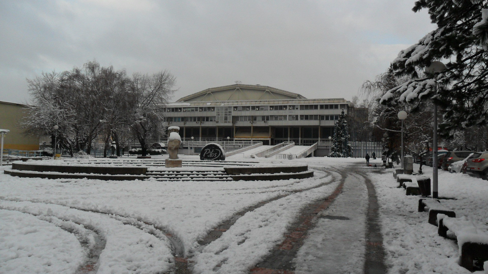
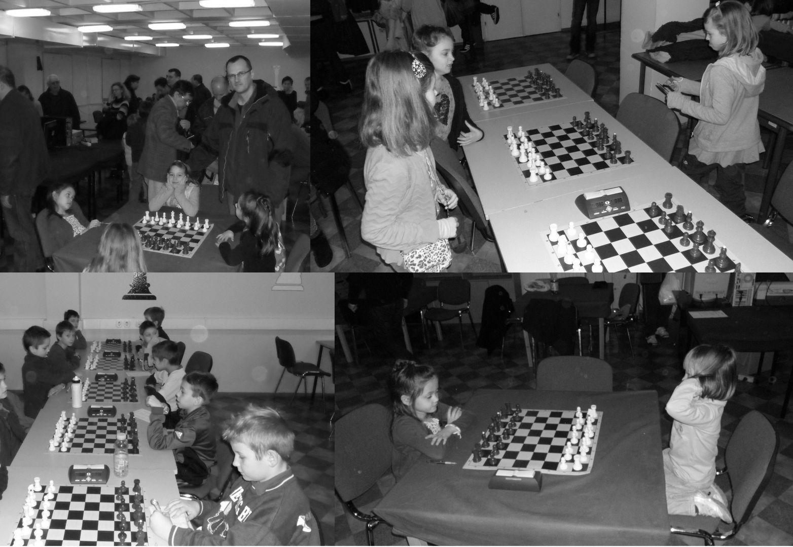

Danas je počelo Pojedinačno prvenstvo Zagreba 2014. za dječake i djevojčice do 9 i 11 godina. Svi naši registrirani članovi te dobi sudjeluju na turniru. Imao sam priliku malo pratiti današnja zbivanja i, osim što sam sretan jer su svi došli, ugodno su me iznenadili dečki, koji su ipak poslušali savjet i počeli zapisivati partije. Još su me ugodnije iznenadili Božo i Bruno jer su stvarno dobro igrali i trudili se. A zahvaljujući partijama koje ćemo poslije analizirati, i brže će naučiti neke nove detalje. Djevojčice još nisu na toj razini jer su mlađe. U njihovoj skupini posebno sam zadovoljan Frankom, koja je prvu partiju odigrala jako lijepo, razmišljajući i pametno se koristeći vremenom. Nažalost, jako se umorila pa je drugu partiju odigrala lošije. Monika igra sve bolje i bolje, a ima i pobjedu iz prvoga kola, a Lucija je uspjela osvojiti pola boda iako mislim da ona može i više. Samo mora biti malo sporija i ne brzati kao Ana, koja je inače najbolja, ali je danas bila prebrza. I za nju znam da bi mogla zapisivati poteze, ali neće. Sutra je nastavak i nadam se da će se svi dobro zabaviti, steći ponešto iskustva i osvojiti još poneki bod. Ili pola! 🙂

[Rezultati.](http://chess-results.com/tnr122768.aspx?lan=13 "Prvenstvo Zagreba za dječake i djevojčice do 9 i 11 godina")

Trenić D.

