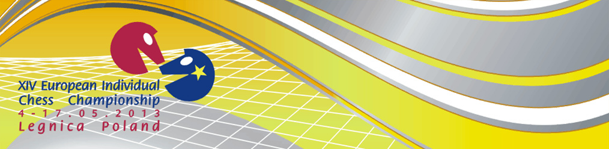

Jučer je u *Legnici*, u *Poljskoj* započelo *XIV pojedinačno Europsko prvenstvo*, a sutra (7.5.) je na redu već treće kolo. Igra se po švicarskom sistemu, jedanaest kola, 90 minuta za 40 poteza + 30 minuta za ostatak partije + 30 sekundi za svaki potez, počevši od prvog. Ukupni nagradni fond je 100 000 € koje će podjeliti prvih 25 igrača. Sudjeluje 286 igrača iz 38 zemalja, 12 sa rejtingom 2700+, **[8 iz Hrvatske](http://en.eicc2013.pl/index.php/results "XIV pojedinačno Europsko prvenstvo - popis HR igrača"). Šarić** nakon dva kola ima 100%-tni učinak, **Stević, Kuljašević** i **Brkić** imaju po bod i pol, **Kožul** 1, dok naši ostali predstavnici još čekaju na prve bodove.

NAPOMENA: gornja grafika je poveznica na službene stranice turnira; međutim u kasnovečernjim satima preusmjerava na stranice hosting providera i baca neke njihove reklame. Osim što su na poljskom, pa su stoga mrvicu nerazumljive, predstavljaju stvarno inovativan način spamanja i makar je to možda legalno izvedeno ipak je za svaku osudu. U znak prosvjeda nemojte hostat svoje stranice kod njih! 🙂
