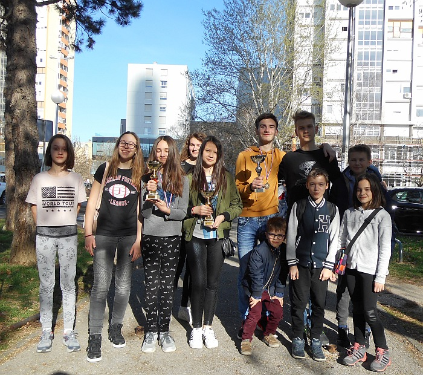
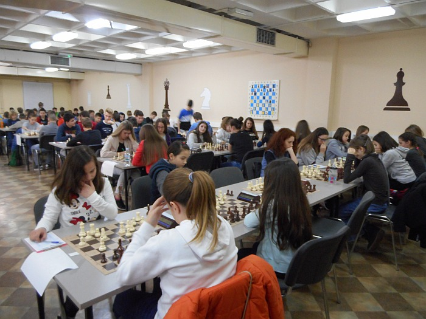
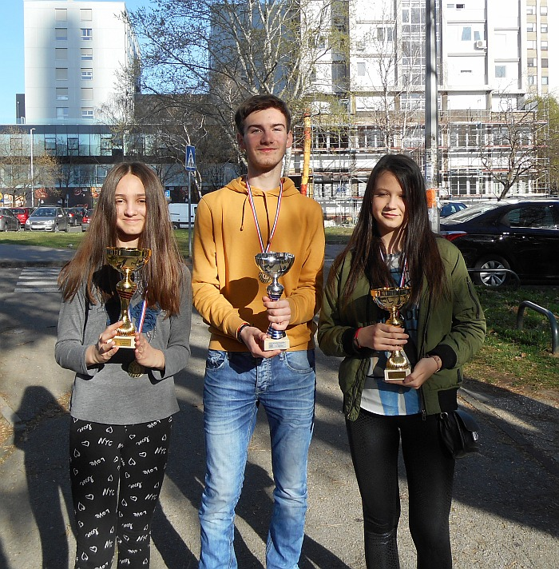

  
**ŠK Odra ima prvakinju Zagreba do 13, prvakinju Zagreba do 15  i prvaka Zagreba do 15 godina!**

**Monika Kolovrat, prvakinja Zagreba do 13 godina!**  
**Samanta Halužan, prvakinja Zagreba do 15 godina!**  
**Ivan Maravić, prvak Zagreba do 15 godina!** 

  

Tri nedjelje zaredom, igrano je Kadetsko pojedinačno prvenstvo Zagreba. U četiri konkurencije, djevojke [do 13](http://chess-results.com/tnr416734.aspx?lan=13&art=4) i [15](http://chess-results.com/tnr416732.aspx?lan=13&art=1) i dječaci do [13](http://chess-results.com/tnr416736.aspx?lan=13&art=4) i [15.](http://chess-results.com/tnr416731.aspx?lan=13&art=4) Turnir je igran u Domu sportova u organizaciji Zagrebačkog šahovskog saveza koji je osigurao i rekvizite za sve sudionike. Tempo igre bio je 30+30 uz obavezno zapisivanje poteza, a bodovao se i za nacionalnu rejting listu.  
Deset naših članova sudjelovalo je na ovim natjecanjima, a kući su ponijeli tri zlata! **Najuvjerljivija je bila Monika** koja je na turniru U13 napravila 8,5/9, a i tih pola boda je poklonila na nagovor tate, kako bi i prije kraja osigurala zlato! :))) Na igri mora još dosta raditi, ali je pokazala izuzetnu smirenost i upornost na cijelom turniru te uz pehar, osvojila i II. kategoriju. Klupske kolegice su također bile blizu postolja, Botica je završila kao četvrta, a Franka kao peta.  
U kategoriji U15, pomalo neočekivano i uz malu dozu sreće, ali na našu veliku radost, **Samanta je osvojila prvo mjesto.** Izgubila je samo jednu partiju, kao i drugoplasirana Tihana Erenda, ali je bila bolja do dodatnim kriterijima. Inače, glavna favoritkinja ovog turnira, Lucija Smetiško je završila kao četvrta jer je posljednji krug ipak dala prednost skijanju.  
Na turniru U15 za dječake, **Ivan Maravić** ponovio je [prošlogodišnji uspjeh](/novosti/pojedinacno-kadetsko-prvenstvo-zagreba-2018/) i opet uzeo zlato. Turnir je odigrao bez opterećenja, nije silio pozicije i lagano se prošetao turnirom. Čak je prijateljski remizirao i s klupskim kolegom Vranešom koji je osvojio peto mjesto na ovom turniru.  
Jedino na turniru U13 za dječake nismo ostvarili neki značajniji rezultat. Još čekamo Luku i Filipa da se prihvate ozbiljnijeg rada.  
Sve u svemu, ovo je povijesni uspjeh i ostvaren je prvenstveno zalaganju i radu svih naših mladih članova. Još jednom čestitke svim sudionicima, a posebno Moniki, Samanti i Ivanu!
