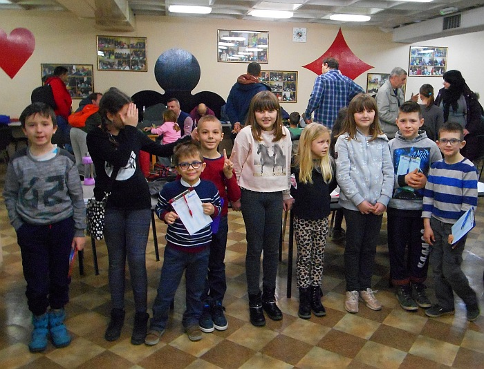
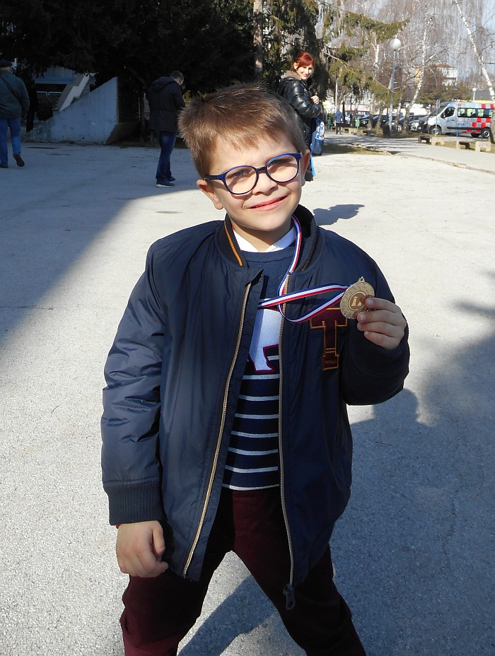
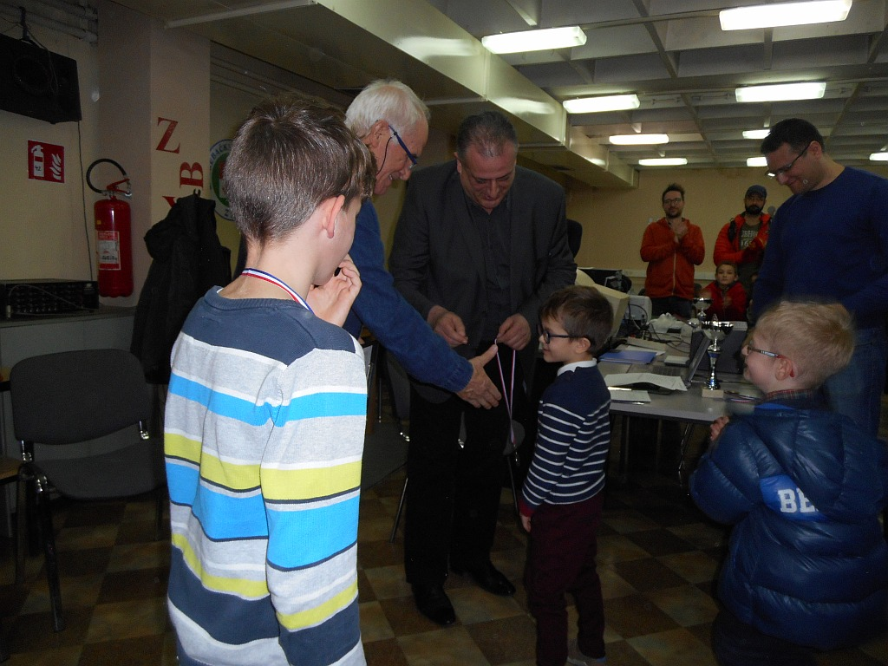
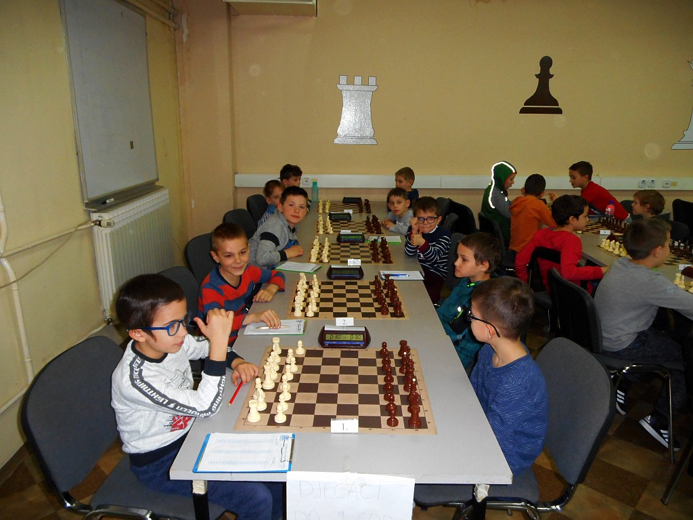
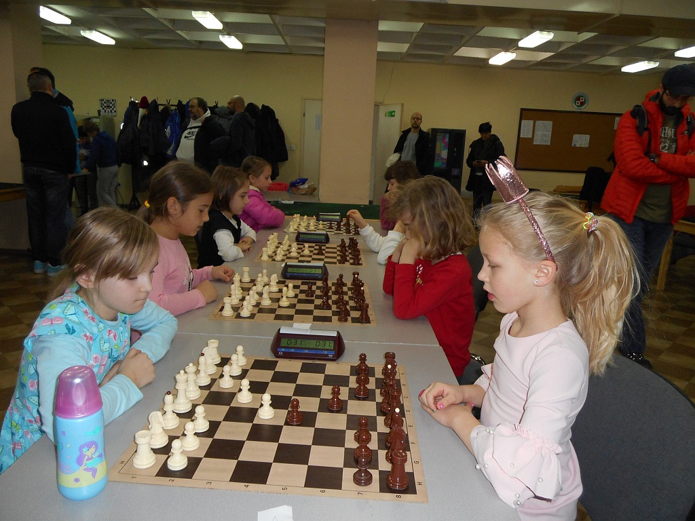
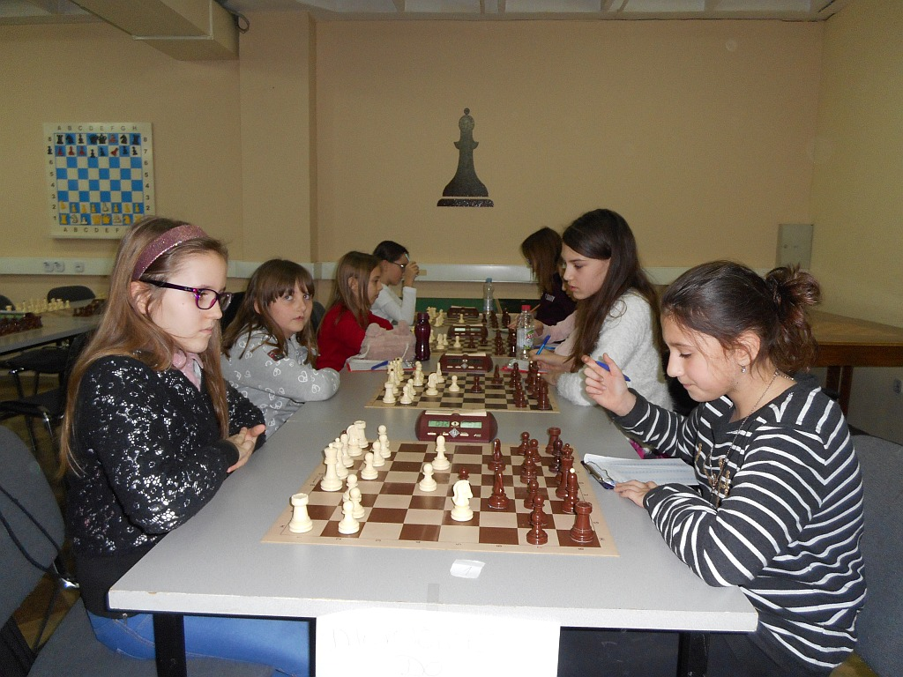

  
Danas su započela pojedinačna kadetska prvenstva Zagreba u kategorijama [U9](http://chess-results.com/tnr409876.aspx?lan=13&art=4) i [U11](http://chess-results.com/tnr409873.aspx?lan=13&art=1). Prvenstva se igraju u Domu sportova u organizaciji Zagrebačkog šahovskog saveza. Tempo igre je 30+30. U kategoriji dječaka U9 nastupa 30 igrača, dok je u kategoriji djevojčica [8 igračica](http://chess-results.com/tnr409877.aspx?lan=13&art=1&fed=CRO). Slično je i starijoj skupini. 29 dječaka igra u skupini U11, dok je [djevojčica 9](http://chess-results.com/tnr409878.aspx?lan=13&art=1&fed=CRO). Iz ŠK Odra nastupa devet članova, Antonio (U11), Dora, Fivana, Flucija (U11), Slavko, Visko, Toma i Ivan Pisačić (U9) i Nola (U9). Nije nam došao samo Luka Matašić koji se malo zasitio šaha. Šteta, jer je u posljednje vrijeme baš dobar. Zasad najbolje ide Visku i Fivani, ali je još daleko do kraja turnira. Turnir se nastavlja sljedeće nedjelje kada se igra četvrto kolo s početkom u 10 sati. Turniri za starije kadete počinju 3. ožujka i također će trajati tri nedjelje za redom.

---

24\. veljače 2019.

#                    **Višeslav osvojio srebro!  
**

Na danas završenom Pojedinačnom kadetskom prvenstvu Zagreba, **Višeslav Botica Visko** osvojio je **drugo mjesto u konkurenciji dječaka [do 9 godina](http://chess-results.com/tnr409876.aspx?lan=13&art=1&fed=CRO)**! Izgubio je samo jednu partiju, od zasluženog pobjednika turnira Petra Jozića iz ŠK Novi Zagreb. Tempo je bio sporiji (30+30) od njemu uobičajenog rapida i uprkos njegovoj snazi, malo smo strahovali, ali rezultat ipak nije izostao. Najviše respekta pokazao je prema klupskom kolegi Slavku Biondiću. Puno radi i vježba, ali mora još puno naučiti, prvenstveno usporiti igru tj. pravilnije trošiti vrijeme i smirenije podnositi poraze. Čestitamo Visku i želimo mu da se na Prvenstvu Hrvatske popne samo za jednu stepenicu više!  I naravno, da do Prvenstva Hrvatske nauči pisati. 🙂

Čak tri naša kadeta vodila su borbu za postolje do zadnjeg kola, Visko, Ivanda i Slavko. Slavka nije mazio ždrijeb i posljednja tri kola igrao je protiv tri najjača igrača na turniru te na kraju završio turnir na 13. mjestu. Uprkos početnoj tremi, na kraju se ipak najbolje prilagodio na sporiji tempo i pravilno trošio vrijeme, a prilično je savladao i pisanje. Ivan Pisačić Ivanda skupio je respektabilnih 6 bodova i dijeli treće mjesto, ali je po dodatnim kriterijima završio turnir kao sedmi. Ivanda je šestogodišnjak, kao i Visko.

Od djevojčica, Fivana i Dora su osvojile po tri boda te [turnir U11](http://chess-results.com/tnr409878.aspx?lan=13&art=4) završile na petom, odnosno šestom mjestu. Flucija i Nola se nisu dočepale bodova, ali su ipak, zahvaljujući manjoj konkurenciji upale među prvih deset! Toma i Antonio su se hrabro borili, a ne sumnjam da će i njih rezultat krenuti budu li samo uporni.  
Svim klincima i klincezama čestitke na uspješno odrađenom turniru!

  
