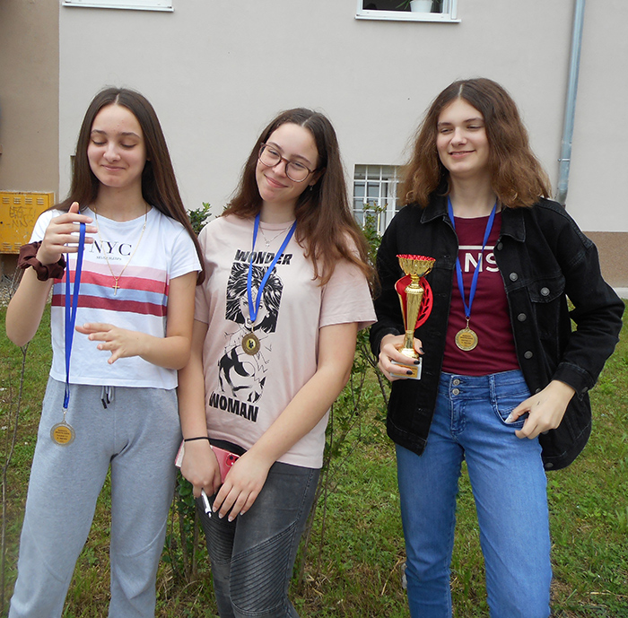
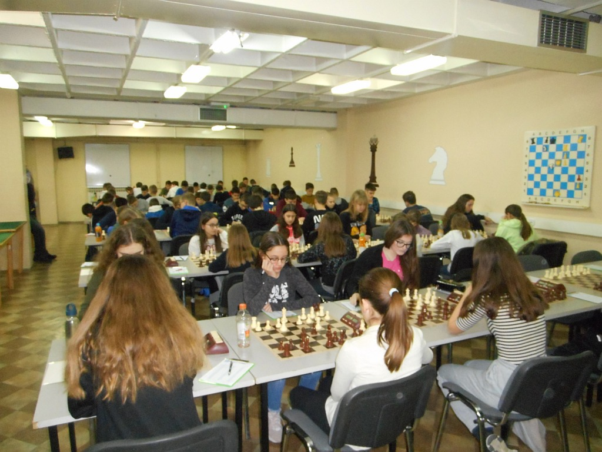
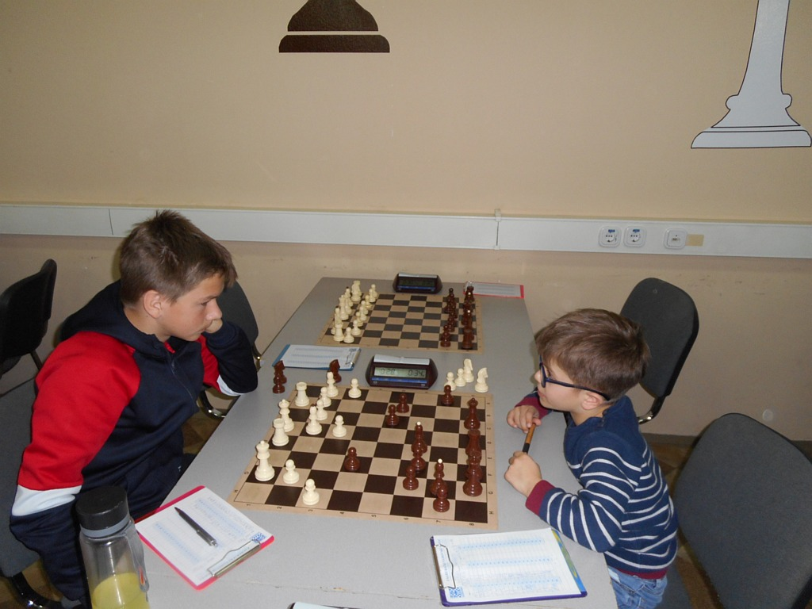
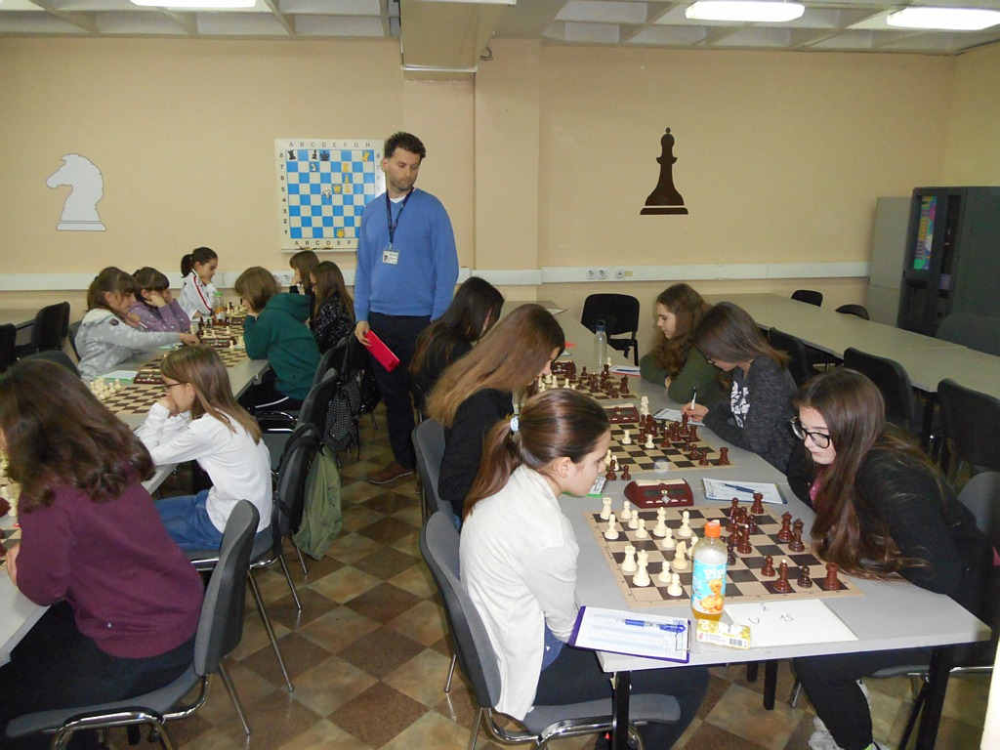
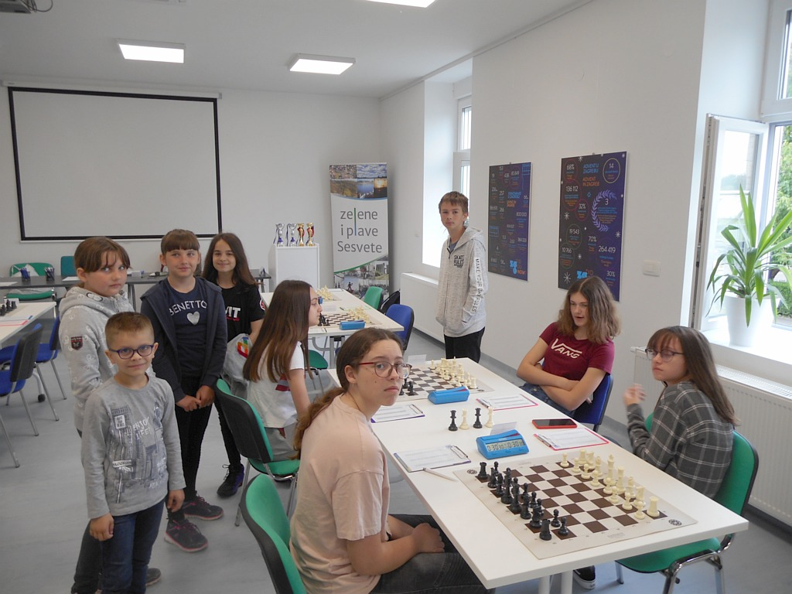

## **Ana prva, Monika druga, Franka treća!  
**

Nakon što su nas [u mlađoj konkurenciji](/novosti/pojedinacna-kadetska-prvenstva-zagreba-2020-u9-u11/) Ivana i Višeslav obradovali s dvije brončane medalje, u starijoj konkurenciji tri djevojke su uzele medalju, a Ana i pehar!  
Na Pojedinačnom kadetskom prvenstvu Zagreba 2020. u  konkurenciji djevojaka [**U15**](https://chess-results.com/tnr520513.aspx?lan=13&art=1&fed=CRO) **Ana je osvojila prvo mjesto**, a **Monika drugo**. **Franka je uzela broncu** u konkurenciji djevojaka [**U13**](https://chess-results.com/tnr513049.aspx?lan=13&art=4&fed=CRO). Čestitamo! U toj konkurenciji nastupile su još sestre Fiolić skupljajući iskustvo za skorašnje prvenstvo hrvatske te Botica, koja je bila hendikepirana, obzirom da je propustila prva dva kola.  
Veliku priliku propustili su Franka, koja je olako poklonila pola boda u predzadnjem kolu te tako završila treća, a ne prva, i Luka Fiolić, koji igra sve bolje, a kojemu je u konkurenciji **[U13](https://chess-results.com/tnr513094.aspx?lan=13&art=4&fed=CRO)** trebala pobjeda u zadnjem kolu za osvajanje medalje. Luka se u posljednje vrijeme najviše trudi i to se uvelike vidi u njegovoj igri.  
Turnir je započeo još početkom ožujka u Domu sportova, ali je bio prekinut te je danas završen u novouređenoj dvorani ŠK Sljeme Agroproteinka u Sesvetama. Nažalost, veliki broj natjecatelja se nije pojavio u ovom nastavku, uključujući naše Josipa, Slavka, Doru, Samantu, Filipa… Svi su ovih zadnjih mjeseci prilično popustili s vježbom, a zadnja dva tjedna čak i sestre Fiolić. Starije djevojke se mogu pravdati pubertetom, ali mlađi nemaju baš neki izgovor. Nadamo se da će se ipak svi početi ozbiljnije pripremati za PH u kolovozu.  
Klinci su ponos ovog Kluba, a ovim rezultatima samo nam potvrđuju da smo na dobrom putu. Imamo već pet kadeta odn. kadetkinja koje možemo stavljati u seniorsku ekipu (Ana, Samanta, Monika, Vraneša i Ivan Maravić), a nadamo se da će se taj broj i povećavati. Još jednom čestitke svima na uloženom trudu, a Ani, Moniki i Franki i velika hvala na osvojenim medaljama!  
   
   
darko
