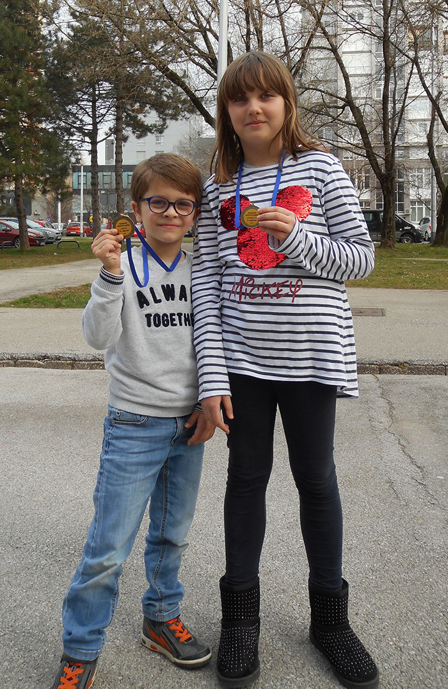
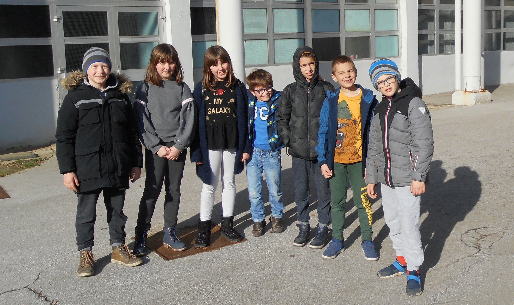
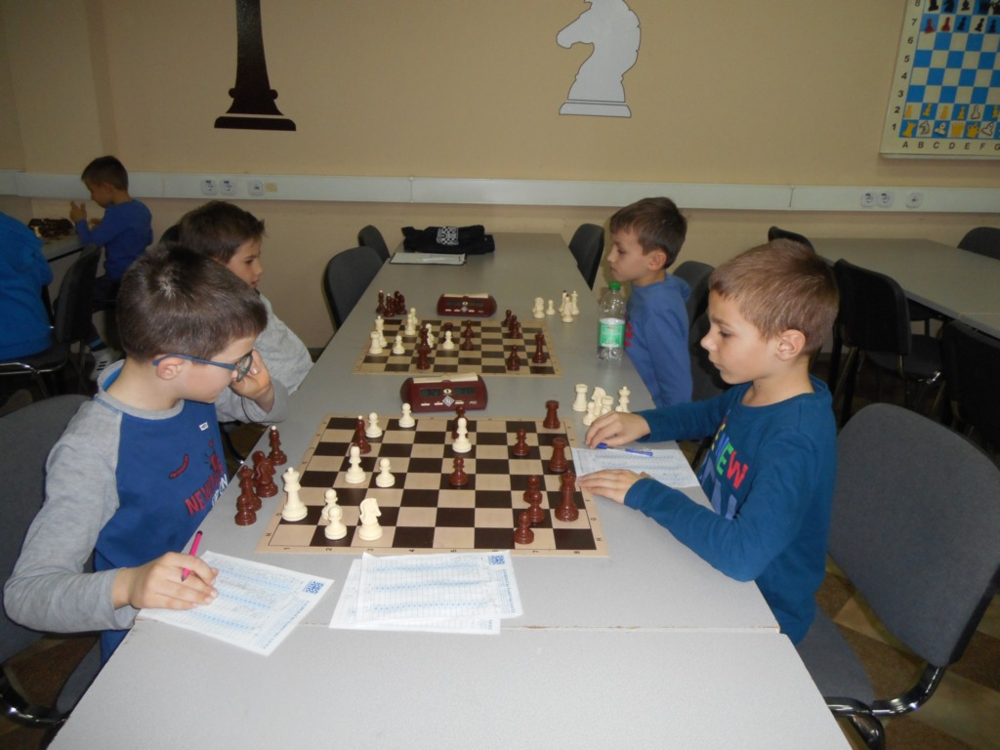
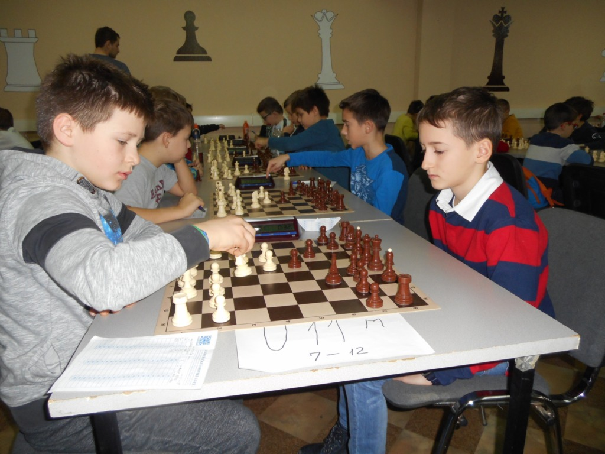

### Ivana i Višeslav osvojili bronce!

Drugog, devetog i 16. veljače, igrana su Pojedinačna kadetska prvenstva Zagreba u kategorijama do 7, do 9 i do 11 godina. Turniri su igrani u Domu sportova u organizaciji Zagrebačkog šahovskog saveza. Tempo igre bio je 30+30 uz obavezno zapisivanje poteza. Novina ove godine su turniri do 7 godina.  Minimalan broj igračica bio je u skupini [do 7](https://chess-results.com/tnr511330.aspx?lan=13&art=4), samo dvije, ali vjerujem da će se to popraviti već sljedeće godine. Od naših članova, nastupili su u kategoriji [U9](https://chess-results.com/tnr511326.aspx?lan=13&art=4); Višeslav Botica, Ivan Pisačić i Toma Biondić. U kategoriji [U11](https://chess-results.com/tnr511324.aspx?lan=13&art=4) nastupili su Luka Matašić i Slavko Biondić. Također u kategoriji [U11Z](https://chess-results.com/tnr511321.aspx?lan=13&art=1) nastupile su sestre Fiolić, Ivana i Lucija.  **Pohvalne rezultate postigli su Višeslav i Ivana, osvojivši treća mjesta u svojoj konkurenciji**. Njih dvoje najviše rade na šahu pa njihov uspjeh nije iznenađenje. Vrlo dobar bio je i Luka Matašić koji je medalju ispustio u posljednjem kolu, ali ipak završio vrlo visoko, na šestom mjestu. Poraz u zadnjem kolu koštao je i Slavka ulaska u prvih deset. Klinci dobro napreduju, a neki od njih su se hrabro prijavili i na turnir starijih ([U13](https://chess-results.com/tnr513094.aspx?lan=13)) koji započinje 1. ožujka. Čestitamo Ivani i Višeslavu, a ostalima želimo da im se već sljedeće godine priključe na postolju. 🙂  
  
 
