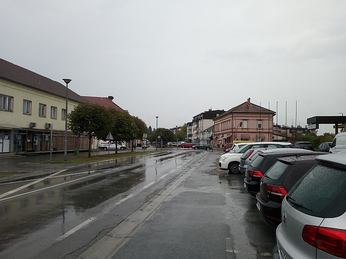
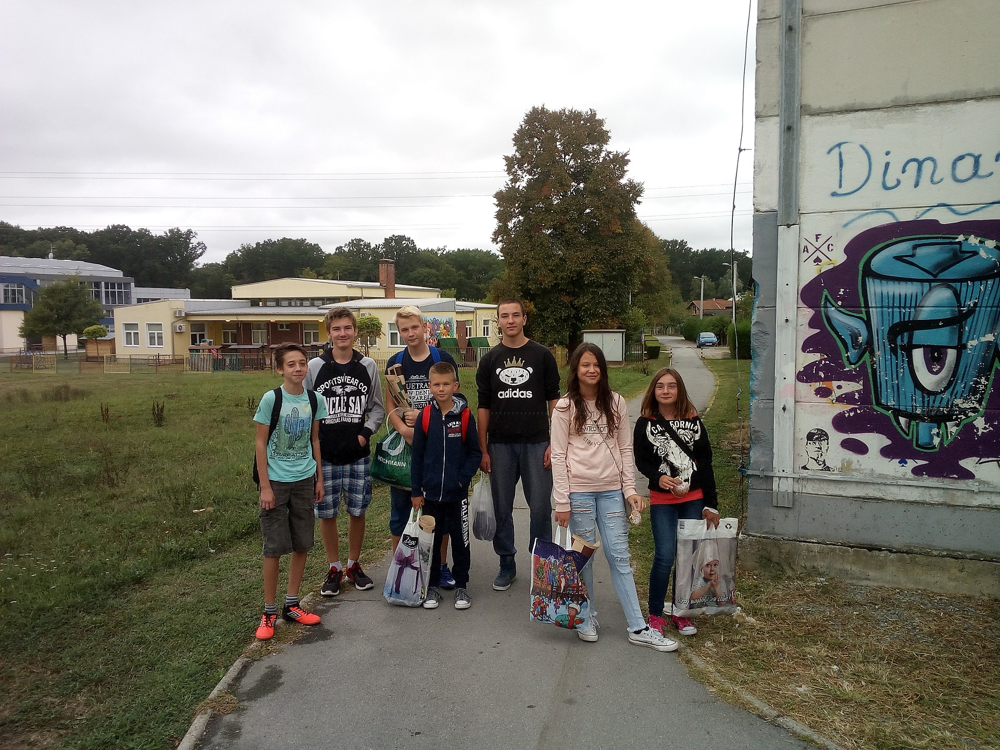
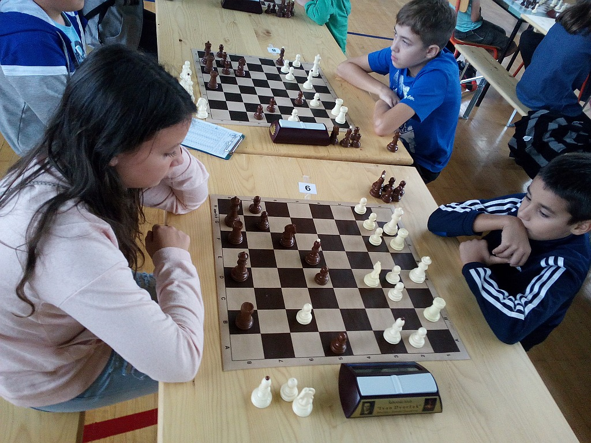
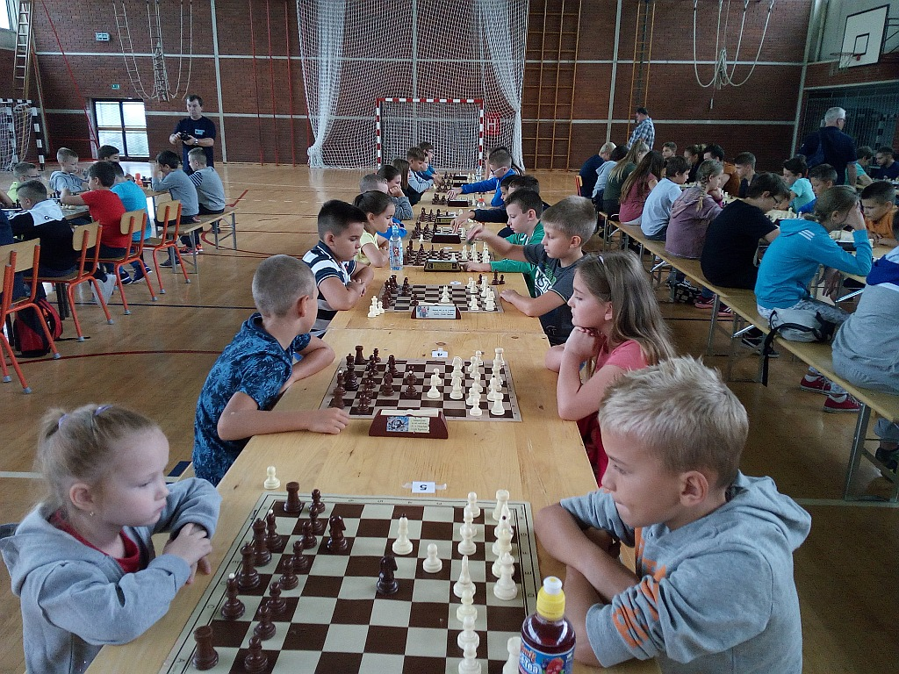
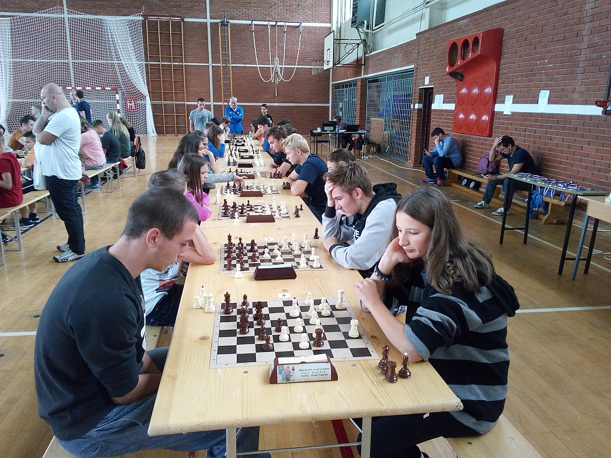
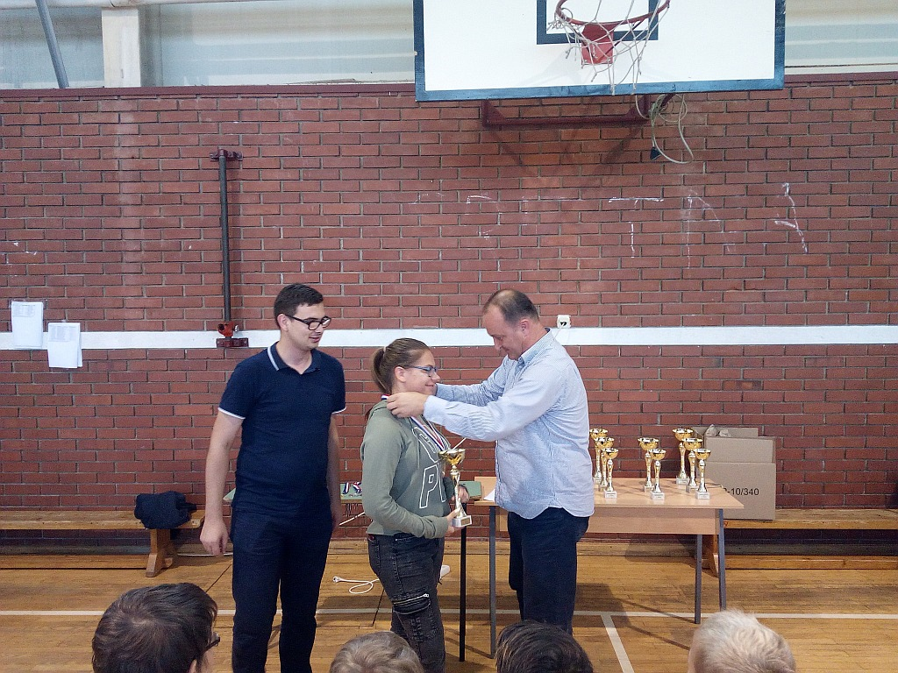
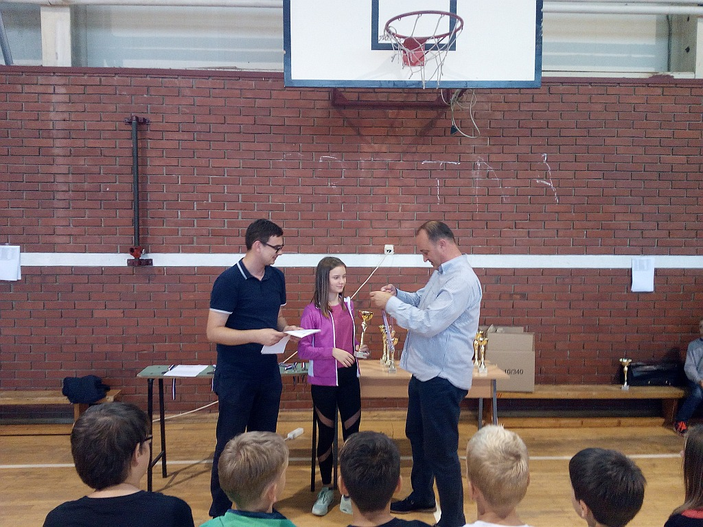

  
U subotu, 2. rujna, u organizaciji Šahovskog saveza Bjelovarsko-bilogorske županije i ŠK Garešnica, odigrana su pojedinačna juniorska i kadetska prvenstva Zajednice županija centar. Igralo se po skupinama [U10](http://chess-results.com/tnr298973.aspx?lan=13&art=4&wi=821), [U12](http://chess-results.com/tnr298972.aspx?lan=13&art=4&wi=821), [U14](http://chess-results.com/tnr299795.aspx?lan=13&art=4&wi=821), [U16](http://chess-results.com/tnr298971.aspx?lan=13&art=1&wi=821) i [U20](http://chess-results.com/tnr298969.aspx?lan=13&art=1&wi=821). Tempo igre je bio 15+5. Nastupilo je sveukupno 77 igrača i igračica u pet mješovitih skupina. Turnir su suvereno vodili šahovski suci Vlado Karagić i Slavko Bejuk, a cijelo natjecanje je prošlo u prijateljskom i ležernom tonu. Organizatori su počastili sve sudionike s pecivima, čipsom, kolačima i sokovima, a organiziran je i ručak za natjecatelje i pratnju u obližnjem [Hotelu Garić](http://www.hotelgaric.com/hr/). Turnir se igrao u sportskoj dvorani OŠ Garešnica.  
Iako se dečki vole hvaliti da su bolji šahisti od djevojaka, u tri od pet starosnih skupina pobjedničke pehare osvojile su djevojke! Prvo mjesto u konkurenciji U20 osvojila je **Ruža Purkić** iz ŠK Picok Đurđevac. U skupini U16 pobjednički pehar odnijela je **Magdalena Muha** iz ŠD Sisak, a u skupini U14 **Jelena Kokša** iz ŠŠK Konaki, Novo Virje. Dečki su osvojili turnire U12 i U10. Na turniru U12 prvo mjesto pripalo je **Šimunu Dumančić** iz ŠK Sljeme-Agroproteinka, a turnir U10 pripao je **Patriku Markoviću** iz istoga kluba.  
Od naših igrača, nastupili su Luka Fiolić, Samanta, Katarina, Božo, Kljujev, Vraneša i **Ivan Maravić** koji je osvojio pehar za **treće mjesto u skupini U14!** Luka je dobro igrao, ali je imao dva gruba previda i opet mu je jedan bod nedostajao da uzme pehar. Samanta i Katarina su imale dosta previda, a kod Samante se u zadnjim partijama osjetio i nedostatak kondicije i koncentracije. Božo je izgubio prvo kolo i uprkos dobrim igrama, nije se stigao vratiti u vrh do kraja turnira, a kod Vraneše se vidio (nepotreban) nedostatak samouvjerenosti te je pokušavao remizirati i dobivene pozicije. Kljujevu je nedostajalo koncentracije u zadnjim kolima tj. nedostatak kondicije te je zadnje kolo grubo previdio. Ivan je osvojio treće mjesto, a za nešto više nedostajali su mu bodovi koje su mu bez grižnje savjesti uzeli klupske kolege. 🙂  
     
 
